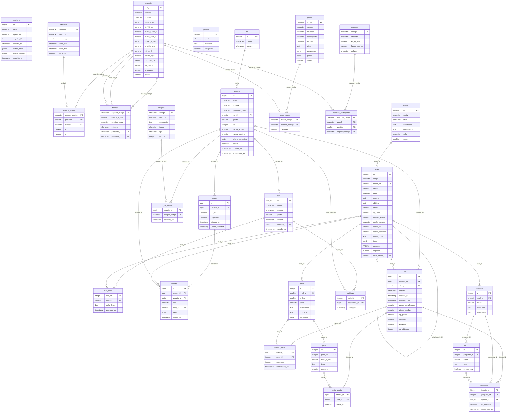
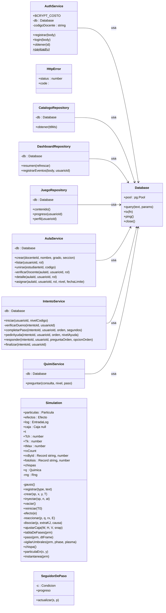
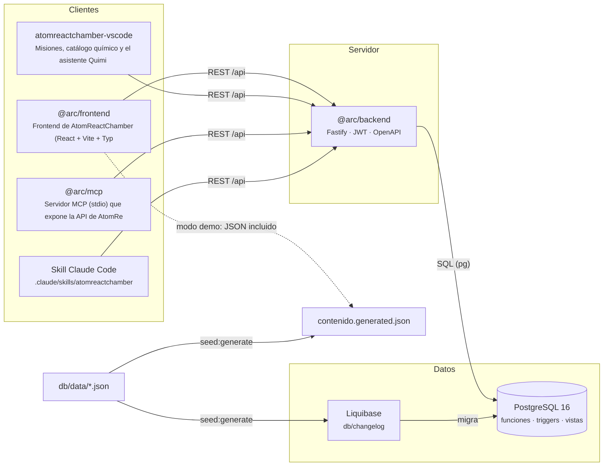
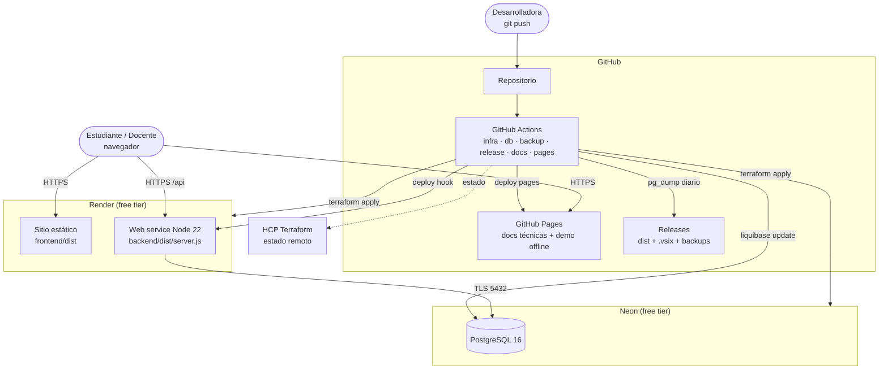

# AtomReactChamber

**Laboratorio virtual de química gamificado para estudiantes de secundaria del Perú.**
Cada casilla de la tabla periódica es una práctica guiada: el estudiante calienta, comprime, ilumina y mezcla
en un simulador molecular; el motor verifica cada paso, el asistente **Quimi** ayuda (cobrando XP) y un
cuestionario final otorga estrellas, experiencia e insignias. El docente crea aulas, asigna niveles y sigue el
progreso en un dashboard calculado en PostgreSQL.

> Proyecto del curso **Base de Datos II** — Universidad Privada de Tacna, Facultad de Ingeniería, EPIS.
> Docente: Ing. Patrick Cuadros Quiroga · Autora: **Adriana Rafaela Laos González** (2023077474) · 2026.

| | Enlace |
|---|---|
| Aplicación (Render) | _se publica al ejecutar `infra.yml` + `release.yml` con los secrets configurados_ |
| Demo sin servidor + documentación técnica (GitHub Pages) | `https://laos19.github.io/demov0.1atomreactchamber/` |
| API (Swagger) | `<url-api>/api/docs` |
| Cuentas de demostración | `estudiante@demo.arc.pe` · `docente@demo.arc.pe` — contraseña `quimica2026` |

## Qué hace

- **Mapa de misiones** con la silueta de la tabla periódica: 9 niveles en 4 misiones (estados de la materia,
  combustión, familias de la tabla, luz y reacciones), alineados a las competencias del CNEB de Ciencia y Tecnología.
- **Niveles guiados**: cada paso tiene una condición verificable (DSL en JSON guardado en la BD, p. ej.
  `temperatura ≥ 600 K durante 2 s`) que el motor evalúa en vivo.
- **Quimi**: ayudas escalonadas (pista → explicación → solución, con costo en XP) y glosario con búsqueda
  de texto completo en español sin tildes.
- **Gamificación**: XP, 1–3 estrellas, racha diaria, 8 insignias, ranking por aula. Repetir un nivel da 25 % de XP.
- **Docentes**: aulas con código de 6 caracteres, asignación de niveles, matriz de progreso estudiante × nivel.
- **Dashboard de uso**: sesiones diarias, embudo por nivel, pasos lentos, preguntas con más errores, uso por integración.
- **Laboratorio libre**: el simulador completo (presets, inyector, consola de eventos, fichas de PubChem).
- **Modo demostración** sin servidor (contenido incluido + localStorage) para GitHub Pages o si el servidor gratuito duerme.

## Arquitectura

```
frontend/          React 18 + Vite + TypeScript · motor de simulación (engine/) · canvas 2D
backend/           Node 22 + Fastify + TypeScript · JWT + roles · OpenAPI · pg
db/                Liquibase (changelogs SQL con rollback) · db/data/*.json = fuente única del contenido
infra/terraform/   Neon (PostgreSQL) + Render (API + sitio) · referencia de costos AWS/Azure
extensions/vscode/ Extensión de VS Code          integrations/mcp/  Servidor MCP
.claude/           Skill y agente de Claude Code  .github/workflows/  7 automatizaciones + CodeQL
docs/              FD01–FD05, diccionario, estándar, diagramas, presentación
```

Las reglas de negocio viven en la base de datos: `fn_finalizar_intento` calcula estrellas y XP en una
transacción, un trigger corrige las respuestas (el cliente no decide si acertó), otro descuenta la XP de las
ayudas y `fn_otorgar_insignias` evalúa los logros. Ver [FD04 — Arquitectura](docs/fd/FD04-Informe-SAD.md).

### Métricas

<!-- AUTO:metricas:inicio -->
| Métrica | Valor |
|---|---|
| Tablas | 29 |
| Vistas / vistas materializadas | 6 / 1 |
| Funciones PL/pgSQL y SQL | 16 |
| Triggers | 10 |
| Índices declarados | 30 |
| Changesets de Liquibase | 48 |
| Endpoints REST | 21 |
| Niveles / pasos / preguntas | 9 / 29 / 27 |
| Pruebas automáticas (API + motor) | 17 + 15 |
<!-- AUTO:metricas:fin -->

## Base de datos

### Diccionario de datos (resumen)

<!-- AUTO:diccionario:inicio -->
| Tabla | Descripción |
|---|---|
| `rol` | Roles de acceso de la aplicación (estudiante, docente, administrador). |
| `usuario` | Cuentas de estudiantes, docentes y administradores, con su experiencia (XP) y racha. |
| `auditoria` | Registro de cambios (insert/update/delete) en tablas sensibles, llenado por fn_auditar(). |
| `elemento` | Elementos químicos que aparecen como átomos en el simulador (color CPK y radio de dibujo). |
| `especie` | Especies químicas del catálogo con datos termodinámicos estándar (NIST/CRC) y CID de PubChem. |
| `especie_atomo` | Átomos que componen cada especie y su posición relativa para dibujarla (relación N:M especie–elemento). |
| `reaccion` | Reacciones elementales que el motor evalúa en cada colisión. ΔH se calcula en la vista v_reaccion_entalpia. |
| `reaccion_participante` | Especies que participan en cada reacción como reactivo o producto (máx. 2 por lado). |
| `fotolisis` | Moléculas que se rompen con fotones de energía ≥ enlace (E = 119 627 / λ kJ/mol). |
| `preset` | Experimentos listos para cargar en el laboratorio libre. |
| `preset_carga` | Partículas que se inyectan al cargar un preset. |
| `mision` | Capítulos temáticos que agrupan niveles (ej. La materia y sus estados). |
| `nivel` | Nivel jugable: una práctica guiada ubicada en una casilla de la tabla periódica. |
| `paso` | Paso de un nivel. La condición se evalúa en el motor del simulador (DSL {todas|alguna:[{metrica, op, valor}]}). |
| `pista` | Ayudas de Quimi por paso: 1 = pista, 2 = explicación, 3 = solución. Cada una cuesta XP. |
| `pregunta` | Preguntas del cuestionario de cierre de cada nivel. |
| `opcion` | Alternativas de cada pregunta. El índice parcial ux_opcion_una_correcta garantiza a lo más una correcta. |
| `insignia` | Logros desbloqueables. fn_otorgar_insignias evalúa tipo/umbral contra el progreso del usuario. |
| `glosario` | Términos que Quimi explica. Búsqueda de texto completo en español sin tildes (índice GIN). |
| `aula` | Grupo de estudiantes a cargo de un docente. Los estudiantes se unen con el código de 6 caracteres. |
| `matricula` | Pertenencia de estudiantes a aulas (relación N:M). |
| `aula_nivel` | Niveles que el docente asigna a un aula, con fecha límite opcional. |
| `intento` | Cada vez que un estudiante juega un nivel. Lo cierra fn_finalizar_intento (estrellas y XP). |
| `intento_paso` | Pasos completados dentro de un intento y el tiempo que tomaron (métrica del dashboard). |
| `pista_usada` | Pistas de Quimi que el estudiante abrió en un intento (una vez por pista). |
| `respuesta` | Respuesta elegida en el cuestionario. es_correcta la fija un trigger desde opcion (no confía en el cliente). |
| `logro_usuario` | Insignias obtenidas por cada usuario. |
| `sesion` | Sesión de uso (anónima o autenticada) desde la web, VS Code, Claude Code o MCP. |
| `evento` | Eventos de telemetría de producto (append-only). Índice BRIN por fecha: tabla grande y ordenada en el tiempo. |

Diccionario completo (columnas, tipos, restricciones, índices): [docs/database](docs/database/).
<!-- AUTO:diccionario:fin -->

### Diagrama entidad-relación

<!-- AUTO:er:inicio -->


<!-- AUTO:er:fin -->

## Diagrama de clases

<!-- AUTO:clases:inicio -->


<!-- AUTO:clases:fin -->

## Diagrama de componentes

<!-- AUTO:componentes:inicio -->


<!-- AUTO:componentes:fin -->

## Diagrama de despliegue

<!-- AUTO:despliegue:inicio -->


<!-- AUTO:despliegue:fin -->

## Automatizaciones (GitHub Actions)

| Rúbrica | Workflow | Reporte |
|---|---|---|
| Infraestructura con Terraform + pruebas + costos | [`infra.yml`](.github/workflows/infra.yml) | pruebas superadas (JUnit), costos (free tier vs. AWS/Azure) |
| Objetos de BD con Liquibase | [`db.yml`](.github/workflows/db.yml) | ejecuciones, `updateSQL`, historial |
| Copias de seguridad | [`backup.yml`](.github/workflows/backup.yml) | tamaño, sha256, restauración verificada por conteo de filas |
| Release y despliegue | [`release.yml`](.github/workflows/release.yml) | release semántico, artefactos, smoke test `/api/health` |
| Documentación en README | [`docs.yml`](.github/workflows/docs.yml) | este README, diccionario y diagramas |
| Documentación técnica en Pages | [`pages.yml`](.github/workflows/pages.yml) | TypeDoc (clases, métodos, propiedades) + BD + demo |

Detalle y secrets necesarios: [docs/automatizaciones.md](docs/automatizaciones.md) · [infra/README.md](infra/README.md).

## Integraciones (reto)

Extensión de **VS Code**, servidor **MCP**, **skill + agente de Claude Code** y **GitHub** (Actions, Pages, Releases).
Cada integración registra su origen en la telemetría y aparece en el dashboard. Ver [docs/integraciones.md](docs/integraciones.md).

## Desarrollo local

Requisitos: Node 22, PostgreSQL 16, Java 17+ (Liquibase).

```bash
npm install
npm run seed:generate                       # regenera semillas desde db/data/*.json
liquibase --changelog-file=db/changelog/db.changelog-master.yaml \
  --url=jdbc:postgresql://localhost:5432/arc --username=postgres update
cp backend/.env.example backend/.env        # DATABASE_URL, JWT_SECRET…
npm run dev:api                             # API en http://localhost:8080 (Swagger en /api/docs)
VITE_API_URL=http://localhost:8080 npm run dev   # frontend en http://localhost:5173
```

Sin servidor: `npm run dev` (sin `VITE_API_URL`) abre el modo demostración.

### Pruebas

```bash
DATABASE_URL=postgres://postgres@localhost:5432/arc npm test -w backend   # integración contra PostgreSQL real
npm test -w frontend      # motor + solucionador que juega los 9 niveles
npm run e2e -w frontend   # Playwright: nivel completo + axe (WCAG 2.2 AA)
```

## Documentos

[Problema y objetivos](docs/investigacion/problema-y-objetivos.md) ·
[FD01 Factibilidad](docs/fd/FD01-Informe-Factibilidad.md) · [FD02 Visión](docs/fd/FD02-Informe-Vision.md) ·
[FD03 SRS](docs/fd/FD03-Informe-SRS.md) · [FD04 SAD](docs/fd/FD04-Informe-SAD.md) ·
[Diccionario de datos](docs/database/) · [Estándar de programación](docs/estandares/estandar-de-programacion.md) ·
[Dirección de arte](docs/diseno/direcciones-de-arte.md) · [Presentación](docs/presentacion/)

## Modelo físico-químico

Discos rígidos 2D con colisiones elásticas (rejilla espacial), velocidades de Maxwell-Boltzmann (σ ∝ √(T/M)),
termostato de Berendsen, reacción si la energía de colisión supera Eₐ (con factor estérico y de presión),
ΔH desde entalpías de formación estándar, fotólisis si E = 119 627/λ supera el enlace, y fases con
Clausius-Clapeyron. **Las energías de activación son valores pedagógicos** elegidos para que las reacciones se
observen en segundos; las entalpías y puntos de cambio de fase son datos estándar (NIST/PubChem).

<!-- AUTO:fecha:inicio -->
_Secciones generadas automáticamente el 2026-11-07 por `scripts/docs/build-readme.mjs`._
<!-- AUTO:fecha:fin -->

## Licencia

MIT © 2026 Adriana Rafaela Laos González.
