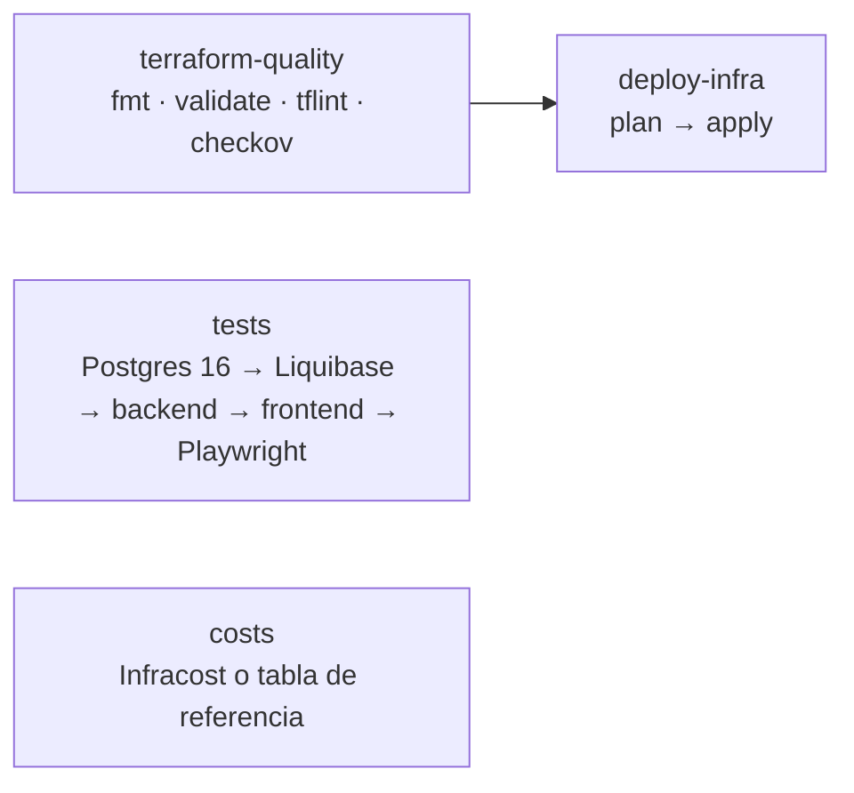

# Automatizaciones (GitHub Actions)

Cada fila de la rúbrica tiene un workflow propio en `.github/workflows/`. Todos publican un **reporte
legible** en el *Job summary* de la ejecución (pestaña **Actions** → ejecución → **Summary**) y lo suben
también como **artefacto** descargable (sección *Artifacts* de la misma página). Además, `pages.yml`
reúne los últimos reportes en el sitio de documentación (`/reportes/`).

Todos terminan en verde aunque falten los secrets de la nube: los pasos de despliegue se omiten y el
reporte lo indica con `omitido: falta secret X`. La lista completa de secrets está en
[`infra/README.md`](../infra/README.md#4-secrets-y-variables-de-github).

## Mapa rúbrica → workflow → reporte

| # | Fila de la rúbrica | Workflow | Cuándo se ejecuta | Reporte producido | Dónde verlo |
|---|---|---|---|---|---|
| 1 | Infraestructura (Terraform) + pruebas + costos | [`infra.yml`](../.github/workflows/infra.yml) | push y PR a `main`; manual con `action = plan / apply / destroy` | **Calidad IaC** (fmt, validate por módulo, tflint, checkov) · **Reporte de pruebas superadas** (tabla por suite + anotaciones JUnit) · **Reporte de costos** (USD 0 de la capa gratuita frente a AWS/Azure con Infracost) · **Terraform producción** (plan, apply, URLs) | Summary · artefactos `reporte-terraform-calidad`, `reporte-pruebas`, `reporte-costos`, `reporte-terraform-produccion` · Pages `/reportes/pruebas/`, `/reportes/costos/` |
| 2 | Base de datos (Liquibase) | [`db.yml`](../.github/workflows/db.yml) | cambios en `db/**`; manual | `validate`, `status --verbose`, `update-sql` (SQL exacto), `update`, prueba de `rollback`, `history`, inventario de tablas/vistas/funciones/triggers y filas por tabla; en producción solo en `main` y con secrets | Summary · artefactos `reporte-liquibase-efimera` (incluye `03-update.sql`) y `reporte-liquibase-produccion` · Pages `/reportes/liquibase/` |
| 3 | Copias de seguridad | [`backup.yml`](../.github/workflows/backup.yml) | diario 03:17 (Lima); manual | Tamaño, SHA-256, cifrado, duración de volcado y restauración, **comparación de filas por tabla** origen vs. restaurado, nivel de retención aplicado | Summary · artefactos `backup-<nivel>-<fecha>` y `reporte-backup-<fecha>` · Release `backup-AAAAMMDD` (opcional) · Pages `/reportes/backup/` |
| 4 | Release y despliegue | [`release.yml`](../.github/workflows/release.yml) | push a `main` y tags `v*` | Versión semántica + CHANGELOG (release-please), tabla de artefactos (frontend .zip, backend .zip, extensión .vsix con SHA-256), pasos del despliegue (Liquibase → Render API → Render Web → smoke test) con URLs | Summary · artefactos `release-<versión>` y `reporte-despliegue` · página **Releases** |
| 5 | Documentación en README | [`docs.yml`](../.github/workflows/docs.yml) | push a `main`; manual | Estado de tbls (ER + diccionario), lint de comentarios, diagramas Mermaid, secciones del README y commit automático `docs: actualizar documentación generada [skip ci]` | Summary · artefacto `reporte-documentacion` · carpetas `docs/database/`, `docs/diagramas/` y `README.md` en el repo |
| 6 | Documentación técnica (GitHub Pages) | [`pages.yml`](../.github/workflows/pages.yml) | push a `main`; al terminar `infra.yml` o `backup.yml`; manual | Tabla de secciones publicadas con enlaces (TypeDoc, BD, diagramas, reportes, demo) | Summary · artefacto `reporte-pages` · `https://laos19.github.io/<repositorio>/` |
| — | Integración continua | [`ci.yml`](../.github/workflows/ci.yml) | PR y push a ramas distintas de `main` | Lint, typecheck, actionlint, `terraform fmt`, pruebas unitarias + integración | Summary · artefactos `reporte-ci-lint`, `reporte-ci-pruebas` |
| — | Seguridad del código | [`codeql.yml`](../.github/workflows/codeql.yml) | push/PR a `main`, semanal | Alertas CodeQL (`security-extended`) | pestaña **Security → Code scanning** |
| — | Dependencias | [`dependabot.yml`](../.github/dependabot.yml) | semanal (npm, Actions) y mensual (Terraform) | PRs de actualización agrupados | pestaña **Pull requests** |

## Detalle por workflow

### 1. `infra.yml`: Infraestructura + pruebas + costos



- **Pruebas:** un contenedor `postgres:16` se migra con Liquibase; luego Vitest (backend con BD real y
  frontend) y Playwright (e2e sobre el build en modo demo). Todas emiten JUnit, que se convierte en la
  tabla *Reporte de pruebas superadas* (`.github/scripts/junit-summary.mjs`) y en anotaciones
  (`mikepenz/action-junit-report`).
- **Costos:** con `INFRACOST_API_KEY` se calcula en vivo `cost-reference/aws` y `cost-reference/azure`;
  sin la clave se muestra la tabla de precios de referencia con fuentes.
- **Plan/apply:** necesita `NEON_API_KEY`, `RENDER_API_KEY`, `RENDER_OWNER_ID` y estado remoto
  (`TF_API_TOKEN` + variable `TF_CLOUD_ORGANIZATION`, o `TF_STATE_PG_CONN_STR`).

### 2. `db.yml`: Liquibase

Siempre prueba las migraciones en una base efímera (así un changeset roto se detecta en el PR). En
`main`, si existen `LIQUIBASE_URL`, `LIQUIBASE_USER` y `LIQUIBASE_PASSWORD`, repite el ciclo contra Neon.
El paso `update-testing-rollback` aplica, revierte y vuelve a aplicar todos los changesets en una base
limpia para demostrar que cada `--rollback` funciona. El reporte HTML de operación de Liquibase se
intenta generar con `--report-enabled`; si la edición Community no lo soporta, el paso se marca como
no disponible y el resumen Markdown sigue existiendo.

### 3. `backup.yml`: Copias de seguridad

1. `pg_dump -Fc --compress=9` de producción (`DATABASE_URL`) o, si falta el secret, de una base efímera
   migrada y sembrada con Liquibase (demostración completa de la estrategia).
2. **Verificación:** se restaura en un PostgreSQL 16 limpio y se comparan los conteos exactos de filas
   de cada tabla; si una difiere, el workflow falla.
3. SHA-256 y, en producción, cifrado AES-256 con `BACKUP_PASSPHRASE` (los datos de estudiantes nunca se
   suben sin cifrar).
4. Retención **abuelo-padre-hijo (GFS)**:

| Nivel | Cuándo | Copias conservadas | Cómo se implementa |
|---|---|---|---|
| Diaria | todos los días | 7 | artefacto con `retention-days: 7` |
| Semanal | domingos | 4 | artefacto de 30 días y, con `BACKUP_RELEASE=true`, Release `backup-AAAAMMDD` |
| Mensual | día 1 | 3 | artefacto de 90 días y Release opcional |
| Point-in-time | continuo | 6 horas | historial de Neon (plan Free) |

El workflow poda los Releases `backup-*` y deja los 7 más recientes (4 semanales + 3 mensuales).

**Restaurar un respaldo:**

```bash
gpg --decrypt atomreactchamber-AAAAMMDD-HHMM.dump.gpg > respaldo.dump   # solo si está cifrado
sha256sum -c atomreactchamber-AAAAMMDD-HHMM.dump.sha256
pg_restore --no-owner --no-privileges --clean --if-exists -d "$DATABASE_URL" respaldo.dump
```

### 4. `release.yml`: Release y despliegue

- **Versionado:** [release-please](https://github.com/googleapis/release-please) lee los mensajes
  *Conventional Commits* (`feat:`, `fix:`, `db:`…) y mantiene un PR `chore: release x.y.z` con el
  `CHANGELOG.md`. Al fusionarlo se crea el tag `vX.Y.Z` y el GitHub Release. Configuración:
  `release-please-config.json` y `.release-please-manifest.json`. Para forzar una versión concreta (por
  ejemplo, la 2.0.0), incluya en un commit el pie `Release-As: 2.0.0`.
- **Artefactos:** `atomreactchamber-frontend-<v>.zip`, `atomreactchamber-backend-<v>.zip`,
  `atomreactchamber-vscode-<v>.vsix` y `SHA256SUMS.txt`, adjuntos al Release.
- **Despliegue:** Liquibase `update` en producción → deploy hook de la API → deploy hook del sitio →
  espera a que Render informe `live` (si hay `RENDER_API_KEY`) → smoke test `GET /api/health` con
  reintentos (el plan Free de Render tarda ~1 min en despertar).

### 5. `docs.yml`: Documentación en README

Migra una base efímera, ejecuta `tbls doc` (diagrama ER en SVG, diagrama Mermaid `er.mmd` y
diccionario de datos en `docs/database/`, configurado en `.tbls.yml`), `npm run docs:diagrams`
(diagramas en `docs/diagramas/`) y `npm run docs:readme` (reescribe las secciones generadas del
README entre marcadores). Si hay cambios, hace commit como `github-actions[bot]`.

### 6. `pages.yml`: Documentación técnica

Construye `site/` con:

| Ruta | Contenido | Generador |
|---|---|---|
| `/` | Portada en español | `scripts/pages/build-index.mjs` |
| `/api/` | Referencia TypeDoc | `npm run docs:api` |
| `/db/` | ER + diccionario (HTML) | `tbls doc` + `scripts/pages/render-markdown.mjs` |
| `/diagramas/` | Diagramas Mermaid renderizados | `render-markdown.mjs` |
| `/reportes/` | Últimos reportes de pruebas, costos, Liquibase, backups y docs | `gh run download` + `render-markdown.mjs` |
| `/docs/` | Documentos Markdown de `docs/` e `infra/README.md` | `render-markdown.mjs` |
| `/app/` | Demo del frontend en modo offline (`VITE_API_URL` vacío, base `/<repo>/app/`) | `npm run build -w frontend` |

Se publica con `actions/upload-pages-artifact` + `actions/deploy-pages`. Si Pages no está habilitado,
el despliegue se omite y el resumen explica cómo activarlo.
