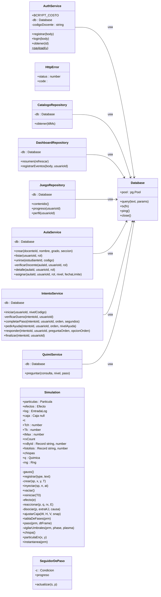

# Diagrama de clases

> Generado automáticamente por `scripts/docs/build-diagrams.mjs`. No editar a mano.

Clases de la API (Fastify) y del motor de simulación. Las flechas indican dependencias inyectadas por constructor.

| Clase | Archivo | Miembros |
|---|---|---|
| `AuthService` | `backend/src/auth/AuthService.ts` | 7 |
| `Database` | `backend/src/db/Database.ts` | 5 |
| `HttpError` | `backend/src/errors.ts` | 2 |
| `CatalogoRepository` | `backend/src/repositories/CatalogoRepository.ts` | 2 |
| `DashboardRepository` | `backend/src/repositories/DashboardRepository.ts` | 3 |
| `JuegoRepository` | `backend/src/repositories/JuegoRepository.ts` | 4 |
| `AulaService` | `backend/src/services/AulaService.ts` | 7 |
| `IntentoService` | `backend/src/services/IntentoService.ts` | 7 |
| `QuimiService` | `backend/src/services/QuimiService.ts` | 2 |
| `Simulation` | `frontend/src/engine/Simulation.ts` | 30 |
| `SeguidorDePaso` | `frontend/src/engine/conditions.ts` | 3 |

