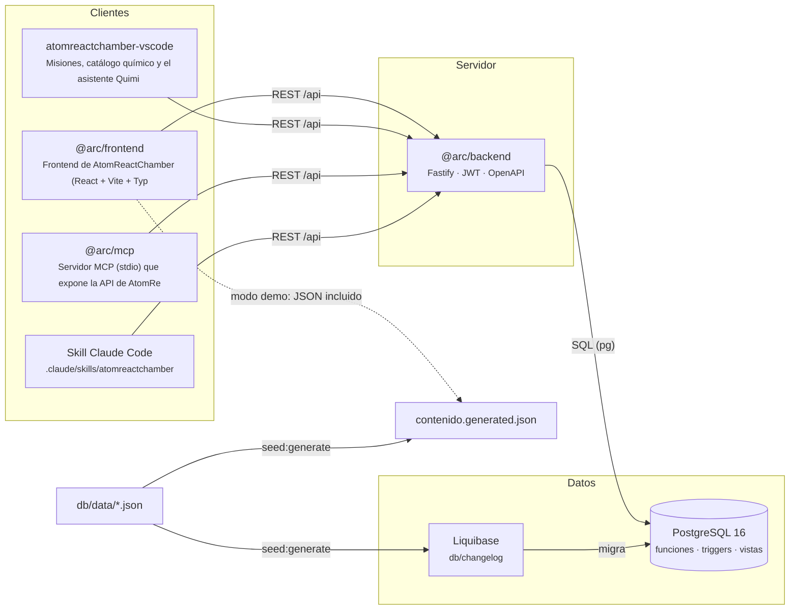

# Diagrama de componentes

> Generado automáticamente por `scripts/docs/build-diagrams.mjs`. No editar a mano.

Paquetes del monorepo (workspaces npm) y cómo se comunican. `db/data/*.json` es la fuente única del contenido: genera la semilla SQL y el modo offline.

