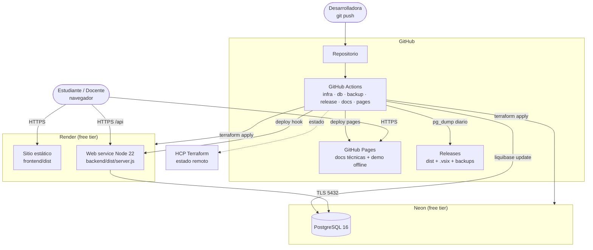

# Diagrama de despliegue

> Generado automáticamente por `scripts/docs/build-diagrams.mjs`. No editar a mano.

Infraestructura aprovisionada con Terraform (módulos: database (database-neon), app (app-render)) y automatizada con GitHub Actions. Costo mensual en free tier: US$ 0 (ver infra/terraform/cost-reference).

