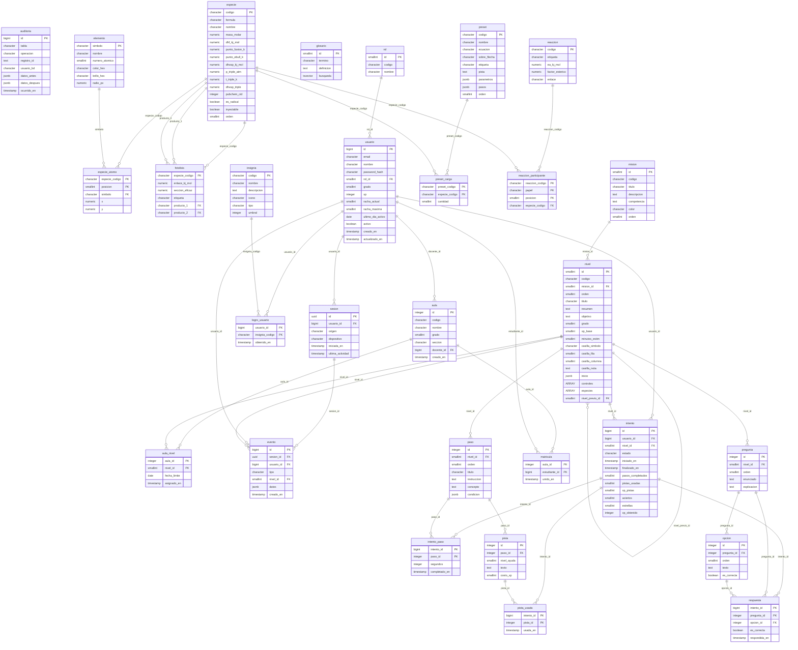

# Diagrama entidad-relación

> Generado automáticamente por `scripts/docs/build-diagrams.mjs`. No editar a mano.

29 tablas del esquema `public` (leído de la base de datos migrada). El diccionario de datos completo está en [docs/database](../database/).

