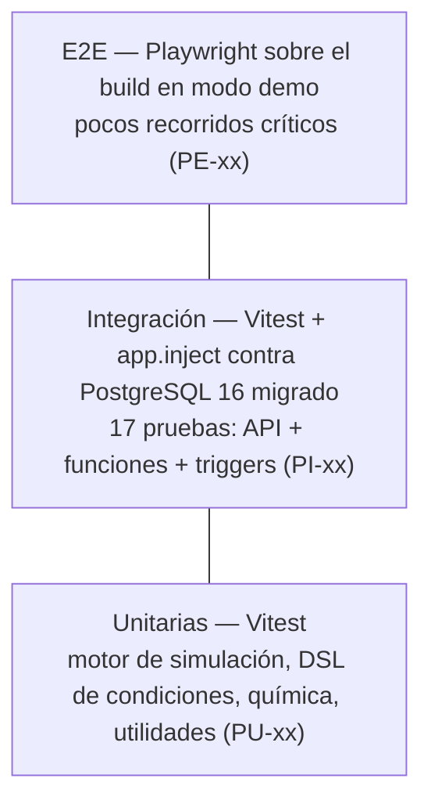

# Control de versiones

| Versión | Hecha por | Revisada por | Aprobada por | Fecha | Motivo |
|---|---|---|---|---|---|
| 1.0 | Adriana Laos | Ing. Patrick Cuadros Quiroga (pendiente) | (pendiente) | 2026-11-07 | Primera versión: convenciones efectivamente usadas en el repositorio |

---

# 1. Introducción

## 1.1 Propósito

Este estándar fija las convenciones de código, base de datos, API, control de versiones, pruebas, seguridad y
accesibilidad de **AtomReactChamber**. No es un ideal teórico: describe las reglas **que el código actual ya
sigue** (verificadas en `db/`, `backend/`, `frontend/`, `infra/` y `.github/`), de modo que todo aporte nuevo se
parezca al existente. Cuando una regla aún no se cumple en todo el repositorio, se marca como **(meta)**.

## 1.2 Alcance

Aplica a todo el monorepo: SQL y Liquibase (`db/`), TypeScript del backend, del frontend, de la extensión de
VS Code y del servidor MCP, Terraform (`infra/`), *workflows* (`.github/`) y documentación (`docs/`).

## 1.3 Principios

1. **Un idioma de dominio: español.** Tablas, columnas, funciones, clases de dominio, mensajes al usuario,
   comentarios y *commits* en español (Perú). Se mantienen en inglés las palabras reservadas, las APIs de
   terceros y los términos técnicos sin traducción establecida (`token`, `pool`, `hook`).
2. **La base de datos es la autoridad** de las reglas de negocio (FD04 ADR-03).
3. **Un contrato, una fuente:** contenido en `db/data/*.json`; validación y OpenAPI desde esquemas zod.
4. **Nada de secretos en el repositorio.**
5. **Si no está probado, no está terminado.**

# 2. Convenciones de nombres

## 2.1 Base de datos (PostgreSQL)

| Objeto | Convención | Ejemplos reales |
|---|---|---|
| Tabla | `snake_case`, español, **singular** | `usuario`, `intento_paso`, `reaccion_participante` |
| Tabla de relación N:M | Nombre que describe la relación o `tabla1_tabla2` | `matricula`, `aula_nivel`, `logro_usuario` |
| Columna | `snake_case`, español; unidades al final | `masa_molar`, `dhf_kj_mol`, `punto_ebull_k`, `minutos_estim` |
| Clave primaria sustituta | `id` (`GENERATED ALWAYS AS IDENTITY`) | `usuario.id` |
| Clave primaria natural | El código estable del dominio | `elemento.simbolo`, `especie.codigo`, `insignia.codigo` |
| Clave foránea | `<entidad>_id` o `<entidad>_codigo`; rol explícito si hay ambigüedad | `nivel_id`, `especie_codigo`, `docente_id`, `estudiante_id`, `nivel_previo_id` |
| Booleano | Prefijo `es_` o adjetivo | `es_correcta`, `es_radical`, `activo`, `inyectable` |
| Fecha y hora | Participio + `_en` (`timestamptz`) | `creado_en`, `iniciado_en`, `respondida_en` |
| Fecha sin hora | Sustantivo descriptivo (`date`) | `fecha_limite`, `ultimo_dia_activo` |
| Función de negocio | `fn_<verbo>_<objeto>` | `fn_finalizar_intento`, `fn_usar_pista`, `fn_quimi_buscar` |
| Función de *trigger* | `fn_tg_<tabla>_<acción>` (o `fn_auditar` genérica) | `fn_tg_respuesta_validar`, `fn_tg_aula_codigo` |
| *Trigger* | `tg_<tabla>_<acción>` | `tg_respuesta_validar`, `tg_usuario_auditoria` |
| Vista | `v_<sustantivo>` | `v_progreso_estudiante`, `v_ranking_aula` |
| Vista materializada | `mv_<sustantivo>` | `mv_uso_diario` |
| Índice | `ix_<tabla>_<columnas>` | `ix_intento_usuario_nivel`, `ix_evento_creado` |
| Índice / restricción única | `ux_<tabla>_<columnas>` | `ux_usuario_email`, `ux_nivel_casilla`, `ux_opcion_una_correcta` |
| CHECK con nombre | `ck_<tabla>_<regla>` | `ck_intento_fin`, `ck_especie_sublimacion_completa` |
| Parámetro de función | `p_<nombre>` | `p_intento`, `p_nivel_ayuda` |
| Variable local PL/pgSQL | `v_<nombre>` | `v_estrellas`, `v_racha` |
| Valores enumerados | `snake_case` sin tildes, en `CHECK (... IN (...))` | `'en_curso'`, `'pagina_vista'`, `'estudiante'` |

Las restricciones CHECK de una sola columna y las PK/FK pueden quedar con el nombre que genera PostgreSQL
(`*_check`, `*_pkey`, `*_fkey`); las de varias columnas **deben** tener nombre `ck_`/`ux_`.

## 2.2 TypeScript

| Elemento | Convención | Ejemplos reales |
|---|---|---|
| Clase | `PascalCase`, sustantivo + rol | `AuthService`, `IntentoService`, `CatalogoRepository`, `Database`, `HttpError` |
| Interfaz / tipo | `PascalCase`, sin prefijo `I` | `UsuarioPublico`, `TokenPayload`, `ResultadoIntento`, `Condicion` |
| Esquema zod | `PascalCase` + sufijo según uso (`Body`, `Query`, `Param`) | `RegistroBody`, `QuimiQuery`, `IdParam` |
| Método / función | `camelCase`, verbo en español | `registrar`, `completarPaso`, `pedirAyuda`, `evaluarRegla`, `construirQuimica` |
| Variable / propiedad | `camelCase` | `nivelAyuda`, `fechaLimite`, `codigoDocente` |
| Constante de módulo | `UPPER_SNAKE_CASE` | `API_VERSION`, `MAX_PARTICULAS`, `PHOTON_KJ_NM` |
| Constante estática de clase | `UPPER_SNAKE_CASE` | `AuthService.BCRYPT_COSTO` |
| Componente React | `PascalCase` | `MapaMisiones`, `PanelQuimi` |
| *Hook* React | `use` + `PascalCase` | `useSimulacion` |
| Variables de entorno | `UPPER_SNAKE_CASE` | `DATABASE_URL`, `JWT_SECRET`, `VITE_API_URL` |
| Campos JSON de la API | `camelCase` en cuerpos de entrada; columnas `snake_case` tal como salen de la BD en lecturas | `nivelAyuda`; `xp_obtenido` |

Cuando una propiedad refleja una columna de la BD se conserva el `snake_case` (p. ej., `ResultadoIntento.xp_obtenido`)
para evitar capas de mapeo.

## 2.3 Archivos y carpetas

| Tipo | Convención | Ejemplos |
|---|---|---|
| Archivo de clase TS | Igual que la clase (`PascalCase.ts`) | `AuthService.ts`, `Simulation.ts` |
| Módulo de funciones TS | `camelCase.ts` / minúsculas | `conditions.ts`, `chemistry.ts`, `schemas.ts`, `errors.ts` |
| Componente React | `PascalCase.tsx` | `MapaMisiones.tsx` |
| Prueba | `<nombre>.test.ts` junto al código o en `test/` | `engine.test.ts`, `test/api.test.ts` |
| *Changeset* SQL | `NNN-<tema>.sql` (3 dígitos, orden de aplicación) | `004-juego.sql`, `007-funciones.sql` |
| Semilla generada | `9NN-semilla-<tema>.sql` (no editar a mano) | `900-semilla-catalogo.sql` |
| Script | `kebab-case.mjs` / `.sh` | `generate-seed.mjs`, `render-deploy.sh` |
| Terraform | `main.tf`, `variables.tf`, `outputs.tf`, `locals.tf`, `terraform.tf`, `providers.tf` | `modules/app-render/` |
| Documento | `FDNN-Informe-<Nombre>.md`; resto en `kebab-case.md` | `FD03-Informe-SRS.md`, `diccionario-de-datos.md` |

# 3. Liquibase y SQL

## 3.1 Reglas de los *changesets*

1. Formato **SQL formateado**: el archivo empieza con `--liquibase formatted sql`.
2. Encabezado: `--changeset adriana.laos:NNN-n comment:<descripción en español>` donde `NNN` es el prefijo del
   archivo y `n` el correlativo dentro de él (`007-6`).
3. **Rollback obligatorio** en cada *changeset* (`--rollback ...`). Si un *changeset* crea varios objetos, el
   *rollback* los elimina en orden inverso de dependencias.
4. `runOnChange:true` en funciones, vistas y semillas (objetos que se reemplazan con `CREATE OR REPLACE` o
   *upserts* idempotentes). **Nunca** en `CREATE TABLE`.
5. `splitStatements:false` en *changesets* con cuerpos `$$ ... $$` (PL/pgSQL).
6. Datos de demostración con `context:demo`; producción no los aplica.
7. Un *changeset* aplicado **no se edita** (salvo los `runOnChange`): los cambios de esquema van en un *changeset*
   nuevo (`ALTER TABLE ...`).
8. Todo objeto nuevo lleva `COMMENT ON` (tabla, columnas no evidentes, vistas y funciones). Liquibase elimina los
   comentarios `/* */` del cuerpo de las funciones, así que la documentación persistente es `COMMENT ON`.
9. Las semillas se generan con `npm run seed:generate` desde `db/data/*.json`; los archivos `9NN-*.sql` no se
   editan a mano.

```sql
--changeset adriana.laos:010-1 comment:Momento del cuestionario (pre/post) para medir ganancia de aprendizaje
ALTER TABLE respuesta ADD COLUMN momento varchar(4) NOT NULL DEFAULT 'post'
  CHECK (momento IN ('pre', 'post'));
COMMENT ON COLUMN respuesta.momento IS 'pre = diagnóstico antes del nivel; post = cuestionario de cierre.';
--rollback ALTER TABLE respuesta DROP COLUMN momento;
```

## 3.2 Estilo SQL

- Palabras reservadas en **MAYÚSCULAS** (`SELECT`, `CREATE TABLE`, `NOT NULL`); identificadores en minúsculas.
- Funciones y tipos en minúsculas (`count(*)`, `coalesce`, `timestamptz`, `jsonb`).
- Sangría de 2 espacios; en `CREATE TABLE`, nombres y tipos alineados en columnas.
- Una cláusula principal por línea en consultas largas (`SELECT`, `FROM`, `JOIN`, `WHERE`, `GROUP BY`).
- `JOIN` explícitos con alias cortos (`i` intento, `n` nivel, `u` usuario); nunca comas en `FROM` salvo
  funciones de conjunto o CTE de un valor.
- Tipos: `bigint` para tablas de alto volumen (`usuario`, `intento`, `evento`), `smallint` para catálogos pequeños,
  `numeric(p,s)` para magnitudes físicas, `timestamptz` para instantes, `jsonb` solo para configuración que se
  consume como unidad.
- Integridad declarativa primero (`NOT NULL`, `CHECK`, `UNIQUE`, FK); *triggers* solo cuando la regla cruza tablas.
- Funciones: `LANGUAGE plpgsql` con volatilidad correcta (`IMMUTABLE` para cálculos puros como
  `fn_calcular_estrellas`, `STABLE` para lecturas como `fn_quimi_buscar`).
- Errores de regla de negocio: `RAISE EXCEPTION '<mensaje en español para el estudiante>' USING ERRCODE = 'P0001'`;
  "no encontrado": `ERRCODE = 'P0002'`. La API traduce P0001 → 409 y P0002 → 404.
- Bloqueo pesimista (`SELECT … FOR UPDATE`) en funciones que leen y luego actualizan la misma fila.
- Cada índice nuevo se justifica (consulta que acelera) en el FD04 §8.3; toda FK nueva lleva índice **(meta)**.

# 4. TypeScript

## 4.1 Configuración

- `strict: true`, `noUnusedLocals`, `noImplicitOverride`; objetivo `ES2023`, módulos `NodeNext` en el backend
  (importaciones con extensión `.js`) y `ESNext`/Vite en el frontend.
- Prohibido `any` explícito; usar `unknown` y estrechar. Se permite `as` solo tras validar con zod o en el borde
  con `pg`.
- `npm run typecheck` sin errores es requisito de CI (`ci.yml`).

## 4.2 Estilo

- 2 espacios, comillas simples, punto y coma, coma final en literales multilínea, líneas de hasta ~120 caracteres.
- `const` por defecto; `let` solo si se reasigna; nunca `var`.
- `async/await` en lugar de cadenas `.then()`; paralelizar lecturas independientes con `Promise.all`
  (como en `JuegoRepository.contenido`).
- Inyección de dependencias por constructor con `private readonly` (`constructor(private readonly db: Database)`).
- Funciones puras en `engine/` (sin DOM, sin React, sin `Math.random` directo: se inyecta `Rng`) para poder
  probarlas.
- Errores: lanzar `HttpError(status, mensaje, CODIGO)` o los ayudantes `noEncontrado()`/`prohibido()`; envolver las
  llamadas a funciones de la BD con `try { … } catch (e) { throw mapPgError(e); }`.
- Configuración solo a través de `loadConfig()` (zod, *fail fast*); nunca `process.env` disperso.
- *(Meta)* Añadir ESLint (`typescript-eslint`) y Prettier con estas reglas; hoy el *lint* es `tsc --noEmit`.

## 4.3 Documentación con TSDoc

Todo miembro **exportado o público** (clases, métodos, interfaces, funciones, constantes) lleva un comentario TSDoc
en español, que TypeDoc publica en GitHub Pages (`npm run docs:api` → `site/api`).

```ts
/**
 * Registra que el estudiante completó el paso `orden`.
 * @param intentoId Intento en curso.
 * @param usuarioId Dueño del intento (del JWT).
 * @param orden Orden del paso dentro del nivel (1…n).
 * @param segundos Tiempo empleado en el paso (para el dashboard).
 * @returns Orden registrado.
 * @throws HttpError 403 si el intento no es del usuario; 409 si el paso está fuera de orden.
 */
async completarPaso(intentoId: number, usuarioId: number, orden: number, segundos: number) { … }
```

Etiquetas usadas: `@param`, `@returns`, `@throws`, `@module` (cabecera de módulo), `@example` cuando ayude.
Los comentarios explican el **porqué** (p. ej., "un único pool por proceso: Neon Free admite pocas conexiones"),
no repiten el código.

# 5. Convenciones REST

| Regla | Detalle | Ejemplo |
|---|---|---|
| Prefijo | Todas las rutas bajo `/api` | `/api/juego` |
| Recursos | Sustantivos en español, plural para colecciones | `/api/intentos`, `/api/aulas` |
| Subrecursos | Acciones de un recurso como subcolecciones | `POST /api/intentos/:id/pasos`, `/ayudas`, `/respuestas` |
| Acciones no CRUD | Verbo como subruta, solo cuando no hay sustantivo natural | `POST /api/intentos/:id/finalizar`, `POST /api/aulas/unirse` |
| Métodos | `GET` lectura (idempotente, cacheable); `POST` creación o acción. No se usan `PUT`/`DELETE` en la v2. | — |
| Códigos | `200` OK, `201` creado, `202` aceptado (telemetría), `400` validación, `401` no autenticado, `403` prohibido, `404` no encontrado, `409` regla de negocio o duplicado, `429` límite, `500` interno | — |
| Validación | Cada ruta declara `body`/`params`/`querystring` con un esquema zod convertido con `js()`; campos no declarados se descartan | `body: js(PasoBody)` |
| Seguridad | `onRequest: [app.autenticar]` o `[app.requiereRol(...)]`; `security: [{ bearerAuth: [] }]` en el esquema | — |
| Documentación | `tags` y `summary` en español en cada ruta (OpenAPI en `/api/docs`) | `summary: 'Iniciar un nivel'` |
| Versionado | Versión semántica en `API_VERSION` y `/api/health`; un cambio incompatible exige `feat!` y nueva versión mayor | `2.0.0` |
| Caché | Recursos estáticos con `Cache-Control` | `GET /api/catalogo` → `public, max-age=300` |

## 5.1 Formato de error

Toda respuesta de error tiene **exactamente** esta forma:

```json
{ "error": "REGLA_NEGOCIO", "mensaje": "paso fuera de orden: se esperaba el paso 2" }
```

- `error`: código estable en `UPPER_SNAKE_CASE` que el cliente puede interpretar (`VALIDACION`,
  `NO_AUTENTICADO`, `PROHIBIDO`, `NO_ENCONTRADO`, `DUPLICADO`, `DATOS_INVALIDOS`, `REGLA_NEGOCIO`,
  `CREDENCIALES`, `CODIGO_DOCENTE`, `NIVEL_BLOQUEADO`, `AULA_NO_ENCONTRADA`, `INTERNO`).
- `mensaje`: texto en español, comprensible para un escolar, sin detalles internos (nunca SQL, *stack traces* ni
  nombres de tablas en errores 500).

# 6. Control de versiones

## 6.1 Commits: Conventional Commits en español

Formato: `tipo(ámbito): descripción en minúsculas, imperativo o sustantivo, sin punto final`.

| Tipo | Uso | Sección del CHANGELOG |
|---|---|---|
| `feat` | Nueva funcionalidad | Funcionalidades |
| `fix` | Corrección de error | Correcciones |
| `db` | Cambio de esquema o datos (*changeset*) | Base de datos |
| `perf` | Mejora de rendimiento | Rendimiento |
| `docs` | Documentación | Documentación |
| `refactor` | Cambio interno sin alterar comportamiento | Refactorización |
| `test` | Pruebas | Pruebas |
| `ci` / `build` | *Workflows*, dependencias, empaquetado | Integración continua / Build |
| `chore` / `style` | Mantenimiento / formato (ocultos en el CHANGELOG) | — |

Ámbitos usados: `api`, `db`, `web`, `engine`, `infra`, `ci`, `docs`, `vscode`, `mcp`. Cambio incompatible: `!`
tras el tipo o pie `BREAKING CHANGE:`. Ejemplos reales: `feat(db): modelo de datos PostgreSQL con Liquibase,
semillas y datos demo`; `feat(api): API REST Fastify + TypeScript con JWT, roles y OpenAPI`. release-please usa
estos tipos para calcular la versión y el CHANGELOG (`release-please-config.json`); Dependabot usa
`build(deps)`.

## 6.2 Ramas

Flujo **GitHub Flow**:

- `main` siempre desplegable y protegida: solo se integra por *pull request* con CI en verde.
- Ramas cortas desde `main`: `feat/<tema>`, `fix/<tema>`, `db/<tema>`, `docs/<tema>`, `ci/<tema>`
  (ej. `feat/panel-quimi`, `db/indices-fk`).
- Integración por *squash merge*; el título del PR es el mensaje Conventional Commit final.
- Las versiones se etiquetan automáticamente (`vX.Y.Z`) con el PR de *release* de release-please.

## 6.3 Revisión de código y plantilla de PR

Todo cambio entra por PR con la plantilla `.github/pull_request_template.md`, que exige: descripción y enlace al
*issue*, tipo de cambio, cómo se probó (`npm test`, e2e en modo demo, prueba manual), sección de base de datos
(*changeset* con `--rollback`, probado con `liquibase update` + `rollback-count 1`, `COMMENT ON` actualizado) y la
lista de verificación (estándar, sin secretos, documentación, CI en verde, accesibilidad).

Lista del revisor (también aplicable en autorrevisión, dado que el equipo es de una persona; se apoya en la
*skill* `github-pr-review` y en CodeQL):

1. ¿Las reglas de negocio nuevas están en la BD y tienen prueba de integración?
2. ¿Toda consulta es parametrizada y toda entrada tiene esquema?
3. ¿Los nombres siguen la sección 2 y hay TSDoc / `COMMENT ON`?
4. ¿El *changeset* tiene *rollback* y no modifica uno ya aplicado?
5. ¿Los errores siguen el formato `{error, mensaje}`?
6. ¿La interfaz nueva es accesible con teclado y lector de pantalla?

# 7. Pruebas

## 7.1 Pirámide de pruebas



*Figura 1. Pirámide de pruebas de AtomReactChamber.*

| Nivel | Herramienta | Qué se prueba | Dónde corre |
|---|---|---|---|
| Unitarias | Vitest | Funciones puras del `engine/` (química, fases, fotones, DSL); cada nivel completable con su solución | `ci.yml`, local |
| Integración | Vitest + `app.inject` + PostgreSQL real | Cada *endpoint* y cada regla de la BD (orden de pasos, ayudas, estrellas, XP, 25 %, insignias, desbloqueo, aulas, telemetría) | `infra.yml` (servicio `postgres:16` + Liquibase) |
| Migraciones | Liquibase | `update`, prueba de *rollback* en BD limpia, `update` de nuevo | `db.yml` |
| E2E | Playwright | Recorrido del estudiante en modo demo | `infra.yml` |
| Seguridad | CodeQL, Dependabot | Vulnerabilidades en código y dependencias | `codeql.yml`, `dependabot.yml` |

Reglas:

- Toda regla de negocio nueva (RN-xx) tiene al menos una prueba de integración que la ejercita **contra la BD
  real**; no se simula PostgreSQL con *mocks*.
- Las pruebas crean sus datos con un sufijo único (`test-…@prueba.pe`) y los eliminan en `afterAll`.
- Nombres de prueba en español, como afirmación del comportamiento: `'una repetición da solo 25 % de XP'`.
- Meta de cobertura del backend ≥ 70 % (OS-8) **(meta: falta configurar el reporte de cobertura)**.

# 8. Seguridad

1. **Secretos** solo en GitHub Secrets (`DATABASE_URL`, `LIQUIBASE_*`, `NEON_API_KEY`, `RENDER_API_KEY`,
   `TF_API_TOKEN`, `BACKUP_PASSPHRASE`…) y en el panel de Render; `JWT_SECRET` lo genera Render. Archivos `.env`
   y `terraform.tfvars` están en `.gitignore`; solo se versionan `*.example`.
2. Los *workflows* deben terminar en verde aunque falten *secrets*: los pasos que los usan se condicionan y se
   omiten.
3. **Consultas parametrizadas siempre** (`$1, $2…` con `Database.query`); prohibido concatenar entradas en SQL.
   Las semillas generadas escapan literales con la función `q()` de `generate-seed.mjs`.
4. Validar toda entrada con zod en el borde; `removeAdditional: 'all'`.
5. Contraseñas con bcrypt (costo ≥ 10); nunca registrar contraseñas ni *tokens* (`logger.redact`).
6. Autorización en dos niveles: rol en la ruta y propiedad en el servicio (o en la BD).
7. Nunca devolver al cliente datos que permitan hacer trampa (texto de ayudas, `es_correcta`).
8. Minimizar datos de menores: no pedir DNI, fecha de nacimiento ni fotos; recomendar alias.
9. Dependencias nuevas: licencia compatible (MIT, Apache 2.0, BSD, PostgreSQL) y sin vulnerabilidades altas.

# 9. Accesibilidad (WCAG 2.2 AA)

1. HTML semántico: `button` para acciones, `a` para navegación, encabezados en orden, `main`/`nav`.
2. **Teclado completo**: todo control (incluidos los del simulador: T, P, V, UV, λ, chispa, inyectar) es
   alcanzable con Tab y operable con teclado; foco visible; sin trampas de foco en diálogos (Quimi, resultados).
3. Contraste mínimo 4,5:1 en texto normal y 3:1 en texto grande y componentes; la información nunca depende solo
   del color (estado de las casillas del mapa con ícono y texto).
4. Etiquetas accesibles en controles (`<label>`, `aria-label`) y valores anunciados en deslizadores
   (`aria-valuetext="700 K"`).
5. El lienzo del simulador tiene una alternativa textual: resumen en vivo (`aria-live="polite"`) de temperatura,
   fases y reacciones detectadas, y del paso logrado.
6. Respetar `prefers-reduced-motion` (animaciones de estrellas, insignias y partículas reducidas).
7. Objetivos táctiles de al menos 24 × 24 px (WCAG 2.2, criterio 2.5.8).
8. Idioma declarado (`<html lang="es-PE">`) y textos alternativos en imágenes informativas.
9. Verificación: Lighthouse *Accessibility* ≥ 90 en las 5 vistas principales y auditoría manual con las *skills*
   de accesibilidad antes de cada *release* **(meta: Lighthouse CI)**.

# 10. Terraform y *workflows*

- Terraform: estilo oficial de HashiCorp (`terraform fmt`), módulos con `variables.tf` (con `description` y
  `type`), `outputs.tf` y versiones de *providers* fijadas en `terraform.tf`; `tflint` sin errores.
- Recursos y variables en `snake_case`.
- *Workflows*: nombre en español, *jobs* con nombres descriptivos, acciones fijadas por versión mayor
  (`actions/checkout@v4`), reportes como artefactos y resumen en `$GITHUB_STEP_SUMMARY`.

# Conclusiones

1. El estándar formaliza convenciones que ya existen en el código, por lo que su cumplimiento es verificable en
   el repositorio actual.
2. Las reglas de base de datos (prefijos, *rollback* obligatorio, `COMMENT ON`, errores P0001/P0002) son las que
   más impacto tienen en la calidad del producto y en los objetivos del curso.

# Recomendaciones

1. Incorporar ESLint y Prettier al *workflow* `ci.yml` para automatizar la sección 4.2.
2. Configurar la cobertura de Vitest (`@vitest/coverage-v8`) y publicarla en GitHub Pages.
3. Activar la protección de la rama `main` (PR obligatorio y CI en verde) en GitHub.

# Referencias

Conventional Commits. (s. f.). *Conventional Commits 1.0.0*. https://www.conventionalcommits.org/es/v1.0.0/

HashiCorp. (s. f.). *Terraform style guide*. https://developer.hashicorp.com/terraform/language/style

Liquibase. (s. f.). *Liquibase formatted SQL*. https://docs.liquibase.com/concepts/changelogs/sql-format.html

Microsoft. (s. f.). *TSDoc*. https://tsdoc.org/

OWASP Foundation. (2025). *OWASP Top Ten web application security risks*. https://owasp.org/www-project-top-ten/

W3C. (2023). *Web Content Accessibility Guidelines (WCAG) 2.2*. https://www.w3.org/TR/WCAG22/
