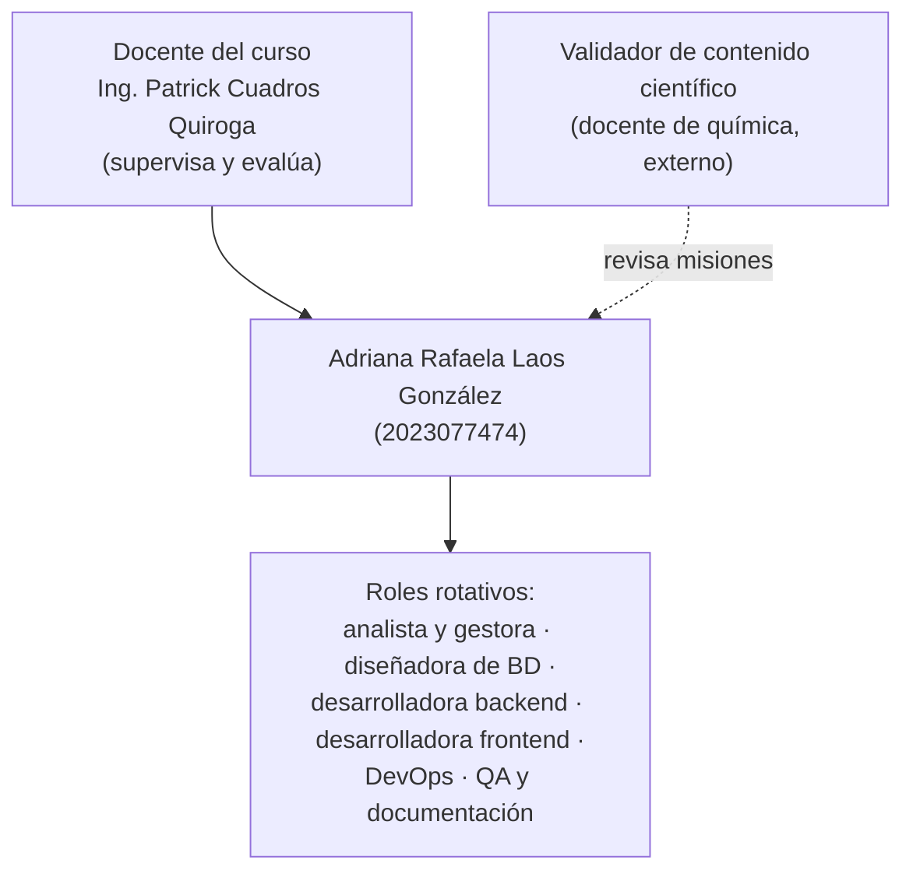
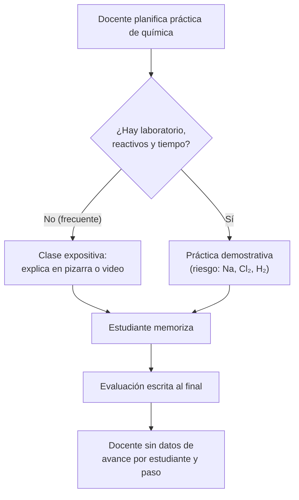
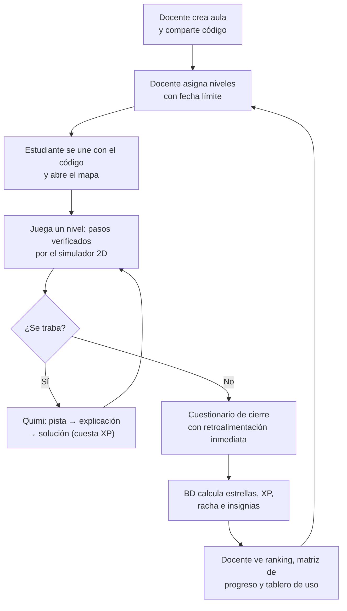
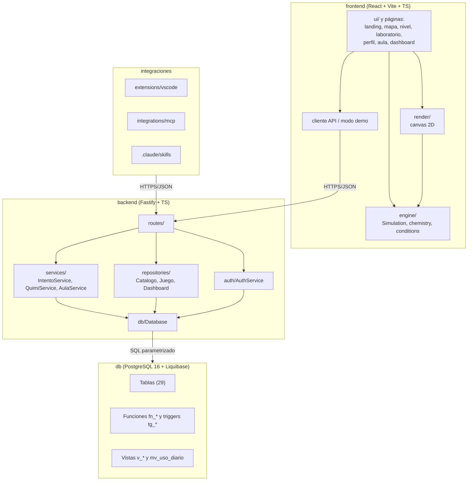
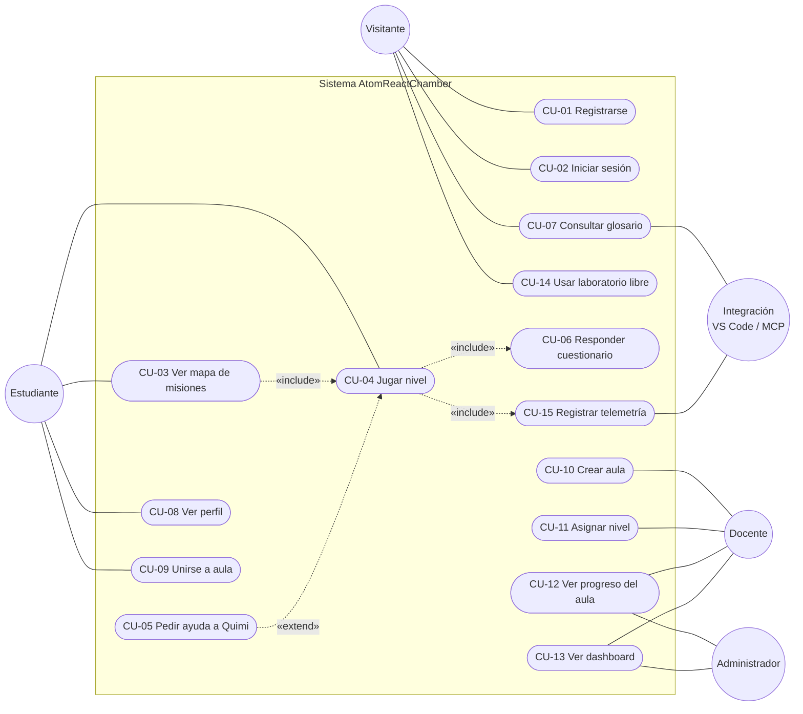
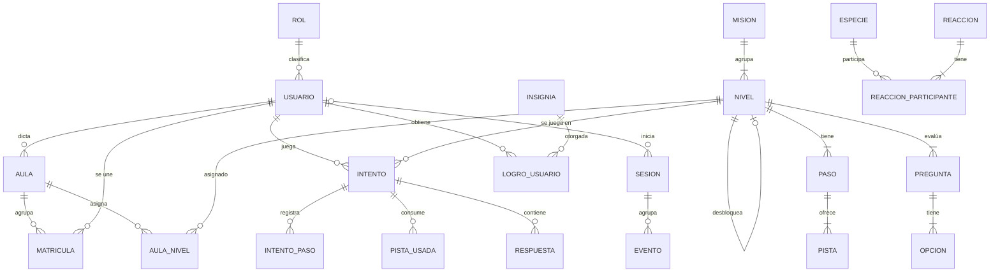
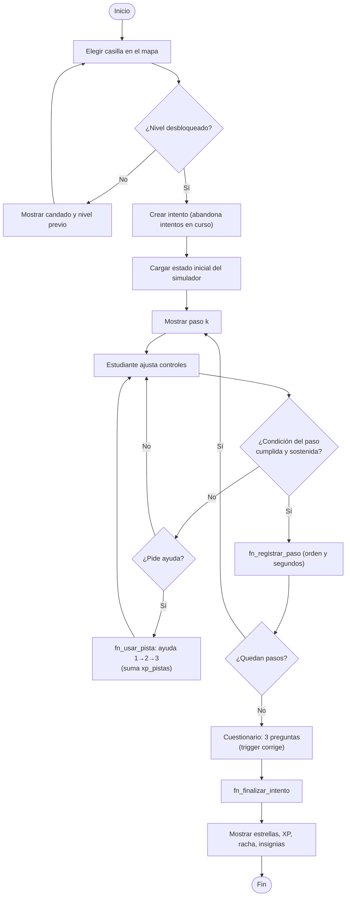
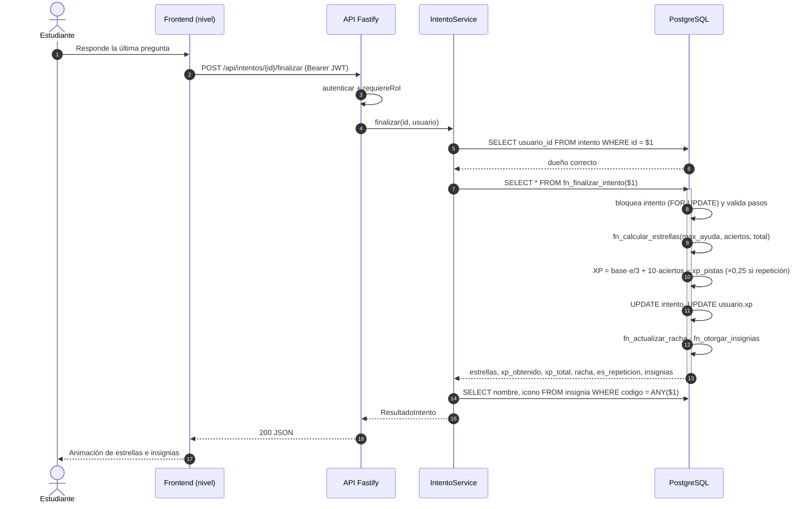
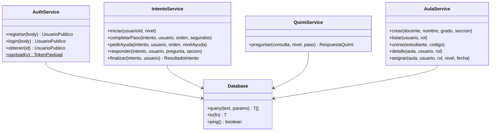

# Control de versiones

| Versión | Hecha por | Revisada por | Aprobada por | Fecha | Motivo |
|---|---|---|---|---|---|
| 1.0 | Adriana Laos | Ing. Patrick Cuadros Quiroga (pendiente) | (pendiente) | 2026-11-07 | Primera versión del SRS de AtomReactChamber v2, trazada contra la implementación real (BD, API y pruebas) |

---

# Introducción

Este documento especifica los requerimientos de software de **AtomReactChamber: laboratorio virtual
gamificado de química para estudiantes de secundaria del Perú**, en la forma recomendada por la norma
IEEE 830-1998 y adaptada a la plantilla FD03 de la Escuela Profesional de Ingeniería de Sistemas de la UPT.
Es coherente con el **FD01 v2.0 (Informe de Factibilidad)** y el **FD02 v2.0 (Documento de Visión)**: mismo
título, objetivos SMART, interesados, alcance y restricciones.

A diferencia de un SRS escrito antes de programar, cada requerimiento de esta versión está **trazado** contra
la implementación existente: el *endpoint* de la API (`backend/src/routes/index.ts`), la tabla o función de la
base de datos (`db/changelog/sql/*.sql`) y la prueba automatizada que lo verifica
(`backend/test/api.test.ts`, `frontend/src/engine/engine.test.ts`). Lo que aún no está implementado se marca
explícitamente como **pendiente**.

## Propósito

- Definir de forma verificable **qué** debe hacer AtomReactChamber (requerimientos funcionales), **con qué
  calidad** (requerimientos no funcionales) y **bajo qué reglas** (reglas de negocio).
- Servir de contrato entre la desarrolladora, el docente del curso y los usuarios del piloto.
- Ser la base del diseño (FD04 – Documento de Arquitectura de Software) y de las pruebas.

## Alcance

AtomReactChamber es una aplicación web cliente-servidor (React + Vite + TypeScript; Node 22 + Fastify 5 +
TypeScript; PostgreSQL 16 en Neon) que convierte la tabla periódica en un **mapa de misiones**. Cada casilla es
un **nivel**: una práctica guiada por pasos que se **verifican con un simulador molecular 2D**. El asistente
**Quimi**, basado en reglas y en la base de datos, ofrece ayudas escalonadas y un glosario con búsqueda de texto
completo. La gamificación (XP, 1–3 estrellas, insignias, rachas y ranking por aula) se calcula en PostgreSQL.
El docente crea aulas con código de ingreso, asigna niveles y revisa el progreso; un tablero muestra métricas
de uso.

**Incluye:** los requerimientos RF-01 a RF-28 de la sección 4.1.
**No incluye (trabajo futuro, FD02 §1.2):** laboratorio 3D, reportes PDF por correo, módulo de números
cuánticos, editor de prácticas para docentes y Quimi con modelo de lenguaje (LLM, 3.ª unidad).

## Definiciones, siglas y abreviaturas

Se adoptan las del FD02 v2.0 §1.3. Se añaden:

| Término | Descripción |
|---|---|
| RF / RNF / RN | Requerimiento funcional / no funcional / regla de negocio. |
| CU | Caso de uso. |
| Intento | Cada vez que un estudiante juega un nivel (tabla `intento`). Estados: `en_curso`, `completado`, `abandonado`. |
| Ayuda | Pista escalonada de Quimi: 1 = pista, 2 = explicación, 3 = solución (tabla `pista`). |
| DSL de condiciones | Lenguaje JSON con que se escribe la condición verificable de un paso: `{"todas"|"alguna": [{metrica, op, valor}], "durante": s}`. |
| *Endpoint* | Ruta HTTP de la API (prefijo `/api`). |
| Modo demo | Frontend sin API (`VITE_API_URL` vacío); usa el contenido local `contenido.generated.json`. |
| p95 | Percentil 95 del tiempo de respuesta. |
| WCAG | *Web Content Accessibility Guidelines* 2.2 (W3C). |
| OWASP | *Open Worldwide Application Security Project*; su Top 10 lista los riesgos web más críticos. |

## Referencias

- IEEE. (1998). *IEEE Std 830-1998: Recommended practice for software requirements specifications*.
- FD01 v2.0 Informe de Factibilidad; FD02 v2.0 Documento de Visión; `docs/investigacion/problema-y-objetivos.md`.
- FD04 v1.0 Documento de Arquitectura de Software; `docs/database/diccionario-de-datos.md`.
- Bibliografía y webgrafía completas al final del documento.

## Visión general del documento

La sección 1 describe la organización y el contexto; la 2, la visión general del proyecto; la 3, los procesos
actual y propuesto; la 4, los requerimientos y reglas de negocio; la 5, el modelo conceptual y lógico (perfiles,
casos de uso, especificaciones, actividades, secuencias y clases); la 6, la trazabilidad; y luego conclusiones,
recomendaciones y referencias.

# 1. Generalidades de la organización

## 1.1 Nombre de la organización

AtomReactChamber se desarrolla en la **Escuela Profesional de Ingeniería de Sistemas (EPIS) de la Facultad de
Ingeniería de la Universidad Privada de Tacna**, en el curso **Base de Datos II** (docente: Ing. Patrick Cuadros
Quiroga). La organización **beneficiaria** es una **institución educativa (IE) de secundaria** que lo use como
complemento del área de Ciencia y Tecnología del CNEB; el piloto se acordará con el docente del curso
(FD01 §4, FD02 §5).

## 1.2 Visión del producto

Ser el laboratorio virtual de química en español, gratuito y alineado al CNEB, que cualquier estudiante de
secundaria del Perú pueda usar desde el navegador para experimentar de forma segura y que dé al docente datos
útiles para guiar el aprendizaje.

## 1.3 Misión del producto

Ofrecer prácticas guiadas, verificables y gamificadas de química, con ayuda graduada y seguimiento docente,
sobre una base de datos sólida y una infraestructura de costo cero durante el desarrollo y el piloto.

## 1.4 Organigrama del proyecto

El proyecto tiene una **sola integrante con roles rotativos** (FD01 §4.2.3).

*Figura 1. Organigrama del proyecto (una integrante con roles rotativos).*

# 2. Visión general del proyecto

## 2.1 Problema

Los estudiantes de 1.º a 5.º de secundaria tienen pocas oportunidades de experimentar con fenómenos químicos,
lo que limita la competencia *"Indaga mediante métodos científicos para construir sus conocimientos"* del CNEB
(Minedu, 2016). En PISA 2022 solo el 47 % de los estudiantes peruanos alcanzó el nivel 2 o superior en ciencias
(OECD, 2023) y, en el área rural, el 21,8 % (Gestión, s. f.). Incluso en Tacna, en la ECE 2019 solo el 18,6 % de
los estudiantes de 2.º de secundaria logró el nivel satisfactorio en Ciencia y Tecnología (Andina, 2020).
El detalle está en el FD01 §3.1 y en `docs/investigacion/problema-y-objetivos.md`.

## 2.2 Objetivos

**Objetivo general (FD01 §1.4.1):** desarrollar e implementar, en 16 semanas, AtomReactChamber, un laboratorio
virtual gamificado de química con base de datos PostgreSQL, que permita a estudiantes de 1.º a 5.º de secundaria
realizar prácticas guiadas verificadas por un simulador molecular 2D y a los docentes hacer seguimiento del
avance, logrando en un piloto una tasa de niveles completados ≥ 60 % y una usabilidad SUS ≥ 70.

Los objetivos específicos **OE-1 a OE-9** (FD01 §1.4.2) y los de solución **OS-1 a OS-10** (FD02 §1.2.1) se
trazan contra los requerimientos en la sección 6.

## 2.3 Usuarios y actores

| Actor | Tipo | Descripción | Rol en la BD |
|---|---|---|---|
| Visitante | Humano | Persona sin sesión: ve la portada, usa el modo demo, consulta el catálogo y a Quimi. | — (sesión anónima en `sesion`) |
| Estudiante | Humano | Juega niveles, pide ayudas, responde cuestionarios, se une a aulas. | `rol.codigo = 'estudiante'` |
| Docente | Humano | Crea aulas, asigna niveles, ve ranking, progreso y tablero. Se registra con código de invitación. | `'docente'` |
| Administrador | Humano | Mismos permisos que el docente sobre **todas** las aulas; mantiene el contenido vía `db/data` + Liquibase. | `'admin'` |
| Integración | Sistema | Extensión VS Code, skill de Claude Code y servidor MCP que consumen la API. | `sesion.origen ∈ {vscode, claude, mcp}` |
| GitHub Actions | Sistema | Ejecuta migraciones, pruebas, respaldos, *release* y documentación. | — |
| PostgreSQL (reloj) | Sistema | Funciones y *triggers* que aplican las reglas de negocio. | — |

# 3. Análisis de procesos

## 3.1 Proceso actual

*Figura 2. Proceso actual de enseñanza de prácticas de química.*

**Problemas observados:** prácticas peligrosas o costosas se omiten; el estudiante no manipula variables;
la retroalimentación llega tarde; el docente no sabe en qué paso se traba cada estudiante.

## 3.2 Proceso propuesto

*Figura 3. Proceso propuesto con AtomReactChamber.*

# 4. Especificación de requerimientos de software

## 4.1 Requerimientos funcionales

Prioridad según MoSCoW adaptado: **Alta** (imprescindible para el piloto), **Media** (importante), **Baja**
(deseable). Estado: ✔ implementado y probado · ◐ implementado sin prueba automatizada · ✖ pendiente.
Los códigos de prueba (PI-xx, PU-xx, PE-xx) se definen en la sección 6.2.

### 4.1.1 Cuadro resumen

| ID | Nombre | Actor | Prioridad | Endpoint / componente | Tabla / función BD | Prueba | Estado |
|---|---|---|---|---|---|---|---|
| RF-01 | Registrar cuenta de estudiante | Visitante | Alta | `POST /api/auth/registro` | `usuario`, `ux_usuario_email` | PI-05, PI-06 | ✔ |
| RF-02 | Registrar cuenta de docente con código | Visitante | Alta | `POST /api/auth/registro` (`rol: docente`) | `usuario`, `rol` | PI-07, PI-16 | ✔ |
| RF-03 | Iniciar sesión | Visitante | Alta | `POST /api/auth/login` | `usuario.password_hash` | PI-07 | ✔ |
| RF-04 | Consultar usuario autenticado | Estudiante, docente | Alta | `GET /api/auth/yo` | `usuario`, `rol` | PI-08 | ✔ |
| RF-05 | Consultar catálogo químico | Todos | Alta | `GET /api/catalogo` | `elemento`, `especie`, `reaccion`, `v_reaccion_entalpia`, `fotolisis`, `preset` | PI-02, PU-01 | ✔ |
| RF-06 | Consultar contenido del juego sin respuestas | Todos | Alta | `GET /api/juego` | `mision`, `nivel`, `paso`, `pregunta`, `opcion`, `insignia` | PI-03 | ✔ |
| RF-07 | Ver mapa de misiones con estado de cada nivel | Estudiante | Alta | `GET /api/progreso`; página `mapa` | `intento`, `nivel.nivel_previo_id` | PI-13 | ✔ |
| RF-08 | Iniciar un nivel desbloqueado | Estudiante | Alta | `POST /api/intentos` | `intento` | PI-09, PI-10 | ✔ |
| RF-09 | Simular y verificar la condición de cada paso | Estudiante | Alta | `frontend/src/engine` (`Simulation`, `conditions`) | `paso.condicion` (DSL) | PU-05 a PU-07 | ✔ |
| RF-10 | Registrar paso completado en orden | Estudiante | Alta | `POST /api/intentos/:id/pasos` | `fn_registrar_paso`, `intento_paso` | PI-10, PI-12 | ✔ |
| RF-11 | Pedir ayuda escalonada a Quimi | Estudiante | Alta | `POST /api/intentos/:id/ayudas` | `fn_usar_pista`, `pista_usada`, `tg_pista_usada_contar` | PI-11 | ✔ |
| RF-12 | Consultar el glosario de Quimi | Todos | Alta | `GET /api/quimi?q=` | `fn_quimi_buscar`, `glosario` (GIN) | PI-15 | ✔ |
| RF-13 | Responder el cuestionario de cierre | Estudiante | Alta | `POST /api/intentos/:id/respuestas` | `respuesta`, `tg_respuesta_validar`, `tg_respuesta_contar` | PI-12 | ✔ |
| RF-14 | Finalizar intento (estrellas, XP, racha, insignias) | Estudiante | Alta | `POST /api/intentos/:id/finalizar` | `fn_finalizar_intento` y dependientes | PI-12, PI-14 | ✔ |
| RF-15 | Consultar perfil | Estudiante | Media | `GET /api/perfil`; página `perfil` | `v_progreso_estudiante`, `logro_usuario` | PI-13 | ✔ |
| RF-16 | Crear aula | Docente | Alta | `POST /api/aulas` | `aula`, `tg_aula_codigo`, `tg_aula_docente` | PI-16 | ✔ |
| RF-17 | Unirse a un aula con código | Estudiante | Alta | `POST /api/aulas/unirse` | `matricula` | PI-16 | ✔ |
| RF-18 | Listar mis aulas | Estudiante, docente | Media | `GET /api/aulas` | `aula`, `matricula` | — | ◐ |
| RF-19 | Asignar nivel a un aula con fecha límite | Docente | Alta | `POST /api/aulas/:id/niveles` | `aula_nivel` | — | ◐ |
| RF-20 | Ver ranking y matriz de progreso del aula | Docente | Alta | `GET /api/aulas/:id`; página `aula` | `v_ranking_aula`, `intento` | PI-16 | ✔ |
| RF-21 | Ver tablero de uso | Docente, admin | Media | `GET /api/dashboard`; página `dashboard` | `mv_uso_diario`, `v_estadisticas_nivel`, `v_tiempo_por_paso`, `v_preguntas_dificiles` | PI-17 | ✔ |
| RF-22 | Registrar telemetría de uso | Todos, integraciones | Media | `POST /api/eventos` | `sesion`, `evento` | PI-17 | ✔ |
| RF-23 | Usar el laboratorio libre con experimentos predefinidos | Todos | Baja | página `laboratorio`; `GET /api/catalogo` | `preset`, `preset_carga` | PU-01 a PU-04 | ◐ |
| RF-24 | Usar el modo demo sin conexión | Visitante | Media | `VITE_API_URL` vacío; `contenido.generated.json` | — (semilla `db/data`) | PE-01 | ◐ |
| RF-25 | Consultar estado del servicio | Sistema, GitHub Actions | Media | `GET /api/health` | `SELECT 1` | PI-01 | ✔ |
| RF-26 | Consultar documentación OpenAPI | Desarrolladores, integraciones | Baja | `GET /api/docs`, `/api/docs/json` | — | PI-04 | ✔ |
| RF-27 | Auditar cambios en tablas sensibles | Sistema (BD) | Media | — | `fn_auditar`, `auditoria` | — | ◐ |
| RF-28 | Consultar la API desde integraciones (VS Code, Claude Code, MCP) | Integración | Baja | `/api/catalogo`, `/api/juego`, `/api/quimi`, `/api/eventos` | `sesion.origen` | — | ◐ |

### 4.1.2 Especificación detallada

**RF-01 — Registrar cuenta de estudiante**

| Campo | Detalle |
|---|---|
| Descripción | El visitante crea una cuenta con nombre (2–80 caracteres), correo, contraseña (8–72 caracteres) y grado (1–5, opcional). Recibe el usuario creado y un JWT. |
| Prioridad | Alta |
| Actor | Visitante |
| Criterio de aceptación | (1) Respuesta `201` con `{usuario, token}`; (2) la contraseña se guarda con bcrypt (costo 10), nunca en texto plano; (3) un correo repetido, aunque cambie mayúsculas, devuelve `409 DUPLICADO`; (4) datos inválidos devuelven `400 VALIDACION`. |
| Trazabilidad | `POST /api/auth/registro` → `AuthService.registrar` → `usuario` (índice único `ux_usuario_email` sobre `lower(email)`); PI-05, PI-06. Límite de 10 solicitudes/min por IP. |

**RF-02 — Registrar cuenta de docente con código de invitación**

| Campo | Detalle |
|---|---|
| Descripción | Para registrarse con `rol: docente` se exige `codigoDocente` igual a la variable `DOCENTE_CODIGO` de la API. Los docentes no guardan grado. |
| Prioridad | Alta |
| Actor | Visitante (docente) |
| Criterio de aceptación | Código incorrecto o ausente → `403 CODIGO_DOCENTE`; código correcto → `201` con rol `docente`. |
| Trazabilidad | `AuthService.registrar`; `config.ts` (`DOCENTE_CODIGO`); PI-07, PI-16. |

**RF-03 — Iniciar sesión**

| Campo | Detalle |
|---|---|
| Descripción | El usuario envía correo y contraseña; si coinciden y la cuenta está activa, recibe un JWT firmado (HS256) con `sub`, `rol` y `nombre`, válido por 7 días. |
| Prioridad | Alta |
| Actor | Estudiante, docente, administrador |
| Criterio de aceptación | Credenciales correctas → `200 {usuario, token}`; incorrectas o cuenta inactiva → `401 CREDENCIALES` con el mismo mensaje genérico (no revela si el correo existe). |
| Trazabilidad | `POST /api/auth/login` → `AuthService.login`; `usuario.activo`; PI-07. |

**RF-04 — Consultar usuario autenticado**

| Campo | Detalle |
|---|---|
| Descripción | Devuelve los datos públicos del usuario del token (id, nombre, correo, rol, grado, XP, racha). |
| Criterio de aceptación | Sin token o token inválido → `401 NO_AUTENTICADO`; nunca devuelve `password_hash`. |
| Trazabilidad | `GET /api/auth/yo`; decorador `app.autenticar`; PI-08. |

**RF-05 — Consultar catálogo químico**

| Campo | Detalle |
|---|---|
| Descripción | Devuelve elementos, 13 especies (con datos termodinámicos y geometría), 12 reacciones con ecuación y ΔH, 3 fotólisis y 4 experimentos predefinidos, en la forma que consume el motor del simulador. |
| Prioridad | Alta |
| Criterio de aceptación | ΔH de cada reacción = Σ ΔHf°(productos) − Σ ΔHf°(reactivos), calculado por la vista (p. ej., C + O₂ → CO₂: −393,5 kJ/mol). Cabecera `Cache-Control: public, max-age=300`. |
| Trazabilidad | `GET /api/catalogo` → `CatalogoRepository` (caché de 5 min) → `v_reaccion_entalpia`; PI-02, PU-01. |

**RF-06 — Consultar contenido del juego sin respuestas**

| Campo | Detalle |
|---|---|
| Descripción | Devuelve misiones, niveles (casilla, estado inicial, controles, pasos con su condición y número de ayudas, cuestionario), insignias y costos de las ayudas. |
| Criterio de aceptación | La respuesta **no** contiene `es_correcta` ni el texto de las ayudas (evita trampas); cada paso informa `ayudas = 3`. |
| Trazabilidad | `GET /api/juego` → `JuegoRepository.contenido`; PI-03. |

**RF-07 — Ver mapa de misiones**

| Campo | Detalle |
|---|---|
| Descripción | El mapa con forma de tabla periódica muestra cada nivel en su casilla (`casilla_fila` 1–7, `casilla_columna` 1–18) con estado **bloqueado**, **disponible** o **completado** y sus mejores estrellas. |
| Criterio de aceptación | Un nivel está desbloqueado si `nivel_previo_id` es nulo o si el usuario completó el nivel previo (RN-07). Tras completar el nivel 1, el nivel 2 aparece desbloqueado. En modo demo el progreso se guarda en el navegador. |
| Trazabilidad | `GET /api/progreso` → `JuegoRepository.progreso`; restricción `ux_nivel_casilla`; PI-13. |

**RF-08 — Iniciar un nivel**

| Campo | Detalle |
|---|---|
| Descripción | Crea un intento `en_curso` para el nivel indicado; si había otro intento en curso del mismo nivel, lo marca `abandonado`. |
| Criterio de aceptación | Nivel inexistente → `404`; nivel bloqueado → `409 NIVEL_BLOQUEADO`; correcto → `201 {intento, nivel}`. Todo en una transacción. |
| Trazabilidad | `POST /api/intentos` → `IntentoService.iniciar` (`Database.tx`); `ck_intento_fin`; PI-09, PI-10. |

**RF-09 — Simular y verificar pasos**

| Campo | Detalle |
|---|---|
| Descripción | El simulador molecular 2D modela T, P, V, luz UV (λ), chispa e inyección de especies; detecta reacciones y fotólisis. Cada paso se considera logrado cuando su condición del DSL (`todas`/`alguna` de reglas `{metrica, op, valor}`, opcionalmente sostenida `durante` n segundos) se cumple sobre la instantánea de la simulación. |
| Criterio de aceptación | Todas las condiciones de los 9 niveles son alcanzables aplicando la solución del paso; las métricas soportadas son `temperatura`, `presion`, `volumen`, `uv`, `lambda`, `conteo:<sp>`, `fase:<sp>`, `reacciones:<rx>`, `reacciones_total`, `fotolisis:<sp>`, `chispas`, `razon:<A>:<B>` y `fase_predominante`; operadores `>=`, `<=`, `==`, `>`, `<`, `approx`. |
| Trazabilidad | `frontend/src/engine/Simulation.ts`, `conditions.ts`, `chemistry.ts`; columna `paso.condicion` (CHECK de forma); PU-05 a PU-07. |

**RF-10 — Registrar paso completado**

| Campo | Detalle |
|---|---|
| Descripción | Al cumplirse la condición, el cliente informa el orden del paso y los segundos empleados (0–86 400). |
| Criterio de aceptación | El paso debe pertenecer al nivel del intento y ser exactamente el siguiente (`pasos_completados + 1`); si no → `409 REGLA_NEGOCIO` "paso fuera de orden". Intento ajeno → `403`; intento terminado → `409`. |
| Trazabilidad | `POST /api/intentos/:id/pasos` → `fn_registrar_paso` → `intento_paso`; PI-10, PI-12. |

**RF-11 — Pedir ayuda escalonada a Quimi**

| Campo | Detalle |
|---|---|
| Descripción | El estudiante pide la ayuda 1 (pista), 2 (explicación) o 3 (solución) del paso actual. |
| Criterio de aceptación | No se puede abrir la ayuda *n* sin haber abierto la *n − 1* (`409`); la primera apertura descuenta su costo (5, 10 y 20 XP) y la registra; volver a abrirla devuelve `costoXp = 0, yaUsada = true`. |
| Trazabilidad | `POST /api/intentos/:id/ayudas` → `fn_usar_pista`; `pista_usada` (PK `intento_id, pista_id`); `tg_pista_usada_contar`; PI-11. |

**RF-12 — Consultar el glosario de Quimi**

| Campo | Detalle |
|---|---|
| Descripción | Pregunta libre (2–200 caracteres). Quimi responde con el término más relevante del glosario (39 términos), hasta 3 términos relacionados y, si se indica nivel y paso, el concepto del paso. |
| Criterio de aceptación | La búsqueda ignora tildes y mayúsculas ("energia de activacion" encuentra "Energía de activación"); sin coincidencias, Quimi sugiere usar las ayudas del paso. |
| Trazabilidad | `GET /api/quimi` → `QuimiService` → `fn_quimi_buscar` (`websearch_to_tsquery`, configuración `es_sin_tildes`, índice GIN `ix_glosario_busqueda`); PI-15. |

**RF-13 — Responder el cuestionario de cierre**

| Campo | Detalle |
|---|---|
| Descripción | El estudiante responde cada pregunta (3 por nivel) eligiendo una alternativa; recibe de inmediato si acertó, la explicación y cuál era la correcta. |
| Criterio de aceptación | La corrección la decide la BD (se ignora cualquier valor enviado por el cliente); una sola respuesta por pregunta e intento (PK); opción que no corresponde a la pregunta del nivel → `409`. |
| Trazabilidad | `POST /api/intentos/:id/respuestas`; `tg_respuesta_validar` (BEFORE INSERT), `tg_respuesta_contar` (AFTER INSERT); índice parcial `ux_opcion_una_correcta`; PI-12. |

**RF-14 — Finalizar intento**

| Campo | Detalle |
|---|---|
| Descripción | Cierra el intento en **una sola transacción** de la BD y devuelve estrellas, XP obtenida, XP total, racha, si fue repetición e insignias nuevas (con nombre e ícono). |
| Criterio de aceptación | Exige todos los pasos completos (`409` "faltan pasos"); aplica RN-01 a RN-06 y RN-08; ejemplo verificado: nivel 1 (100 XP base), 3 estrellas, 2 aciertos y una pista de 5 XP → 115 XP; repetición con 3 aciertos → round(130 × 0,25) = 33 XP. |
| Trazabilidad | `POST /api/intentos/:id/finalizar` → `fn_finalizar_intento` → `fn_calcular_estrellas`, `fn_actualizar_racha`, `fn_otorgar_insignias`; PI-12, PI-14. |

**RF-15 — Consultar perfil**

| Campo | Detalle |
|---|---|
| Descripción | Muestra XP, racha actual y máxima, niveles completados, estrellas totales, insignias obtenidas y los últimos 20 intentos. |
| Trazabilidad | `GET /api/perfil` → `JuegoRepository.perfil` → `v_progreso_estudiante`; PI-13. |

**RF-16 — Crear aula**

| Campo | Detalle |
|---|---|
| Descripción | El docente indica nombre (3–60), grado (1–5) y sección (por defecto "A"); la BD genera un código único de 6 caracteres sin letras ambiguas. |
| Criterio de aceptación | Solo `docente` o `admin` (`403` en otro caso, verificado también por *trigger*); código con patrón `^[A-Z0-9]{6}$`. |
| Trazabilidad | `POST /api/aulas` → `AulaService.crear`; `tg_aula_codigo` → `fn_generar_codigo_aula`; `tg_aula_docente`; PI-16. |

**RF-17 — Unirse a un aula**

| Campo | Detalle |
|---|---|
| Descripción | El estudiante ingresa el código (se normaliza a mayúsculas). |
| Criterio de aceptación | Código inexistente → `404 AULA_NO_ENCONTRADA`; unirse dos veces no duplica la matrícula (`ON CONFLICT DO NOTHING`). |
| Trazabilidad | `POST /api/aulas/unirse` → `matricula`; PI-16. |

**RF-18 — Listar mis aulas**

| Campo | Detalle |
|---|---|
| Descripción | El estudiante ve las aulas en que está matriculado (con nombre del docente); el docente, las que dicta (con número de estudiantes); el administrador, todas. |
| Trazabilidad | `GET /api/aulas` → `AulaService.listar`. Prueba automatizada pendiente. |

**RF-19 — Asignar nivel a un aula**

| Campo | Detalle |
|---|---|
| Descripción | El docente asigna un nivel con fecha límite opcional; reasignar actualiza la fecha. |
| Criterio de aceptación | Solo el docente dueño o un admin (`403`); nivel inexistente → `404`. |
| Trazabilidad | `POST /api/aulas/:id/niveles` → `aula_nivel` (PK `aula_id, nivel_id`, `ON CONFLICT DO UPDATE`). Prueba automatizada pendiente. |

**RF-20 — Ver ranking y matriz de progreso del aula**

| Campo | Detalle |
|---|---|
| Descripción | El docente ve el ranking (RANK por XP y estrellas), los niveles asignados y una matriz estudiante × nivel con estrellas, intentos y pistas. |
| Criterio de aceptación | Un estudiante o un docente ajeno recibe `403`. |
| Trazabilidad | `GET /api/aulas/:id` → `v_ranking_aula` (función de ventana `RANK() OVER (PARTITION BY aula_id …)`); PI-16. |

**RF-21 — Ver tablero de uso**

| Campo | Detalle |
|---|---|
| Descripción | Indicadores (estudiantes, aulas, sesiones y activos en 7 días, niveles completados, tasa de completado, % de aciertos, pistas por nivel), uso diario de 30 días, estadísticas por nivel, 5 pasos más lentos, 5 preguntas más difíciles y distribución por origen, dispositivo e insignias. |
| Criterio de aceptación | Solo docente o admin; refresca `mv_uso_diario` sin bloquear lecturas (`REFRESH … CONCURRENTLY`); devuelve 30 días y 9 niveles. |
| Trazabilidad | `GET /api/dashboard` → `DashboardRepository.resumen`; PI-17. |

**RF-22 — Registrar telemetría**

| Campo | Detalle |
|---|---|
| Descripción | El cliente envía lotes de 1 a 50 eventos (12 tipos cerrados) con un UUID de sesión, origen y dispositivo; funciona con o sin sesión iniciada. |
| Criterio de aceptación | `202 {registrados}`; tipo desconocido → `400`; límite de 60 lotes/min por IP. |
| Trazabilidad | `POST /api/eventos` → `DashboardRepository.registrarEventos` (*upsert* de `sesion`, inserción de `evento` con `jsonb_to_recordset`); PI-17. |

**RF-23 — Laboratorio libre**

| Campo | Detalle |
|---|---|
| Descripción | Simulador sin guía con todos los controles y los 4 experimentos predefinidos (combustión de H₂, álcali–agua, síntesis de agua con UV, cadena H₂ + Cl₂), perfil energético y registro de reacciones. |
| Trazabilidad | Página `laboratorio`; `preset`, `preset_carga`; evento `preset_cargado`. |

**RF-24 — Modo demo sin conexión**

| Campo | Detalle |
|---|---|
| Descripción | Si `VITE_API_URL` está vacío, el frontend funciona sin API con el contenido generado desde `db/data` (`npm run seed:generate`); el progreso se guarda en el navegador. Es la versión publicada en GitHub Pages. |
| Trazabilidad | `db/scripts/generate-seed.mjs` → `frontend/src/data/contenido.generated.json`; PE-01 (Playwright sobre el *build* en modo demo, `infra.yml`). |

**RF-25 a RF-28**

| ID | Descripción y criterio de aceptación | Trazabilidad |
|---|---|---|
| RF-25 | `GET /api/health` devuelve `{estado: ok\|degradado, db, version, hora}`; lo usan Render (health check) y el *smoke test* de `release.yml`. | PI-01 |
| RF-26 | La API publica su contrato OpenAPI 3 generado desde los esquemas zod, con interfaz Swagger en `/api/docs`. | PI-04; `npm run openapi -w backend` |
| RF-27 | Todo INSERT/UPDATE/DELETE en `usuario` y `aula`, y UPDATE/DELETE en `nivel` y `paso`, queda en `auditoria` con la fila antes/después en JSON, sin `password_hash`. | `fn_auditar`, 4 *triggers* `tg_*_auditoria` |
| RF-28 | La extensión VS Code, la skill de Claude Code y el servidor MCP consultan la API y registran su uso con `origen` = `vscode`, `claude` o `mcp`. | `CHECK` de `sesion.origen`; `extensions/vscode`, `integrations/mcp`, `.claude/skills/atomreactchamber` |

## 4.2 Requerimientos no funcionales

| ID | Atributo | Requerimiento | Métrica / criterio de aceptación | Verificación | Prioridad |
|---|---|---|---|---|---|
| RNF-01 | Rendimiento (cliente) | El simulador mantiene una animación fluida en equipos de aula. | ≥ 30 FPS con hasta 900 partículas (`MAX_PARTICULAS`) en equipo de 4 GB de RAM sin GPU dedicada. | Medición con *Performance* de Chrome en el piloto | Alta |
| RNF-02 | Rendimiento (API) | Respuestas rápidas con el servicio activo. | p95 < 500 ms en `GET /api/juego`, `POST /api/intentos/*`; catálogo en caché 5 min; pool de 5 conexiones. | Prueba de carga ligera (autocannon) — pendiente | Alta |
| RNF-03 | Disponibilidad | Servicio disponible en horario escolar sobre planes gratuitos. | ≥ 99 % de chequeos `/api/health` OK de 07:00 a 18:00; arranque en frío del plan gratuito de Render ≤ 60 s, mitigado con modo demo y mensaje "despertando servidor" (Render, s. f.). | Workflow programado de monitoreo — pendiente (hoy: *smoke test* en `release.yml`) | Alta |
| RNF-04 | Seguridad – autenticación | Contraseñas con bcrypt (costo 10); JWT HS256 con secreto ≥ 32 caracteres y expiración de 7 días; mensajes de error genéricos en el login. | Revisión de código; PI-07, PI-08. | Alta |
| RNF-05 | Seguridad – autorización | Control por rol en cada *endpoint* (`requiereRol`) y verificación de propiedad del intento y del aula. | Estudiante en `GET /api/aulas/:id` → 403 (PI-16); intento ajeno → 403. | Alta |
| RNF-06 | Seguridad – OWASP Top 10 | Control de acceso roto: RNF-05. Fallas criptográficas: TLS en tránsito (Render/Neon) y *hash* bcrypt. Inyección: solo consultas parametrizadas `$1…` y validación de entrada con esquemas. Diseño inseguro: reglas críticas en la BD (sección 4.3). Configuración insegura: Helmet, CORS restringido a `CORS_ORIGIN`, configuración validada al iniciar (*fail fast*). Componentes y cadena de suministro: Dependabot y CodeQL. Fallas de autenticación: límite de 10 solicitudes/min en `/auth/*` y 300/min global. Registro: *logs* con `authorization` y `password` redactados; errores 500 sin detalles internos. | 0 hallazgos críticos o altos en CodeQL; revisión manual con la lista OWASP Top 10 (OWASP Foundation, 2025). | `codeql.yml`, `dependabot.yml` | Alta |
| RNF-07 | Privacidad | Minimización de datos de menores: solo nombre/alias, correo y grado; sin DNI ni fotos; ranking visible solo para el docente del aula; telemetría anónima posible (UUID de sesión). Consentimiento de padres para menores de 14 años (D. S. 016-2024-JUS). | Revisión del esquema (diccionario de datos); formulario de consentimiento antes del piloto — pendiente. | Alta |
| RNF-08 | Usabilidad | Interfaz comprensible para escolares de 12 a 17 años. | SUS ≥ 70 en el piloto (referencia ≈ 68; Bangor et al., 2009); docente crea aula y asigna nivel en ≤ 5 min (OS-9). | Cuestionario SUS; prueba de tarea cronometrada | Alta |
| RNF-09 | Accesibilidad | Conformidad WCAG 2.2 nivel AA en las vistas principales. | Lighthouse *Accessibility* ≥ 90 en mapa, nivel, Quimi, perfil y aula (OS-6); navegación completa por teclado con foco visible; contraste ≥ 4,5:1; textos alternativos; `prefers-reduced-motion` respetado; controles del simulador con etiqueta accesible. | Lighthouse CI — pendiente; auditoría manual con *skills* de accesibilidad | Alta |
| RNF-10 | Mantenibilidad | Código tipado y documentado; esquema versionado. | TypeScript `strict`; TSDoc en miembros públicos publicado con TypeDoc; 100 % de objetos de BD en *changesets* Liquibase con *rollback*; cobertura de pruebas del backend ≥ 70 % (OS-8). | `ci.yml`, `db.yml`, `pages.yml`; reporte de cobertura — pendiente | Media |
| RNF-11 | Portabilidad | Infraestructura reproducible y migrable. | Terraform modular (`database-neon`, `app-render`); referencia de costos para AWS y Azure con Infracost; cliente en cualquier navegador moderno con Canvas 2D y ES2020. | `infra.yml` | Media |
| RNF-12 | Trazabilidad de datos | Todo intento, paso, ayuda y respuesta queda registrado con marca de tiempo. | 100 % de filas de `intento`, `intento_paso`, `pista_usada`, `respuesta` con `timestamptz` no nulo (por diseño: `NOT NULL DEFAULT now()`). | Diccionario de datos | Alta |
| RNF-13 | Recuperabilidad | Respaldo diario de la BD con restauración probada. | `pg_dump` diario y restauración de verificación en un PostgreSQL efímero (comparación de conteos de filas). | `backup.yml` | Media |
| RNF-14 | Costo | Operación sin costo durante desarrollo y piloto. | S/ 0 mensuales en Neon, Render y GitHub Pages (OS-10); reporte de costos de referencia en CI. | `infra.yml` (Infracost) | Media |
| RNF-15 | Escalabilidad de datos | La telemetría crece sin degradar consultas. | Índices BRIN en `evento.creado_en` y `sesion.iniciada_en`; tablero sobre vista materializada. | FD04 §8 | Baja |

## 4.3 Reglas de negocio

Todas las reglas siguientes están implementadas **en PostgreSQL** (funciones `fn_*` y *triggers* `tg_*`), de modo
que ningún cliente —web, VS Code, MCP— puede saltárselas.

| ID | Regla | Implementación | Prueba |
|---|---|---|---|
| RN-01 | **Estrellas.** Completar un nivel da 3 estrellas de base; −1 si se abrió una explicación (ayuda 2); −1 adicional si se abrió la solución (ayuda 3); −1 si el cuestionario tiene menos de 2/3 de aciertos. Mínimo 1 estrella. | `fn_calcular_estrellas` (IMMUTABLE) | PI-12 |
| RN-02 | **XP del intento.** XP = round(xp_base × estrellas / 3) + 10 × aciertos − XP gastada en ayudas; nunca negativa (`greatest(0, …)`). | `fn_finalizar_intento` | PI-12 |
| RN-03 | **Repetición al 25 %.** Si el usuario ya había completado ese nivel, la XP del nuevo intento se multiplica por 0,25 (redondeo). | `fn_finalizar_intento` (`es_repeticion`) | PI-14 |
| RN-04 | **Ayudas escalonadas.** Orden obligatorio 1 → 2 → 3 por paso; cada ayuda cuesta 5, 10 y 20 XP y se cobra solo la primera vez por intento; no se registran ayudas nuevas en intentos terminados. | `fn_usar_pista`; PK de `pista_usada`; `tg_pista_usada_contar` | PI-11 |
| RN-05 | **Racha.** Al completar un nivel: si el último día activo (zona America/Lima) fue ayer, la racha sube en 1; si fue hoy, no cambia; en otro caso vuelve a 1. La racha máxima nunca es menor que la actual. | `fn_actualizar_racha`; `CHECK (racha_maxima >= racha_actual)` | PI-12 |
| RN-06 | **Insignias.** Al cerrar un intento se otorgan, de forma idempotente, las insignias cuyo umbral alcanzó el usuario según 6 métricas: niveles completados (1, 5, 9), intentos sin pistas (1), racha (3), estrellas totales (20, mejor por nivel), XP total (1000) y cuestionarios perfectos (3). | `fn_otorgar_insignias`; PK de `logro_usuario` | PI-12 |
| RN-07 | **Desbloqueo.** Un nivel con `nivel_previo_id` solo puede iniciarse si el usuario completó ese nivel previo; los niveles forman una cadena lineal de 9. | `IntentoService.iniciar`, `JuegoRepository.progreso` (dato en `nivel.nivel_previo_id`) | PI-09, PI-13 |
| RN-08 | **Cierre completo.** Un intento solo se finaliza si están todos sus pasos; un intento terminado no admite pasos ni ayudas nuevas; `finalizado_en` es nulo si y solo si está en curso; `estrellas` existe si y solo si está completado. | `fn_finalizar_intento`, `fn_registrar_paso`; `ck_intento_fin`, `ck_intento_estrellas` | PI-12 |
| RN-09 | **Pasos en orden.** Cada paso debe pertenecer al nivel del intento y ser el siguiente al último completado. | `fn_registrar_paso` | PI-10 |
| RN-10 | **Corrección en la BD.** `respuesta.es_correcta` se toma de `opcion.es_correcta`; se ignora lo que envíe el cliente; la opción debe pertenecer a la pregunta del nivel del intento; cada pregunta tiene a lo más una alternativa correcta. | `tg_respuesta_validar`, `tg_respuesta_contar`; índice parcial `ux_opcion_una_correcta` | PI-12 |
| RN-11 | **Un intento activo por nivel.** Al iniciar un nivel, los intentos en curso del mismo nivel y usuario pasan a `abandonado`. | `IntentoService.iniciar` (transacción) | PI-14 |
| RN-12 | **Aulas.** Solo un docente o administrador puede ser dueño de un aula; el código es único, de 6 caracteres, sin I, O, 0 ni 1. | `tg_aula_docente`, `tg_aula_codigo`, `fn_generar_codigo_aula`; `CHECK (codigo ~ '^[A-Z0-9]{6}$')` | PI-16 |
| RN-13 | **Registro docente.** Registrarse como docente exige el código de invitación `DOCENTE_CODIGO`; nadie puede registrarse como administrador desde la API. | `AuthService.registrar`; esquema `RegistroBody` (`rol ∈ {estudiante, docente}`) | PI-07 |
| RN-14 | **Correo único** sin distinguir mayúsculas. | Índice único de expresión `ux_usuario_email` sobre `lower(email)` | PI-06 |
| RN-15 | **Entalpía derivada.** ΔH de reacción no se almacena: se calcula desde ΔHf° de las especies. | Vista `v_reaccion_entalpia` | PI-02 |
| RN-16 | **Contenido seguro.** El contenido público del juego nunca incluye el texto de las ayudas ni la alternativa correcta. | `JuegoRepository.contenido` | PI-03 |

## 4.4 Restricciones

Se mantienen las restricciones RES-01 a RES-10 del FD02 §8. En términos de diseño:

| ID | Restricción |
|---|---|
| RES-01 | Aplicación web sin instalación; navegadores modernos con Canvas 2D y ES2020. |
| RES-02 | Stack fijo: React 18 + Vite + TypeScript; Node 22 + Fastify 5 + TypeScript; PostgreSQL 16; Liquibase; Terraform; GitHub Actions. |
| RES-03 | Planes gratuitos: Neon (100 CU-h/mes y 1 GB por proyecto; Neon, 2026), Render Free (suspensión tras 15 min sin tráfico) y GitHub Pages. |
| RES-04 | Una sola desarrolladora; 16 semanas. |
| RES-05 | Simulación 2D; energías de activación didácticas declaradas como tales (`reaccion.ea_kj_mol`). |
| RES-06 | Quimi sin LLM en esta versión. |
| RES-07 | Cambios de esquema solo mediante *changesets* Liquibase con *rollback*; ningún cambio manual en producción. |
| RES-08 | Datos de menores conforme a la Ley 29733 y el D. S. 016-2024-JUS. |
| RES-09 | El contenido (misiones, niveles, pasos, ayudas, preguntas, glosario) se edita solo en `db/data/*.json` y se publica por migración; no hay editor en la interfaz (trabajo futuro). |

# 5. Fase de desarrollo

## 5.1 Perfiles de usuario

| Perfil | Características | Conocimientos | Necesidades de la interfaz | Permisos |
|---|---|---|---|---|
| Estudiante | 12–17 años, 1.º a 5.º de secundaria; uso en aula de innovación o en casa. | Nociones de materia según grado; navegador básico. | Instrucciones breves, retroalimentación inmediata, lenguaje sencillo, teclado y contraste. | Jugar, pedir ayudas, responder, unirse a aulas, ver su perfil. |
| Docente | 25–65 años, docente de Ciencia y Tecnología. | Dominio del área; plataformas educativas básicas. | Panel claro, datos por estudiante y paso, poca configuración. | Lo del estudiante + crear aulas, asignar niveles, ver ranking, matriz y tablero. |
| Administrador | Responsable técnico (en el piloto, la desarrolladora). | Gestión de sistemas web, Git y SQL. | Seguridad, auditoría y despliegue automatizado. | Lo del docente sobre todas las aulas; mantenimiento de contenido por repositorio. |
| Visitante | Cualquier persona sin sesión. | — | Probar sin registrarse. | Portada, modo demo, catálogo, Quimi (glosario), telemetría anónima. |

## 5.2 Modelo conceptual

### 5.2.1 Diagrama de paquetes

*Figura 4. Diagrama de paquetes de AtomReactChamber.*

### 5.2.2 Diagrama de casos de uso

Mermaid no tiene diagrama de casos de uso; se aproxima con un diagrama de flujo: actores a la izquierda y a la
derecha, casos de uso como óvalos dentro del límite del sistema, `«include»` con línea punteada.

*Figura 5. Diagrama de casos de uso (aproximado con diagrama de flujo). El estudiante, el docente y el
administrador heredan los casos de uso del visitante.*

### 5.2.3 Especificación de casos de uso

**CU-01 — Registrarse**

| Campo | Descripción |
|---|---|
| Actor principal | Visitante |
| Requerimientos | RF-01, RF-02; RN-13, RN-14 |
| Precondición | No tiene sesión iniciada. |
| Postcondición | Existe un `usuario` con rol estudiante o docente; el cliente guarda el JWT. |
| Flujo básico | 1. El visitante elige "Crear cuenta". 2. Ingresa nombre, correo, contraseña y grado. 3. El sistema valida el formato (zod/Ajv). 4. El sistema calcula el *hash* bcrypt y crea el usuario. 5. El sistema devuelve el usuario y el token. 6. El cliente muestra el mapa de misiones. |
| Flujo alternativo A1 — Docente | 2a. Marca "Soy docente" e ingresa el código de invitación. 4a. Si el código no coincide, el sistema responde 403 y muestra "Código de docente incorrecto". |
| Excepciones | E1. Correo ya registrado → 409 "Ya existe un registro con esos datos". E2. Datos inválidos → 400 con el detalle. E3. Más de 10 intentos por minuto → 429. |

**CU-04 — Jugar nivel**

| Campo | Descripción |
|---|---|
| Actor principal | Estudiante |
| Requerimientos | RF-07 a RF-10, RF-13, RF-14; RN-01 a RN-09, RN-11 |
| Precondición | Sesión iniciada; el nivel está desbloqueado. |
| Postcondición | El intento queda `completado` con estrellas y XP; se actualizan XP del usuario, racha e insignias. |
| Flujo básico | 1. El estudiante elige una casilla disponible del mapa. 2. El sistema crea el intento (`POST /intentos`) y carga el estado inicial del simulador (parámetros, especies y controles habilitados). 3. El sistema muestra el objetivo y el paso 1 (instrucción y concepto). 4. El estudiante manipula los controles (T, P, V, UV, λ, chispa, inyectar). 5. El motor evalúa la condición del paso en cada instante; al cumplirse (y sostenerse `durante` los segundos indicados) el sistema registra el paso con su tiempo (`POST /pasos`). 6. Se repiten 3–5 para cada paso. 7. Al terminar los pasos se ejecuta CU-06. 8. El sistema finaliza el intento (`POST /finalizar`) y muestra estrellas, XP, racha e insignias nuevas con animación (respetando `prefers-reduced-motion`). 9. El mapa marca el nivel como completado y desbloquea el siguiente. |
| Flujos alternativos | A1. El estudiante se traba → CU-05. A2. Abandona el nivel → el intento queda en curso y se marcará `abandonado` al reiniciar. A3. Sin conexión o modo demo → el motor valida localmente y el progreso se guarda en el navegador. |
| Excepciones | E1. Nivel bloqueado → 409 "completa el anterior". E2. Paso fuera de orden → 409. E3. Token vencido → 401 y se pide iniciar sesión. |

**CU-05 — Pedir ayuda a Quimi**

| Campo | Descripción |
|---|---|
| Actor principal | Estudiante |
| Requerimientos | RF-11, RF-12; RN-04, RN-01 |
| Precondición | Intento en curso en el paso *k*. |
| Postcondición | La ayuda queda registrada en `pista_usada` (si es nueva) y su costo se suma a `intento.xp_pistas`. |
| Flujo básico | 1. El estudiante abre el panel de Quimi. 2. El sistema muestra las tres ayudas del paso con su costo (5, 10, 20 XP) y advierte que la explicación y la solución reducen estrellas. 3. El estudiante pide la ayuda 1. 4. El sistema verifica el orden, registra la ayuda y devuelve el texto. 5. Si sigue trabado, pide la 2 y luego la 3 (pasos 3–4). |
| Flujo alternativo A1 — Pregunta libre | 1a. Escribe una pregunta ("¿qué es un radical?"). 2a. El sistema busca en el glosario sin tildes y responde con el término más relevante y el concepto del paso actual. |
| Excepciones | E1. Pide la ayuda 2 sin haber abierto la 1 → 409 "primero abre la ayuda 1". E2. Reabre una ayuda → se muestra sin costo (`yaUsada`). |

**CU-06 — Responder cuestionario**

| Campo | Descripción |
|---|---|
| Actor principal | Estudiante |
| Requerimientos | RF-13; RN-10, RN-01, RN-02 |
| Precondición | Todos los pasos del intento completados. |
| Postcondición | 3 filas en `respuesta` con `es_correcta` decidido por la BD; `intento.aciertos` actualizado. |
| Flujo básico | 1. El sistema muestra la pregunta 1 con sus alternativas. 2. El estudiante elige una. 3. El sistema inserta la respuesta; el *trigger* fija si es correcta y suma el acierto. 4. El sistema muestra "¡Correcto!" o "Incorrecto", la explicación y la alternativa correcta. 5. Se repite para las demás preguntas. 6. Continúa CU-04 paso 8. |
| Excepciones | E1. Responder dos veces la misma pregunta → 409 (duplicado). E2. Opción ajena a la pregunta → 409. |

**CU-10 — Crear aula**

| Campo | Descripción |
|---|---|
| Actor principal | Docente |
| Requerimientos | RF-16, RF-19; RN-12 |
| Precondición | Sesión con rol docente o administrador. |
| Postcondición | Existe un `aula` con código único; queda registrada en `auditoria`. |
| Flujo básico | 1. El docente abre "Mis aulas" y elige "Nueva aula". 2. Ingresa nombre, grado y sección. 3. El sistema crea el aula; el *trigger* genera el código. 4. El sistema muestra el código grande y un botón para copiarlo. 5. El docente asigna niveles con fecha límite (CU-11). |
| Excepciones | E1. Rol estudiante → 403. E2. Datos inválidos → 400. |

**CU-13 — Ver dashboard**

| Campo | Descripción |
|---|---|
| Actor principal | Docente o administrador |
| Requerimientos | RF-21, RF-22 |
| Precondición | Sesión con rol docente o administrador. |
| Postcondición | Ninguna (consulta). `mv_uso_diario` queda refrescada. |
| Flujo básico | 1. El usuario abre "Dashboard". 2. El sistema refresca la vista materializada sin bloquear lecturas. 3. El sistema muestra los indicadores, el gráfico de uso de 30 días, la tabla por nivel (tasa de completado, estrellas, pistas, minutos), los pasos más lentos y las preguntas con más errores. 4. El usuario identifica qué pasos o preguntas reforzar en clase. |
| Excepciones | E1. Rol estudiante → 403. E2. BD no disponible → 500 genérico y el `health` informa `degradado`. |

## 5.3 Modelo lógico

### 5.3.1 Modelo conceptual de datos

Vista simplificada de las entidades del dominio (el modelo físico completo, con 29 tablas, está en el FD04 §8 y
en el diccionario de datos).

*Figura 6. Modelo conceptual de datos (entidades principales).*

### 5.3.2 Diagrama de actividades: jugar un nivel

*Figura 7. Diagrama de actividades del caso de uso Jugar nivel.*

### 5.3.3 Diagrama de secuencia: finalizar un intento

*Figura 8. Secuencia de cierre de un intento.*

### 5.3.4 Diagrama de clases (dominio de la API)

*Figura 9. Clases de servicio de la API (detalle completo en el FD04 §5).*

# 6. Trazabilidad

## 6.1 Matriz objetivos ↔ requerimientos ↔ pruebas

| Objetivo (FD01/FD02) | Requerimientos | Reglas | Evidencia / prueba |
|---|---|---|---|
| OE-1 BD en 3FN con migraciones versionadas | RF-27, RNF-10, RES-07 | RN-15 | `db.yml` (Liquibase `update` + `rollback`); diccionario de datos generado |
| OE-2 / OS-1 Catálogo de misiones alineadas al CNEB | RF-05, RF-06, RF-07 | RN-07 | PI-02, PI-03, PU-07 (todos los niveles completables). **Hoy: 9 niveles en 4 misiones; meta ≥ 12** |
| OE-3 / OS-2 Tasa de niveles completados ≥ 60 % | RF-08, RF-10, RF-14, RF-21 | RN-08, RN-11 | Vista `v_estadisticas_nivel.tasa_completado`; KPI `tasa_completado` del tablero |
| OE-4 / OS-3 +15 p. p. en el cuestionario | RF-13, RF-21 | RN-10 | `respuesta`, `v_preguntas_dificiles`; PI-12 |
| OS-4 Mediana ≤ 3 min por paso | RF-10, RF-21 | RN-09 | `v_tiempo_por_paso.segundos_mediana` |
| OE-5 / OS-5 ≤ 30 % de pasos con "solución" | RF-11 | RN-04, RN-01 | `pista_usada` ⋈ `pista` (`nivel_ayuda = 3`); PI-11 |
| OE-6 / OS-6 Accesibilidad ≥ 90 y SUS ≥ 70 | RNF-08, RNF-09 | — | Lighthouse CI (pendiente); cuestionario SUS |
| OE-7 / OS-7 Disponibilidad ≥ 99 % | RF-25, RNF-03 | — | PI-01; monitoreo programado (pendiente) |
| OE-8 / OS-8 Calidad del software | RNF-10, RF-26 | — | 17 pruebas de integración + pruebas del motor; CI en verde |
| OS-9 Gestión docente en ≤ 5 min | RF-16, RF-17, RF-19, RF-20 | RN-12 | PI-16; prueba de tarea cronometrada |
| OE-9 / OS-10 Costo S/ 0 | RNF-14, RNF-11 | — | `infra.yml` (Infracost) |
| OI-2 Ganancia de aprendizaje | RF-13 | RN-10 | Requiere distinguir pre/post en `respuesta` (**pendiente**, ver Recomendaciones) |
| OI-4 Pistas escalonadas | RF-11 | RN-04 | Consulta sobre `pista_usada` e `intento_paso` |

## 6.2 Catálogo de pruebas

**Pruebas de integración** (`backend/test/api.test.ts`, Vitest + `app.inject` contra PostgreSQL 16 migrado):

| ID | Prueba | RF / RN |
|---|---|---|
| PI-01 | `GET /api/health` responde ok con la BD conectada | RF-25 |
| PI-02 | `GET /api/catalogo` devuelve 13 especies y ΔH calculado por la vista | RF-05, RN-15 |
| PI-03 | `GET /api/juego` no expone respuestas correctas ni texto de pistas | RF-06, RN-16 |
| PI-04 | `GET /api/docs/json` documenta las rutas | RF-26 |
| PI-05 | Registra un estudiante y devuelve JWT | RF-01 |
| PI-06 | Rechaza correo duplicado (índice único sin distinguir mayúsculas) | RF-01, RN-14 |
| PI-07 | Rechaza docente sin código y login con clave incorrecta | RF-02, RF-03, RN-13 |
| PI-08 | Protege rutas privadas | RF-04, RNF-05 |
| PI-09 | No permite iniciar un nivel bloqueado | RF-08, RN-07 |
| PI-10 | Inicia el nivel 1 y valida el orden de los pasos | RF-08, RF-10, RN-09 |
| PI-11 | Las ayudas son escalonadas y cuestan XP una sola vez | RF-11, RN-04 |
| PI-12 | Completa pasos, responde (corrige la BD) y finaliza con estrellas e insignias | RF-10, RF-13, RF-14, RN-01, RN-02, RN-05, RN-06, RN-08, RN-10 |
| PI-13 | Desbloquea el nivel 2 y refleja el progreso en el perfil | RF-07, RF-15, RN-07 |
| PI-14 | Una repetición da solo 25 % de XP | RF-14, RN-03, RN-11 |
| PI-15 | Quimi encuentra términos sin tildes | RF-12 |
| PI-16 | El docente crea un aula y el estudiante se une con el código | RF-02, RF-16, RF-17, RF-20, RN-12 |
| PI-17 | Registra eventos anónimos y el dashboard los resume | RF-21, RF-22 |

**Pruebas unitarias del motor** (`frontend/src/engine/engine.test.ts`): PU-01 ΔH de la combustión del carbono;
PU-02 Clausius-Clapeyron (agua a 2 atm y 0,5 atm); PU-03 fases del agua a 1 atm; PU-04 energía del fotón
(240 nm rompe O=O); PU-05 lectura de métricas del DSL; PU-06 operadores incluido `approx`; PU-07 cada uno de los
9 niveles es completable con su solución.

**Pruebas extremo a extremo:** PE-01 recorrido en modo demo con Playwright (`infra.yml`).

# Conclusiones

1. Los 28 requerimientos funcionales cubren el alcance del FD02 y cada uno está trazado a un *endpoint*, a un
   objeto de la base de datos y, en 24 casos, a una prueba automatizada.
2. Las 16 reglas de negocio críticas (estrellas, XP, repetición al 25 %, ayudas escalonadas, racha, insignias,
   desbloqueo, corrección) se ejecutan en PostgreSQL, lo que garantiza su cumplimiento desde cualquier cliente y
   es el aporte central para el curso Base de Datos II.
3. Los requerimientos no funcionales tienen métricas verificables; los de accesibilidad, disponibilidad y
   cobertura dependen de automatizaciones aún pendientes.

# Recomendaciones

1. Añadir pruebas de integración para RF-18 (listar aulas) y RF-19 (asignar nivel).
2. Para medir OI-2 (ganancia pre/post), agregar a `intento` o `respuesta` una columna `momento` (`pre`/`post`)
   mediante un nuevo *changeset*, o un cuestionario diagnóstico separado.
3. Completar los niveles faltantes para cumplir OS-1 (≥ 12 niveles) editando `db/data/juego.json`.
4. Implementar el monitoreo programado de `/api/health`, Lighthouse CI y el reporte de cobertura para cerrar
   RNF-03, RNF-09 y RNF-10.
5. Preparar el formulario de consentimiento de padres antes del piloto (RNF-07) y recomendar el uso de alias en
   el campo nombre.

# Bibliografía

Bangor, A., Kortum, P., & Miller, J. (2009). Determining what individual SUS scores mean: Adding an adjective rating scale. *Journal of Usability Studies, 4*(3), 114–123. https://uxpajournal.org/wp-content/uploads/sites/7/pdf/JUS_Bangor_May2009.pdf

Congreso de la República del Perú. (2011). *Ley N.° 29733, Ley de Protección de Datos Personales*. https://www.gob.pe/institucion/congreso-de-la-republica/normas-legales/243470-29733

IEEE. (1998). *IEEE recommended practice for software requirements specifications* (IEEE Std 830-1998). https://doi.org/10.1109/IEEESTD.1998.88286

Ministerio de Educación. (2016). *Currículo Nacional de la Educación Básica*. https://repositorio.minedu.gob.pe/handle/20.500.12799/4551

Ministerio de Justicia y Derechos Humanos. (2024). *Decreto Supremo N.° 016-2024-JUS que aprueba el Reglamento de la Ley N.° 29733*. https://www.congreso.gob.pe/Docs/DGP/DIDP/files/ds_016-2024-jus.pdf

OECD. (2023). *PISA 2022 results (Volume I and II) – Country notes: Peru*. https://www.oecd.org/en/publications/pisa-2022-results-volume-i-and-ii-country-notes_ed6fbcc5-en/peru_3e71791c-en.html

# Webgrafía

Andina. (2020). *Tacna, Moquegua y Arequipa lideran la mejora de aprendizajes a escala nacional*. https://andina.pe/ingles/noticia-tacna-moquegua-y-arequipa-lideran-mejora-aprendizajes-a-escala-nacional-800056.aspx

Gestión. (s. f.). [Nota sobre resultados de PISA 2022 con datos de la Defensoría del Pueblo; título y fecha por confirmar]. https://gestion.pe/peru/lea-tambien-modifican-reglamento-de-la-ley-de-reforma-magisterial-cuales-son-los-cambios-educacion-ocde-noticia/

Neon. (2026). *Free plan limits and quotas*. https://neon.com/faqs/free-plan-limits-and-quotas

OWASP Foundation. (2025). *OWASP Top Ten web application security risks*. https://owasp.org/www-project-top-ten/

Render. (s. f.). *Deploy for free*. https://render.com/docs/free

W3C. (2023). *Web Content Accessibility Guidelines (WCAG) 2.2*. https://www.w3.org/TR/WCAG22/
