# Control de versiones

| Versión | Hecha por | Revisada por | Aprobada por | Fecha | Motivo |
|---|---|---|---|---|---|
| 1.0 | Adriana Laos | Ing. Patrick Cuadros Quiroga (pendiente) | (pendiente) | 2026-11-07 | Primera versión del SAD de AtomReactChamber v2, documentada a partir del código, la BD migrada y la infraestructura reales |

---

# 1. Introducción

## 1.1 Propósito

Este documento describe la arquitectura de **AtomReactChamber: laboratorio virtual gamificado de química para
estudiantes de secundaria del Perú** mediante el modelo de vistas **4+1** de Kruchten (1995) —vista de casos de
uso, lógica, de procesos, de implementación y de despliegue— complementado con los diagramas de **contexto y
contenedores del modelo C4** (Brown, s. f.) y una **vista de datos**, que es el eje del curso Base de Datos II.
Registra además las decisiones arquitectónicas (en formato ADR) y los escenarios de atributos de calidad.

## 1.2 Alcance

Cubre la versión 2.0 del sistema tal como está en el repositorio: frontend React, API Fastify, base de datos
PostgreSQL gestionada con Liquibase, infraestructura Terraform (Neon y Render), automatizaciones de GitHub Actions
e integraciones (extensión VS Code, servidor MCP y *skill* de Claude Code). Los requerimientos que la arquitectura
satisface están en el **FD03 v1.0 (SRS)**; el detalle de cada columna, en `docs/database/diccionario-de-datos.md`.

## 1.3 Definiciones, siglas y abreviaturas

Se usan las del FD02 §1.3 y del FD03. Se añaden:

| Término | Descripción |
|---|---|
| ADR | *Architecture Decision Record*: registro breve de una decisión, su contexto y sus consecuencias. |
| C4 | Modelo de diagramas de arquitectura por niveles: contexto, contenedores, componentes y código. |
| *Driver* arquitectónico | Requerimiento o restricción que condiciona de forma significativa la arquitectura. |
| BRIN | *Block Range Index*: índice compacto para columnas correlacionadas con el orden físico (fechas de inserción). |
| GIN | *Generalized Inverted Index*: índice invertido, usado para búsqueda de texto completo. |
| Vista materializada | Resultado de una consulta guardado físicamente; se refresca bajo demanda. |
| *Cold start* | Tiempo que tarda un servicio suspendido del plan gratuito en volver a responder. |
| IaC | Infraestructura como código (Terraform). |

## 1.4 Organización del documento

La sección 2 presenta los *drivers* y las decisiones; la 3, el contexto (C4); las secciones 4 a 9, las vistas
4+1 y la de datos; la 10, seguridad; la 11, calidad y escenarios; y al final, conclusiones, recomendaciones y
referencias.

# 2. Objetivos y restricciones arquitectónicas

## 2.1 Drivers arquitectónicos

| ID | Driver | Origen | Impacto en la arquitectura |
|---|---|---|---|
| DA-01 | Las reglas de juego (estrellas, XP, ayudas, racha, insignias, corrección) deben ser **íntegras e iguales para todo cliente** (web, VS Code, MCP). | FD03 RN-01 a RN-12 | Reglas en funciones y *triggers* de PostgreSQL; la API solo valida propiedad y traduce errores. |
| DA-02 | **Costo S/ 0** en desarrollo y piloto. | FD01 OE-9; FD02 RES-03 | Neon Free, Render Free, GitHub Pages; proceso Node liviano (≤ 512 MB); pool de 5 conexiones. |
| DA-03 | **Arranque en frío** del plan gratuito (hasta ~1 min) y **conectividad irregular** en IE. | FD01 riesgos 2 y 6 | Modo demo *offline-first*: el frontend funciona sin API con el mismo contenido. |
| DA-04 | **Simulación fluida** en equipos de aula. | FD03 RNF-01 | Motor de simulación en el cliente (TypeScript puro + Canvas 2D), sin viajes al servidor por fotograma. |
| DA-05 | **Protección de datos de menores** y seguridad OWASP. | FD03 RNF-04 a RNF-07 | JWT, bcrypt, roles, consultas parametrizadas, minimización, Helmet, CORS, *rate limit*. |
| DA-06 | **Esquema versionado y reproducible**; eje del curso Base de Datos II. | FD01 OE-1 | Liquibase con *rollback* obligatorio; semilla generada desde JSON; diccionario generado desde la BD. |
| DA-07 | **Portabilidad** a nubes de pago. | FD03 RNF-11 | Terraform modular; arquitectura de referencia AWS/Azure solo para costos. |
| DA-08 | **Desarrolladora única** en 16 semanas. | FD02 RES-04 | Un solo lenguaje (TypeScript) en todo el *stack*; automatización de pruebas, despliegue y documentación. |
| DA-09 | **Métricas de los objetivos SMART** medibles desde la BD. | FD01 OE-3 a OE-5 | Telemetría en `sesion`/`evento`; vistas `v_*` y `mv_uso_diario`. |

## 2.2 Decisiones arquitectónicas (ADR)

| ADR | Decisión | Alternativas consideradas | Justificación | Consecuencias |
|---|---|---|---|---|
| ADR-01 | **Node 22 + TypeScript + Fastify 5** para la API. | Java 21 + Spring Boot (declarado en la v0.1); Python + FastAPI. | Mismo lenguaje que el frontend (DA-08); arranque en < 1 s y bajo consumo de memoria, críticos con el *cold start* y los 512 MB del plan gratuito (DA-02/03); Fastify valida con JSON Schema (Ajv) y genera OpenAPI desde los mismos esquemas zod. | Se corrige la inconsistencia de la v0.1 (Java/Spring Boot nunca se implementó). Menos "estructura impuesta" que Spring: se compensa con capas explícitas (rutas → servicios/repositorios → `Database`). |
| ADR-02 | **PostgreSQL 16** gestionado en **Neon** (plan Free). | MySQL 8; SQLite; Supabase; Firebase. | PL/pgSQL, *triggers*, vistas materializadas, búsqueda de texto completo en español con `unaccent`, índices GIN, BRIN, parciales y de expresión (todos usados); Neon ofrece PostgreSQL *serverless* gratuito con TLS y *branching*. | Dependencia de características de PostgreSQL (aceptable: es el motor del curso). Límites del plan Free (FD01 riesgo 3). |
| ADR-03 | **Reglas de negocio en la BD** (funciones `fn_*`, *triggers* `tg_*`). | Reglas en servicios de la API. | DA-01: varios clientes; transacción atómica de cierre (`fn_finalizar_intento`) con bloqueo `FOR UPDATE`; la corrección del cuestionario no confía en el cliente; refuerza los contenidos de BD II. | Probar requiere una BD real: las 17 pruebas de integración corren contra PostgreSQL 16 migrado (en CI, contenedor `postgres:16`). Los errores de regla salen como `P0001`/`P0002` y la API los traduce a 409/404. |
| ADR-04 | **Liquibase** con SQL formateado. | Flyway; migraciones de un ORM (Prisma, Knex). | `--rollback` por *changeset*; `runOnChange` para funciones, vistas y semillas idempotentes; contextos (`demo`); SQL nativo sin capa ORM. | Liquibase elimina los comentarios `/* */` del cuerpo de las funciones: la documentación de cada objeto se hace con `COMMENT ON` (ver diccionario de datos). |
| ADR-05 | **Terraform modular**: `modules/database-neon`, `modules/app-render`, entorno `envs/prod`, estado remoto en HCP Terraform; **referencia de costos** AWS/Azure con Infracost. | Configuración manual en los paneles; Pulumi. | Reproducibilidad y portabilidad (DA-07); el *workflow* `infra.yml` valida (`fmt`, `validate`, `tflint`) y estima costos en cada cambio. | Los *providers* de Neon y Render son comunitarios/de terceros: se fijan versiones. La referencia AWS/Azure nunca se aplica (`terraform plan` solo para costos). |
| ADR-06 | **Offline-first**: si `VITE_API_URL` está vacío el frontend usa `contenido.generated.json` y guarda el progreso en el navegador. | Exigir conexión siempre. | DA-03; permite publicar una demo completa en GitHub Pages y exponer sin depender del *cold start*. | Dos caminos de datos en el cliente (API y local) detrás de una misma interfaz; en modo demo no hay ranking ni tablero. |
| ADR-07 | **Quimi basado en reglas**: ayudas escalonadas en la BD + glosario con FTS (`fn_quimi_buscar`). | LLM (API comercial) desde la unidad 2. | Seguridad con menores (respuestas controladas), costo cero, determinismo y trazabilidad (`pista_usada`); la clase `QuimiService` mantiene una interfaz estable (`RespuestaQuimi`) para sustituirla en la unidad 3. | Quimi no entiende preguntas fuera del glosario: responde sugiriendo las ayudas del paso. |
| ADR-08 | **JWT sin estado** (HS256, 7 días) en lugar de sesiones en servidor. | Sesiones con *store* en Redis/BD. | Sin almacenamiento adicional en el plan gratuito; la API escala horizontalmente sin afinidad. | Un token emitido sigue siendo válido hasta su expiración aunque la cuenta se desactive (`usuario.activo` se verifica solo en el *login*). Mitigación futura: expiración más corta + *refresh token*. |
| ADR-09 | **Contenido como datos**: `db/data/*.json` es la única fuente de verdad; `generate-seed.mjs` produce las semillas SQL (900–902) y el JSON del modo demo. | Insertar contenido a mano en SQL; CMS. | Revisión del contenido científico por *pull request*; frontend demo y BD siempre iguales. | No hay editor de prácticas en la interfaz (trabajo futuro, FD02 §1.2). |
| ADR-10 | **Simulación y verificación de pasos en el cliente**; el servidor valida orden, pertenencia y propiedad. | Simular en el servidor. | DA-04: decenas de fotogramas por segundo imposibles con ida y vuelta al servidor; el motor es TypeScript puro y probado (`engine.test.ts`). | Un usuario técnico podría marcar pasos sin cumplir la condición; se acepta (fin formativo, sin calificación oficial) y se mitiga con el orden obligatorio y la telemetría de tiempos. |
| ADR-11 | **Un contrato, tres usos**: esquemas zod → JSON Schema (validación Ajv) → OpenAPI → TypeDoc. | Escribir validación y documentación por separado. | Evita divergencia entre validación y documentación (DA-08). | `removeAdditional: 'all'` descarta campos no declarados (p. ej., un `es_correcta` enviado por el cliente). |

## 2.3 Restricciones

Se aplican RES-01 a RES-09 del FD03 §4.4. Las más influyentes son el *stack* fijo, los planes gratuitos, una sola
desarrolladora y el tratamiento de datos de menores.

# 3. Contexto del sistema (C4 – nivel 1 y 2)

## 3.1 Diagrama de contexto

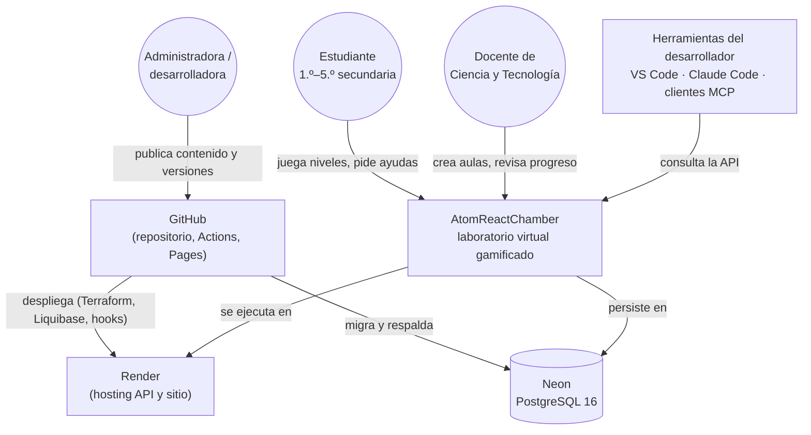

*Figura 1. Contexto de AtomReactChamber (C4 nivel 1).*

## 3.2 Diagrama de contenedores

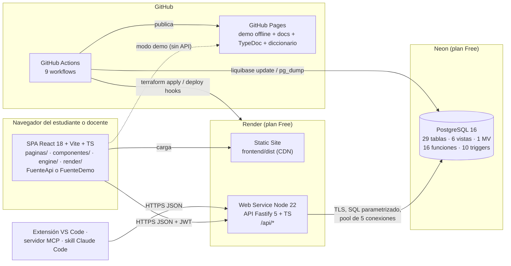

*Figura 2. Contenedores de AtomReactChamber (C4 nivel 2).*

# 4. Vista de casos de uso

Los casos de uso arquitectónicamente significativos —los que ejercitan más componentes y reglas— son:

| CU | Nombre | Por qué es significativo |
|---|---|---|
| CU-04 | Jugar nivel | Recorre motor de simulación, API, transacciones y casi todas las funciones de la BD. |
| CU-05 | Pedir ayuda a Quimi | Regla escalonada en la BD y búsqueda de texto completo. |
| CU-06 | Responder cuestionario | Corrección por *trigger*, no por el cliente. |
| CU-10/12 | Crear aula / ver progreso | Autorización por rol y por propiedad; funciones de ventana. |
| CU-13 | Ver dashboard | Vista materializada y telemetría de alto volumen. |
| CU-01/02 | Registrarse / iniciar sesión | Seguridad (bcrypt, JWT, *rate limit*). |

El diagrama y las especificaciones completas están en el FD03 §5.2.

# 5. Vista lógica

## 5.1 Capas del backend

La API sigue una arquitectura en capas con inyección de dependencias manual (contenedor `Servicios` en `app.ts`):

1. **Rutas** (`routes/index.ts`): declaran método, ruta, esquema (validación + OpenAPI), autenticación y rol.
2. **Servicios** (`services/`): casos de uso con reglas de autorización por propiedad (`IntentoService`,
   `AulaService`, `QuimiService`) y **autenticación** (`auth/AuthService`).
3. **Repositorios** (`repositories/`): lecturas que arman JSON en PostgreSQL (`json_agg`, `json_build_object`).
4. **Acceso a datos** (`db/Database`): *pool* `pg`, consultas parametrizadas y transacciones.
5. **Base de datos**: reglas de negocio en funciones y *triggers*.

Transversales: `config.ts` (configuración validada con zod, *fail fast*), `errors.ts` (`HttpError`,
`mapPgError`), `schemas.ts` (esquemas zod → JSON Schema) y los *plugins* de Fastify (Helmet, CORS, *rate limit*,
JWT, Swagger).

## 5.2 Diagrama de clases del backend

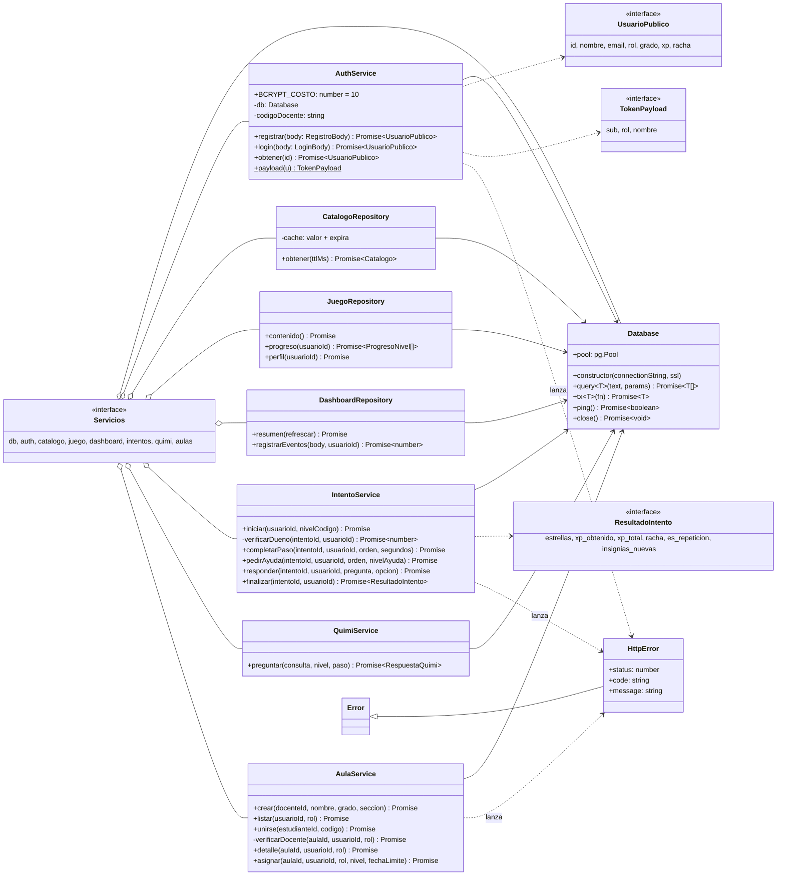

*Figura 3. Diagrama de clases del backend (`backend/src`).*

## 5.3 Modelo lógico del frontend

| Módulo | Responsabilidad | Dependencias |
|---|---|---|
| `engine/chemistry.ts` | Construye la química desde el catálogo (pares reactivos, ΔH, fases por Clausius-Clapeyron, energía del fotón). | Ninguna (TypeScript puro) |
| `engine/Simulation.ts` | Estado y avance de la simulación: partículas, colisiones, reacciones, fotólisis, efectos e instantáneas. Máximo 900 partículas. | `chemistry` |
| `engine/conditions.ts` | Evaluador del DSL de condiciones de pasos (`todas`/`alguna`, operadores, `durante`). | `chemistry`, `Simulation` (tipos) |
| `render/dibujar.ts` | Dibujo en Canvas 2D de la cámara, partículas, enlaces y efectos (chispa, fotones). | `engine` |
| `componentes/Camara.tsx` | Envuelve `Simulation` + `dibujar` en un `<canvas>` con bucle de animación; expone inyectar, chispa, vaciar y la instantánea. | `engine`, `render` |
| `componentes/Controles.tsx` | Deslizadores accesibles de T, P, V, UV y λ, inyector de especies y chispa, según los controles habilitados del nivel. | `engine` (tipos) |
| `componentes/TablaPeriodica.tsx` | Mapa de misiones con forma de tabla periódica: casillas bloqueadas, disponibles y completadas (con estrellas). | `data/tipos` |
| `componentes/Marco.tsx`, `ui.tsx` | Cabecera, navegación por rol, tema claro/oscuro, aviso de modo demo; piezas comunes (estrellas, avisos, insignias). | — |
| `paginas/` | `Inicio`, `Mapa`, `Nivel` (pasos, panel de Quimi, cuestionario y resultado), `Laboratorio`, `Perfil`, `Aula`, `Dashboard`, `Ingresar` (login, registro, accesos demo). Rutas con `HashRouter`. | `componentes`, `estado` |
| `estado/AppContext.tsx` | Estado global: fuente de datos, química construida, contenido del juego, usuario, progreso, servidor caído y paso a modo demo. | `data/fuente` |
| `estado/telemetria.ts` | Cola de eventos enviada por lotes cada 10 s o al ocultar la pestaña (UUID de sesión, sin datos personales). | `data/fuente` |
| `data/fuente.ts` | Interfaz `Fuente` con dos implementaciones: `FuenteApi` (REST + JWT en `localStorage`) y `FuenteDemo` (contenido incluido en el *bundle*, reglas de estrellas/XP/insignias replicadas y progreso en `localStorage`). | `fetch`, `localStorage` |

El motor no depende de React ni del DOM, por lo que se prueba con Vitest sin navegador.

# 6. Vista de procesos

## 6.1 Inicio de sesión con JWT

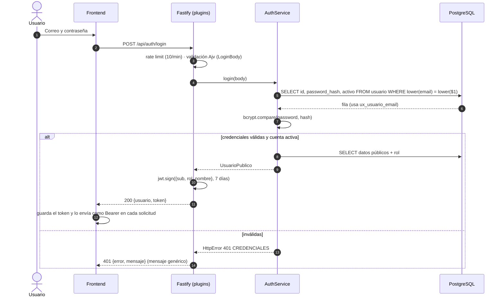

*Figura 4. Secuencia de inicio de sesión.*

## 6.2 Completar un nivel

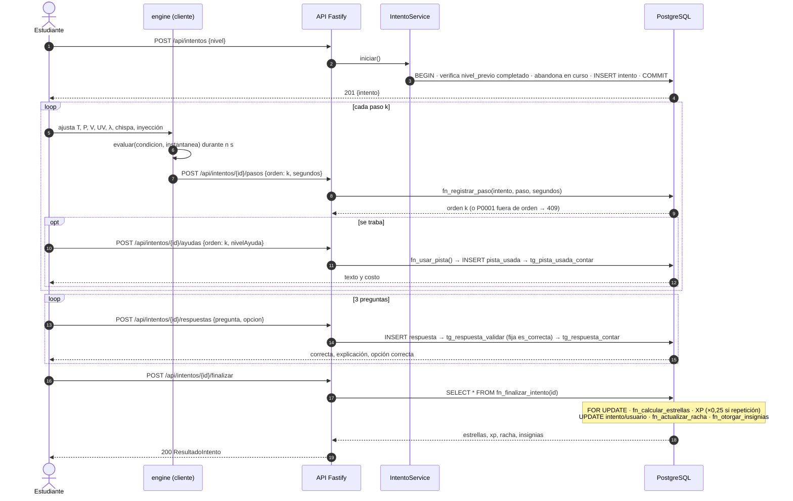

*Figura 5. Secuencia de un nivel completo, desde el inicio hasta `fn_finalizar_intento`.*

## 6.3 Telemetría de uso

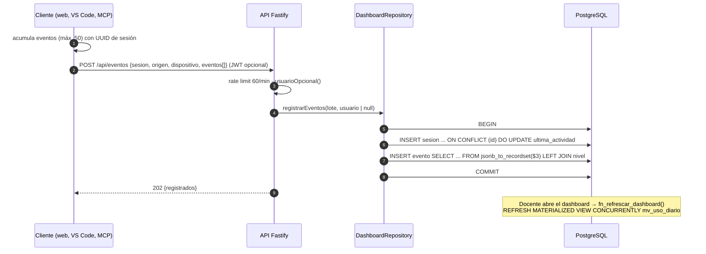

*Figura 6. Secuencia de registro de telemetría y refresco del tablero.*

## 6.4 Concurrencia y transacciones

- `fn_registrar_paso` y `fn_finalizar_intento` bloquean la fila del intento con `SELECT … FOR UPDATE`, de modo
  que dos solicitudes simultáneas del mismo intento se serializan (sin pasos duplicados ni doble XP).
- `fn_actualizar_racha` bloquea la fila del usuario.
- `IntentoService.iniciar` y `DashboardRepository.registrarEventos` usan `Database.tx` (BEGIN/COMMIT/ROLLBACK).
- `REFRESH MATERIALIZED VIEW CONCURRENTLY` no bloquea lecturas gracias al índice único `ux_mv_uso_diario_dia`.

# 7. Vista de implementación

## 7.1 Estructura del monorepo

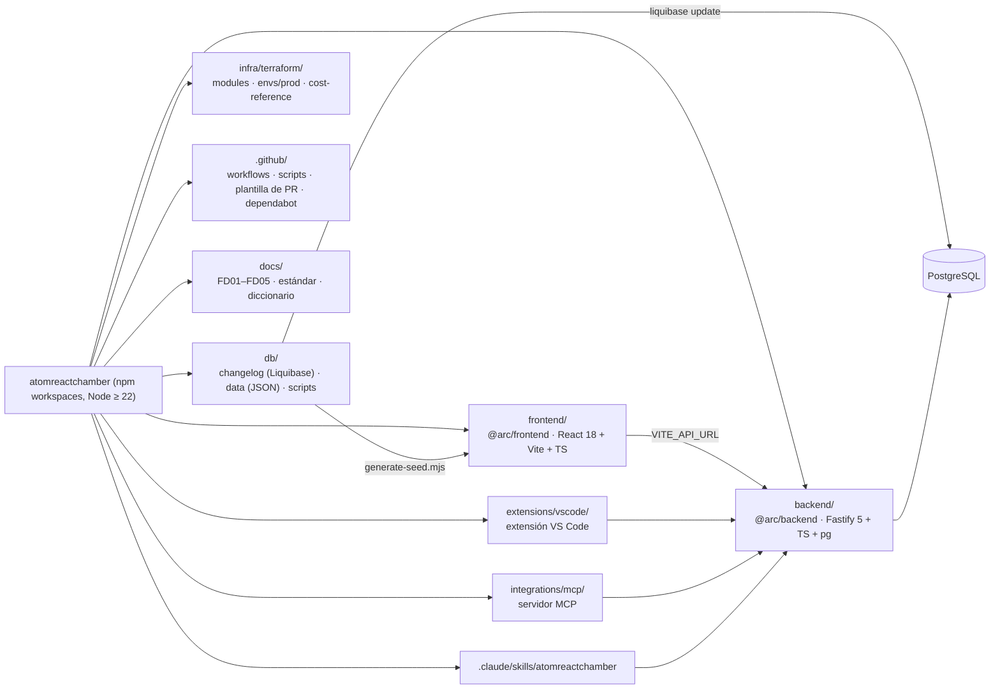

*Figura 7. Componentes del monorepo y sus dependencias.*

| Paquete / carpeta | Artefacto | Construcción | Pruebas |
|---|---|---|---|
| `frontend` | `frontend/dist` (sitio estático) | `npm run build -w frontend` | Vitest (`engine.test.ts`, 15 pruebas); Playwright + axe (`e2e/app.spec.ts`, 7 pruebas) |
| `backend` | `backend/dist/server.js` | `npm run build -w backend` (`tsc`) | Vitest + `app.inject` contra PostgreSQL (17 pruebas) |
| `db` | 13 archivos SQL, 48 *changesets* | `npm run seed:generate`; Liquibase | `db.yml`: `update`, `rollback`, re-`update` en BD efímera |
| `infra/terraform` | Recursos Neon y Render | `terraform plan/apply` (`infra.yml`) | `fmt`, `validate`, `tflint`; Infracost |
| `extensions/vscode` | `.vsix` | `npm run build -w extensions/vscode` | Vitest (19 pruebas) |
| `integrations/mcp` | Servidor MCP (stdio), 5 herramientas + recurso `arc://catalogo` | `npm run build -w integrations/mcp` | Vitest (12 pruebas) |
| `.claude/` | *Skill* `atomreactchamber` y subagente `tutor-quimi` | — | — |
| `docs` | Markdown, `.docx`, `.pdf`, sitio | `docs.yml`, `pages.yml` | — |

## 7.2 Orden de migraciones Liquibase

`db.changelog-master.yaml` incluye, en orden: `001-extensiones` → `002-seguridad` → `003-catalogo` →
`004-juego` → `005-progreso` → `006-telemetria` → `007-funciones` → `008-triggers` → `009-vistas` →
`010-indices-fk` → `900-semilla-catalogo` → `901-semilla-juego` → `902-datos-demo` (contexto `demo`). Las semillas 9xx se generan
desde `db/data/*.json` y son idempotentes (`ON CONFLICT … DO UPDATE`).

# 8. Vista de datos

## 8.1 Modelo entidad-relación

El modelo físico tiene **29 tablas** agrupadas en cinco áreas. Los diagramas se generaron desde el catálogo de
la base de datos migrada (columnas, PK, FK y UK reales); los tipos se abrevian (`varchar`, `int`, `text_arr` =
`text[]`).

**a) Catálogo químico**

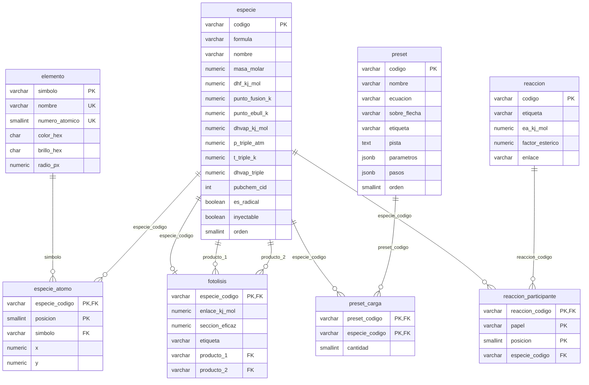

*Figura 8. ER del catálogo químico (003-catalogo.sql).*

**b) Contenido del juego**

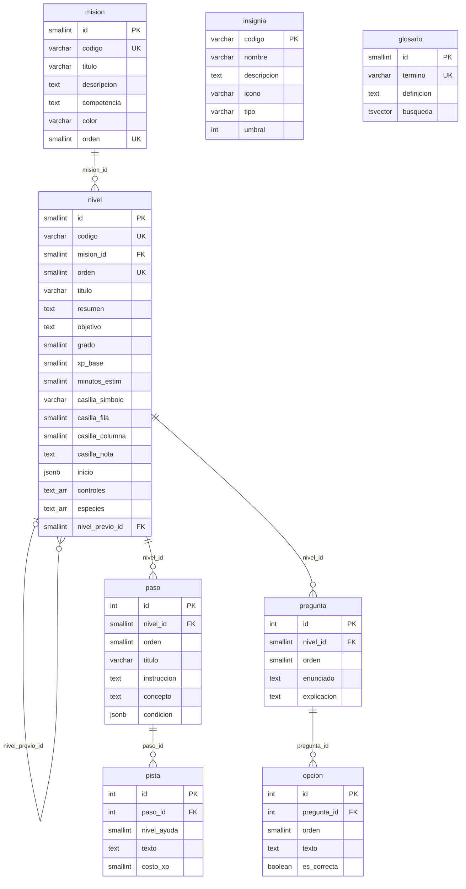

*Figura 9. ER del contenido del juego (004-juego.sql).*

**c) Seguridad, aulas y progreso**

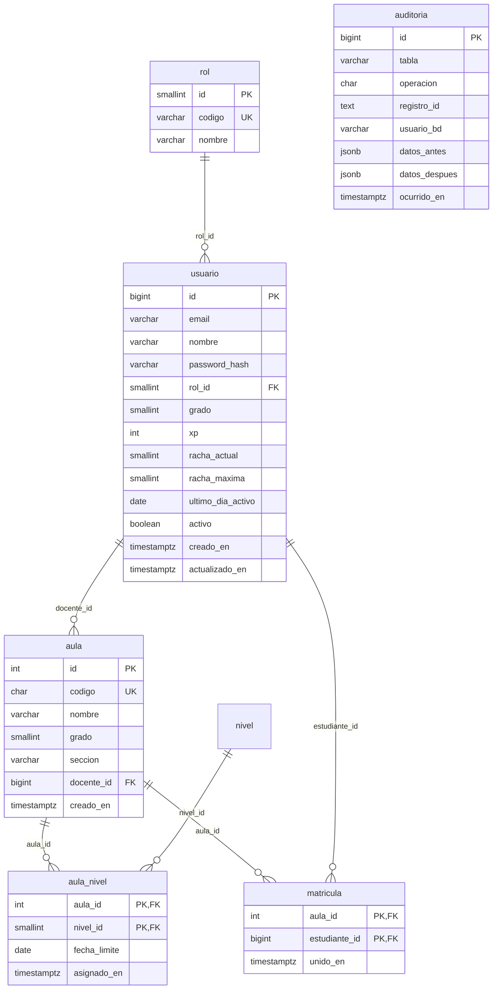

*Figura 10a. ER de seguridad y aulas (002-seguridad.sql, 005-progreso.sql).*

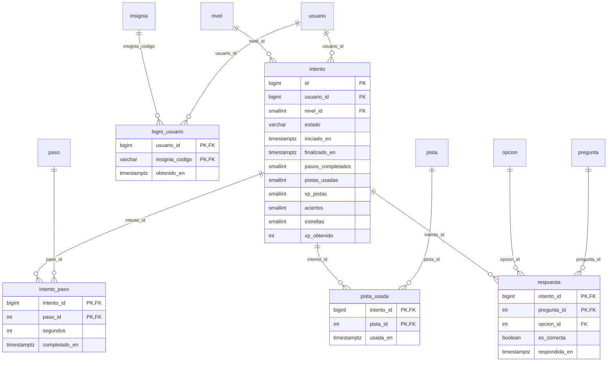

*Figura 10b. ER de intentos y logros (005-progreso.sql). Las entidades sin atributos se detallan en las figuras 9 y 10a.*

**d) Telemetría**

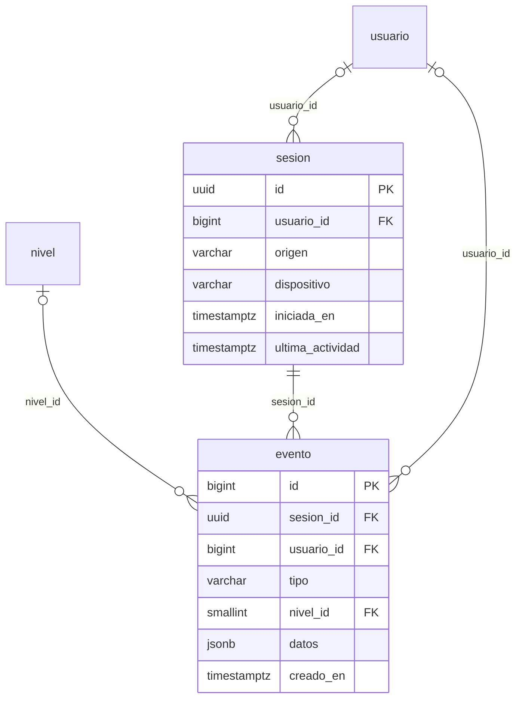

*Figura 11. ER de telemetría (006-telemetria.sql).*

## 8.2 Justificación de la normalización (3FN)

| Forma normal | Cómo se cumple | Ejemplos |
|---|---|---|
| 1FN | Atributos atómicos y claves definidas en todas las tablas. Las listas con significado propio se modelan como tablas: participantes de reacción, átomos de especie, carga de *presets*, opciones de pregunta. | `reaccion_participante` en lugar de una columna "reactivos"; `especie_atomo` en lugar de un arreglo de coordenadas. |
| 2FN | En las tablas con clave compuesta, todo atributo depende de la clave completa. | `intento_paso(intento_id, paso_id)` → `segundos`, `completado_en`; `matricula(aula_id, estudiante_id)` → `unido_en`; `aula_nivel(aula_id, nivel_id)` → `fecha_limite`. |
| 3FN | No hay dependencias transitivas: los datos de un objeto viven solo en su tabla y se referencian por clave. Los valores derivables no se guardan. | ΔH de reacción se calcula en `v_reaccion_entalpia` desde `especie.dhf_kj_mol`; el progreso y el ranking se calculan en `v_progreso_estudiante` y `v_ranking_aula`; el nombre del rol está solo en `rol`. |

**Excepciones deliberadas (desnormalización controlada):**

| Elemento | Motivo | Control |
|---|---|---|
| `intento.pasos_completados`, `pistas_usadas`, `xp_pistas`, `aciertos` | Contadores consultados en cada paso y en el cierre; evitan `count(*)` repetidos y permiten validar el orden en O(1). | Solo los modifican `fn_registrar_paso` y los *triggers* `tg_pista_usada_contar` y `tg_respuesta_contar`. |
| `usuario.xp`, `racha_actual`, `racha_maxima`, `ultimo_dia_activo` | Se leen en cada pantalla (perfil, ranking). | Solo los modifican `fn_finalizar_intento` y `fn_actualizar_racha`; `CHECK (racha_maxima >= racha_actual)`. |
| `nivel.controles`, `nivel.especies` (`text[]`), `nivel.inicio`, `paso.condicion`, `preset.parametros` (`jsonb`) | Configuración que el motor consume como unidad y no se consulta por partes. | `CHECK` de forma (`jsonb_exists`, `jsonb_typeof`). |
| `respuesta.es_correcta` | Conserva el resultado histórico aunque luego se corrija una alternativa. | Lo fija `tg_respuesta_validar`; el cliente no puede escribirlo. |
| `mv_uso_diario` | Agregado de 30 días costoso de recalcular en cada visita. | `fn_refrescar_dashboard()` con `REFRESH CONCURRENTLY`. |

## 8.3 Índices y su justificación

Además de las claves primarias y las restricciones únicas, la BD define estos índices (73 en total contando PK y
UQ; 30 declarados con `CREATE INDEX` en los *changesets*):

| Índice | Tabla (columnas) | Tipo | Justificación |
|---|---|---|---|
| `ux_usuario_email` | `usuario (lower(email))` | B-tree único **de expresión** | Correo único sin distinguir mayúsculas (RN-14) y búsqueda del *login* por `lower(email)`. |
| `ix_usuario_rol` | `usuario (rol_id)` | B-tree | FK; filtros por rol en vistas y tablero. |
| `ix_auditoria_tabla_fecha` | `auditoria (tabla, ocurrido_en DESC)` | B-tree compuesto | Consultar los últimos cambios de una tabla. |
| `ix_especie_atomo_simbolo`, `ix_participante_especie` | catálogo | B-tree | Índices de FK para `JOIN` y para validar borrados en tablas padre. |
| `ix_nivel_mision` | `nivel (mision_id)` | B-tree | FK; niveles por misión. |
| `ux_nivel_casilla` | `nivel (casilla_fila, casilla_columna)` | Único compuesto | Una casilla del mapa por nivel. |
| `ux_paso_nivel_orden`, `ux_pista_paso_nivel`, `ux_pregunta_nivel_orden`, `ux_opcion_pregunta_orden` | contenido | Únicos compuestos | Orden único dentro del padre; además cubren la FK por su primera columna y la búsqueda `WHERE nivel_id = $1 AND orden = $2`. |
| `ux_opcion_una_correcta` | `opcion (pregunta_id) WHERE es_correcta` | Único **parcial** | Garantiza a lo más una alternativa correcta por pregunta sin *trigger* adicional. |
| `ix_glosario_busqueda` | `glosario (busqueda)` | **GIN** | Búsqueda de texto completo de Quimi sobre el `tsvector` generado (término peso A, definición peso B, configuración `es_sin_tildes`). |
| `ix_aula_docente`, `ix_matricula_estudiante` | aulas | B-tree | "Mis aulas" del docente y del estudiante. |
| `ix_intento_usuario_nivel` | `intento (usuario_id, nivel_id)` | B-tree compuesto | Progreso por usuario y nivel; detección de repetición; desbloqueo. |
| `ix_intento_completado` | `intento (nivel_id, finalizado_en) WHERE estado = 'completado'` | B-tree **parcial** | Métricas por nivel y por día solo sobre intentos completados (índice más pequeño). |
| `ix_intento_paso_paso` | `intento_paso (paso_id)` | B-tree | `v_tiempo_por_paso` agrupa por paso. |
| `ix_respuesta_pregunta` | `respuesta (pregunta_id) WHERE NOT es_correcta` | B-tree **parcial** | `v_preguntas_dificiles` cuenta errores por pregunta. |
| `ix_sesion_inicio` | `sesion (iniciada_en)` | **BRIN** | Tabla de solo inserción ordenada en el tiempo: el BRIN ocupa unos pocos KB frente a un B-tree y sirve a los rangos por día de `mv_uso_diario`. |
| `ix_evento_creado` | `evento (creado_en)` | **BRIN** | Ídem para la tabla de mayor crecimiento. |
| `ix_evento_tipo_fecha` | `evento (tipo, creado_en)` | B-tree compuesto | Conteos por tipo de evento en un rango. |
| `ix_sesion_usuario` | `sesion (usuario_id)` | B-tree | Activos en 7 días; FK con `ON DELETE SET NULL`. |
| `ux_mv_uso_diario_dia` | `mv_uso_diario (dia)` | Único | Requisito de `REFRESH MATERIALIZED VIEW CONCURRENTLY`. |

**Índices de claves foráneas (`010-indices-fk.sql`).** La revisión con la regla `requireForeignKeyIndex` de
tbls detectó 11 FK sin índice; el *changeset* 010 los crea: `ix_evento_sesion`, `ix_evento_usuario` y
`ix_evento_nivel` (estos dos **parciales**, `WHERE … IS NOT NULL`, porque las columnas admiten nulos en uso
anónimo), `ix_aula_nivel_nivel`, `ix_pista_usada_pista`, `ix_respuesta_opcion`, `ix_logro_insignia`,
`ix_nivel_previo`, `ix_fotolisis_producto_1`, `ix_fotolisis_producto_2` e `ix_preset_carga_especie`. El más
importante es `ix_evento_sesion`: `sesion → evento` es `ON DELETE CASCADE` y, sin índice, borrar una sesión
recorría toda la tabla de eventos.

## 8.4 Vistas, vista materializada y funciones

| Objeto | Tipo | Uso |
|---|---|---|
| `v_reaccion_entalpia` | Vista | Ecuación legible y ΔH = ΣΔHf(productos) − ΣΔHf(reactivos); alimenta `GET /api/catalogo`. |
| `v_progreso_estudiante` | Vista (CTE) | Mejor puntaje por nivel, estrellas totales, insignias, última actividad. |
| `v_ranking_aula` | Vista (ventana) | `RANK() OVER (PARTITION BY aula_id ORDER BY xp DESC, estrellas_totales DESC)`. |
| `v_estadisticas_nivel` | Vista (`FILTER`) | Intentos, completados, tasa de completado, estrellas, pistas y minutos promedio (OS-2). |
| `v_tiempo_por_paso` | Vista (`percentile_cont`) | Promedio y mediana de segundos por paso (OS-4). |
| `v_preguntas_dificiles` | Vista | % de error por pregunta (OS-3). |
| `mv_uso_diario` | Vista materializada | Sesiones, usuarios activos, eventos, niveles completados y pistas de los últimos 30 días (`generate_series`). |
| `fn_calcular_estrellas`, `fn_registrar_paso`, `fn_usar_pista`, `fn_actualizar_racha`, `fn_otorgar_insignias`, `fn_finalizar_intento`, `fn_quimi_buscar`, `fn_generar_codigo_aula`, `fn_refrescar_dashboard` | 9 funciones de negocio | Ver FD03 §4.3 (RN-01 a RN-12). |
| `fn_tg_actualizado_en`, `fn_auditar`, `fn_tg_respuesta_validar`, `fn_tg_respuesta_contar`, `fn_tg_pista_usada_contar`, `fn_tg_aula_codigo`, `fn_tg_aula_docente` | 7 funciones de *trigger* | Usadas por 10 *triggers* `tg_*`. |

## 8.5 Respaldo y recuperación

`backup.yml` ejecuta diariamente `pg_dump` de la BD de producción, lo cifra con AES-256 (`gpg`, *secret*
`BACKUP_PASSPHRASE`), lo guarda como artefacto de GitHub Actions y lo **restaura con `pg_restore` en un PostgreSQL 16 efímero** para comparar conteos de filas (`row-counts.sql`,
`compare-counts.mjs`). Neon añade restauración a un punto en el tiempo dentro de la ventana del plan Free.

# 9. Vista de despliegue

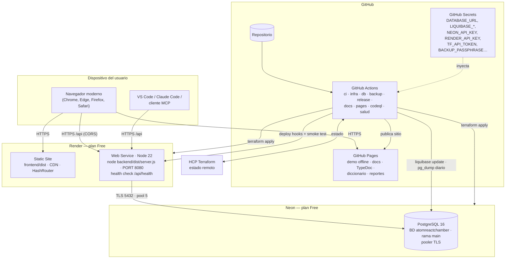

*Figura 12. Vista de despliegue en producción.*

| Nodo | Configuración | Variables |
|---|---|---|
| Render Web Service | Node 22; `npm ci && npm run build -w backend`; inicio `node backend/dist/server.js`; health check `/api/health`. | `DATABASE_URL`, `JWT_SECRET` (≥ 32), `CORS_ORIGIN`, `DOCENTE_CODIGO`, `PORT`, `NODE_ENV=production` |
| Render Static Site | `npm run build -w frontend` → `frontend/dist`; las rutas usan `HashRouter` (`/#/mapa`), por lo que no se necesitan reglas de reescritura. | `VITE_API_URL` |
| Neon | PostgreSQL 16, BD `atomreactchamber`, rol propietario de la aplicación; conexión TLS. | — |
| GitHub Pages | Sitio generado por `pages.yml`: demo (frontend con `VITE_API_URL` vacío), documentación, TypeDoc, diccionario (tbls) y reportes de pruebas. | — |

**Pipeline de entrega:** un *push* a `main` ejecuta `ci.yml` (tipos, *lint*, unitarias), `infra.yml`
(Terraform, pruebas con PostgreSQL de servicio, e2e, costos), `db.yml` (Liquibase en BD efímera y luego en
producción si existe el *secret*), `release.yml` (release-please con Conventional Commits, *build*, *deploy hooks*
y *smoke test*), `docs.yml` y `pages.yml`; además, `salud.yml` consulta `/api/health` cada 6 horas (OS-7) y
mantiene despierto el servicio gratuito. Todos los *workflows* terminan en verde aunque falten *secrets*: los
pasos de despliegue se omiten.

# 10. Seguridad

| Capa | Control | Implementación |
|---|---|---|
| Transporte | HTTPS/TLS extremo a extremo | Render y GitHub Pages con TLS; `Database` activa SSL automáticamente para hosts remotos (Neon). |
| Cabeceras | Helmet; CORS con lista de orígenes; solo `GET`, `POST`, `OPTIONS` | `app.ts` |
| Abuso | *Rate limit* global 300/min; `/auth/*` 10/min; `/eventos` 60/min | `@fastify/rate-limit` |
| Autenticación | bcrypt costo 10; JWT HS256, 7 días; mensaje genérico | `AuthService`, `@fastify/jwt` |
| Autorización | Roles (`requiereRol`) + propiedad (`verificarDueno`, `verificarDocente`) + *trigger* `tg_aula_docente` | Rutas, servicios y BD |
| Entrada | Esquemas zod → Ajv con `removeAdditional: 'all'`; consultas parametrizadas; `CHECK` en la BD | `schemas.ts`, `Database.query` |
| Integridad | Reglas de negocio en la BD; corrección por *trigger*; contenido público sin respuestas | `fn_*`, `tg_*`, `JuegoRepository` |
| Errores | Respuesta uniforme `{error, mensaje}`; los 500 no exponen detalles; mapeo de códigos de PostgreSQL | `errors.ts`, `setErrorHandler` |
| Registro | *Logs* JSON con `authorization` y `password` redactados | `logger.redact` |
| Auditoría | Cambios en `usuario`, `aula`, `nivel`, `paso` en `auditoria`, sin `password_hash` | `fn_auditar` |
| Secretos | Solo en GitHub Secrets y en Render; `JWT_SECRET` lo genera Render (`generate_value` en Terraform) y la API exige ≥ 32 caracteres al iniciar | `config.ts`, `modules/app-render` |
| Cadena de suministro | Dependabot; CodeQL semanal y en cada PR | `.github/` |
| Privacidad | Minimización (sin DNI ni fotos), telemetría anónima posible, ranking solo para el docente del aula | Esquema y rutas |

# 11. Calidad

## 11.1 Atributos de calidad

| Atributo | Táctica arquitectónica |
|---|---|
| Rendimiento | Simulación en el cliente; catálogo en caché (memoria 5 min + `Cache-Control`); JSON armado en PostgreSQL (una ida y vuelta por colección); índices parciales y BRIN; vista materializada. |
| Disponibilidad | Modo demo *offline-first*; health check; *smoke test* tras despliegue; respaldos diarios con restauración probada. |
| Seguridad | Defensa en profundidad (sección 10). |
| Mantenibilidad | Capas explícitas; TypeScript `strict`; TSDoc + TypeDoc; un solo contrato zod; contenido como datos; Liquibase con *rollback*. |
| Portabilidad | Terraform modular; PostgreSQL estándar; Node sin dependencias nativas (`bcryptjs`). |
| Usabilidad y accesibilidad | Pasos breves, ayudas graduadas, retroalimentación inmediata; WCAG 2.2 AA como criterio de diseño (FD03 RNF-09). |
| Verificabilidad | 70 pruebas: integración contra BD real (17), motor puro sin navegador (15, con *solver* de los 9 niveles), e2e + axe en modo demo (7), VS Code (19) y MCP (12). |

## 11.2 Escenarios de atributos de calidad

| ID | Atributo | Fuente | Estímulo | Entorno | Respuesta | Medida |
|---|---|---|---|---|---|---|
| EC-01 | Rendimiento | Estudiante | Ejecuta la cadena fotoquímica H₂ + Cl₂ con muchas partículas | Laptop de 4 GB, Chrome | El motor limita a 900 partículas y mantiene la animación | ≥ 30 FPS |
| EC-02 | Rendimiento | 30 estudiantes de un aula | Inician el mismo nivel a la vez | API activa en Render Free, Neon Free | Cada solicitud usa el *pool* de 5 conexiones; las reglas corren en la BD | p95 < 500 ms; 0 errores 5xx |
| EC-03 | Disponibilidad | Docente | Abre la plataforma a las 08:00 tras una noche sin tráfico | API suspendida (plan Free) | La SPA carga desde el CDN, muestra "despertando servidor" y ofrece modo demo | Primera respuesta de la API ≤ 60 s; la clase puede empezar en modo demo de inmediato |
| EC-04 | Integridad | Estudiante técnico | Envía `es_correcta: true` o una opción de otra pregunta | Producción | Ajv descarta el campo; el *trigger* fija la corrección o rechaza la opción | 0 respuestas mal calificadas |
| EC-05 | Integridad | Dos pestañas del mismo estudiante | Finalizan el mismo intento a la vez | Producción | `FOR UPDATE` serializa; la segunda recibe "el intento ya terminó" | XP sumada una sola vez |
| EC-06 | Seguridad | Atacante | Prueba contraseñas por fuerza bruta en `/api/auth/login` | Internet | *Rate limit* de 10/min por IP; mensaje genérico | ≤ 10 intentos/min; sin enumeración de correos |
| EC-07 | Seguridad | Estudiante | Pide `GET /api/aulas/{id}` de su aula | Producción | `requiereRol('docente','admin')` | 403 |
| EC-08 | Mantenibilidad | Desarrolladora | Agrega una columna a `intento` | Repositorio | Nuevo *changeset* con *rollback*; `db.yml` aplica, revierte y reaplica en BD efímera; el diccionario se regenera | Cambio en producción en < 1 día sin edición manual de la BD |
| EC-09 | Mantenibilidad | Docente validador | Corrige el texto de una pista | Repositorio | Edita `db/data/juego.json` → `seed:generate` → PR → `runOnChange` | Contenido actualizado en BD y demo en el mismo despliegue |
| EC-10 | Portabilidad | UPT / IE | Decide migrar a AWS | Infraestructura | Se reutilizan los módulos y la referencia de costos de Infracost | Estimación de costo disponible en cada PR |
| EC-11 | Recuperabilidad | Error humano | Se borran datos de producción | Producción | Restauración desde el último `pg_dump` verificado o *point-in-time* de Neon | Pérdida máxima de 24 h (RPO); restauración < 1 h (RTO) |

# Conclusiones

1. La arquitectura en capas con reglas de negocio en PostgreSQL garantiza que estrellas, XP, ayudas, rachas,
   insignias y corrección se apliquen igual desde la web, VS Code o MCP, y concentra en la base de datos el valor
   académico del curso.
2. Las decisiones de costo cero (Neon, Render, GitHub Pages) se compensan con tácticas explícitas: modo demo
   *offline-first* frente al *cold start*, *pool* reducido, índices BRIN y vista materializada.
3. El modelo de datos está en 3FN con desnormalizaciones controladas y documentadas, todas mantenidas solo por
   funciones y *triggers*.
4. La infraestructura como código y los *workflows* hacen reproducible el sistema completo y permiten migrar a una
   nube de pago con costos estimados de antemano.

# Recomendaciones

1. *(Hecho en `010-indices-fk.sql`.)* Mantener la regla de tbls `requireForeignKeyIndex` en CI para que toda FK
   nueva tenga índice.
2. Registrar con `COMMENT ON` las descripciones de columnas y funciones que hoy solo están en el diccionario
   (marcadas con †), porque Liquibase elimina los comentarios del cuerpo de las funciones.
3. Reducir la vigencia del JWT e introducir *refresh tokens* para que la desactivación de una cuenta tenga efecto
   inmediato.
4. Añadir Lighthouse CI y cobertura (el monitoreo de `/api/health` ya existe en `salud.yml` y la accesibilidad
   se verifica con axe en Playwright).
5. Particionar `evento` por mes si la telemetría supera el millón de filas.

# Bibliografía

Bass, L., Clements, P., & Kazman, R. (2021). *Software architecture in practice* (4.ª ed.). Addison-Wesley.

Kruchten, P. (1995). Architectural blueprints—The "4+1" view model of software architecture. *IEEE Software, 12*(6), 42–50. https://doi.org/10.1109/52.469759

ISO/IEC/IEEE. (2022). *ISO/IEC/IEEE 42010:2022 Software, systems and enterprise — Architecture description*. https://www.iso.org/standard/74393.html

# Webgrafía

Brown, S. (s. f.). *The C4 model for visualising software architecture*. https://c4model.com/

Fastify. (s. f.). *Fastify documentation*. https://fastify.dev/docs/latest/

Liquibase. (s. f.). *Liquibase formatted SQL*. https://docs.liquibase.com/concepts/changelogs/sql-format.html

Neon. (2026). *Free plan limits and quotas*. https://neon.com/faqs/free-plan-limits-and-quotas

Nygard, M. (2011). *Documenting architecture decisions*. https://cognitect.com/blog/2011/11/15/documenting-architecture-decisions

OWASP Foundation. (2025). *OWASP Top Ten web application security risks*. https://owasp.org/www-project-top-ten/

PostgreSQL Global Development Group. (2024). *PostgreSQL 16 documentation: Index types*. https://www.postgresql.org/docs/16/indexes-types.html

Render. (s. f.). *Deploy for free*. https://render.com/docs/free
