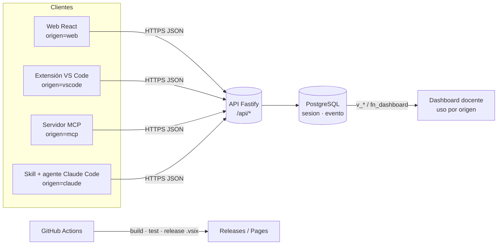

# Integraciones de AtomReactChamber

> Reto de integraciones · Base de Datos II · UPT Tacna — Adriana Rafaela Laos González (2023077474)

AtomReactChamber no vive solo en el navegador: la misma **API REST** (Fastify + PostgreSQL, contrato en
[`backend/src/routes/index.ts`](../backend/src/routes/index.ts)) alimenta a un editor de código, a agentes
de IA y a la automatización de GitHub. Todas las integraciones son **clientes delgados**: no duplican
datos ni reglas, solo consumen endpoints públicos o autenticados con JWT. Cada una se identifica con un
valor de `origen` al registrar telemetría, de modo que el dashboard docente mide su uso real.



## Resumen

| # | Integración | Ubicación | Tecnología | Endpoints que consume | `origen` | Estado |
|---|---|---|---|---|---|---|
| 1 | **Extensión de VS Code** | [`extensions/vscode`](../extensions/vscode) | TypeScript, API de extensiones ^1.90, esbuild | `/health`, `/catalogo`, `/juego`, `/quimi`, `/auth/login`, `/perfil`, `/progreso`, `/eventos` | `vscode` | ✅ `.vsix` |
| 2 | **Servidor MCP** | [`integrations/mcp`](../integrations/mcp) | `@modelcontextprotocol/sdk` 1.32 (stdio), zod | `/catalogo`, `/juego`, `/quimi`, `/dashboard`, `/eventos` | `mcp` | ✅ |
| 3 | **Skill de Claude Code + subagente** | [`.claude/skills/atomreactchamber`](../.claude/skills/atomreactchamber/SKILL.md), [`.claude/agents/tutor-quimi.md`](../.claude/agents/tutor-quimi.md) | Bash + curl + Node (formato) | `/health`, `/catalogo`, `/juego`, `/quimi`, `/auth/login`, `/dashboard`, `/eventos` | `claude` | ✅ |
| 4 | **GitHub Actions / Pages / Releases** | [`.github/workflows`](../.github/workflows) | CI, release-please, Pages | Construye y prueba todo; publica el `.vsix`, los zips y la documentación | — | ✅ |
| — | Web (referencia) | [`frontend`](../frontend) | React 18 + Vite | Todos | `web` | ✅ |

---

## 1. Extensión de VS Code — `atomreactchamber-vscode`

Lleva el laboratorio al editor que el docente y los estudiantes de computación ya usan.

**Funciones**

| Función | Cómo usa la API |
|---|---|
| Vista **Misiones** (misión → nivel → pasos, con grado, XP, minutos y estrellas) | `GET /api/juego` + `GET /api/progreso` (si hay sesión) |
| Vista **Catálogo** (especies con fórmula y ΔHf; reacciones con ecuación, ΔH y exo/endo) | `GET /api/catalogo` |
| **Preguntar a Quimi** (caja de texto → webview con términos del glosario) | `GET /api/quimi?q=` |
| **Ver ficha de especie** (propiedades + enlace a PubChem `https://pubchem.ncbi.nlm.nih.gov/compound/<cid>`) | `GET /api/catalogo` |
| **Explicar reacción** (ecuación, Eₐ, ΔH, tipo y perfil de energía dibujado en SVG) | `GET /api/catalogo` |
| **Iniciar sesión** (JWT guardado en `SecretStorage`) · **Mi progreso** (XP, racha, estrellas, insignias) | `POST /api/auth/login`, `GET /api/perfil` |
| **Abrir laboratorio** | abre `atomreactchamber.webUrl` |
| Barra de estado: estado de la API y XP | `GET /api/health` cada 60 s + `/api/perfil` |

**Seguridad**: los webviews usan CSP `default-src 'none'; script-src 'none'; style-src 'nonce-…'` y todo dato
se escapa con `escapeHtml`. El token nunca se escribe en `settings.json`.

**Instalación y uso**

```bash
npm install && npm run build -w extensions/vscode && npm test -w extensions/vscode
cd extensions/vscode && npx --yes @vscode/vsce package --no-dependencies   # → atomreactchamber-vscode-2.0.0.vsix
code --install-extension atomreactchamber-vscode-2.0.0.vsix
```

En VS Code: ajusta `atomreactchamber.apiUrl` (p. ej. `https://atomreactchamber-api.onrender.com`), abre el
ícono del átomo en la barra de actividades y ejecuta `AtomReactChamber: Iniciar sesión` con
`estudiante@demo.arc.pe` / `quimica2026`.

| Captura | Descripción |
|---|---|
|  | Vista Misiones con estrellas y XP |
|  | Webview «Explicar reacción» con perfil de energía |
|  | Barra de estado y respuesta de Quimi |

## 2. Servidor MCP — `@arc/mcp`

Expone la API como herramientas para cualquier agente compatible con
[Model Context Protocol](https://modelcontextprotocol.io) (Claude Code, Claude Desktop, MCP Inspector).

| Herramienta / recurso | Endpoint | Descripción |
|---|---|---|
| `buscar_especie` | `GET /api/catalogo` | Ficha por fórmula (`H2O`/`H₂O`), código o nombre, con PubChem |
| `explicar_reaccion` | `GET /api/catalogo` | Ecuación, Eₐ, ΔH, tipo y perfil de energía en texto |
| `listar_niveles` | `GET /api/juego` | Misiones y niveles, filtros por grado y misión |
| `preguntar_quimi` | `GET /api/quimi` | Glosario con búsqueda de texto completo |
| `resumen_dashboard` | `GET /api/dashboard` | KPIs y uso por `origen` (requiere `ARC_TOKEN` docente) |
| recurso `arc://catalogo` | `GET /api/catalogo` | Catálogo completo en JSON |

**Instalación y uso**

```bash
npm run build -w integrations/mcp
claude mcp add atomreactchamber -e ARC_API_URL=http://localhost:8080 -- node integrations/mcp/dist/index.js
```

o bien el archivo de proyecto [`.mcp.json`](../.mcp.json) (incluido), que lee `ARC_API_URL` y `ARC_TOKEN` del
entorno. Dentro de Claude Code, `/mcp` muestra el estado y basta pedir: *«Explícame la combustión del
carbono con su perfil de energía»*. Detalles en [`integrations/mcp/README.md`](../integrations/mcp/README.md).


## 3. Skill de Claude Code + subagente `tutor-quimi`

- **Skill** [`atomreactchamber`](../.claude/skills/atomreactchamber/SKILL.md): Claude la carga
  automáticamente cuando la conversación trata de química escolar o del juego. Ejecuta
  [`scripts/arc.sh`](../.claude/skills/atomreactchamber/scripts/arc.sh), que usa **curl** para la API y
  **Node** solo para dar formato legible (sin `jq`).

  ```bash
  .claude/skills/atomreactchamber/scripts/arc.sh reaccion "H2 + O2"
  .claude/skills/atomreactchamber/scripts/arc.sh especie "cloruro de sodio"
  .claude/skills/atomreactchamber/scripts/arc.sh niveles 3 --detalle
  .claude/skills/atomreactchamber/scripts/arc.sh quimi "¿qué es un mol?"
  ARC_EMAIL=docente@demo.arc.pe ARC_PASSWORD=quimica2026 .claude/skills/atomreactchamber/scripts/arc.sh dashboard
  ```

- **Subagente** [`tutor-quimi`](../.claude/agents/tutor-quimi.md): tutor para 1.º–5.º de secundaria que
  explica en tres capas (idea → partículas → dato del laboratorio), da pistas escalonadas como el juego,
  no revela respuestas del cuestionario y usa las herramientas MCP o, si no están, la skill.
  Se invoca con *«usa el agente tutor-quimi para explicarle a un alumno de 3.º la energía de activación»*.


## 4. GitHub Actions, Pages y Releases

| Workflow | Qué hace con las integraciones |
|---|---|
| [`ci.yml`](../.github/workflows/ci.yml) | `npm run typecheck/lint/test` en todos los workspaces (incluye `extensions/vscode` e `integrations/mcp`) |
| [`release.yml`](../.github/workflows/release.yml) | release-please + empaqueta `atomreactchamber-vscode-<versión>.vsix` (`vsce` ejecuta `vscode:prepublish` → build) y lo adjunta al GitHub Release con `SHA256SUMS.txt` |
| [`pages.yml`](../.github/workflows/pages.yml) | Publica la documentación (TypeDoc, BD, reportes) y la demo en GitHub Pages; esta página incluida |
| [`docs.yml`](../.github/workflows/docs.yml) | Regenera README y diagramas |

Ver también [`docs/automatizaciones.md`](automatizaciones.md).

---

## Telemetría por integración (`origen`)

Todas las integraciones envían eventos a `POST /api/eventos` con el mismo esquema
(`backend/src/schemas.ts › EventosBody`):

```json
{
  "sesion": "3f0c…-uuid-v4",
  "origen": "vscode",
  "dispositivo": "escritorio",
  "eventos": [{ "tipo": "quimi_consulta", "datos": { "terminos": 2 } }]
}
```

| Integración | `origen` | Sesión | Eventos que envía | Cómo desactivarlo |
|---|---|---|---|---|
| Web | `web` | una por pestaña | todos los del juego | — |
| VS Code | `vscode` | una por ventana (`crypto.randomUUID`) | `pagina_vista` (ficha, progreso, laboratorio), `quimi_consulta`, `reaccion_observada` | `atomreactchamber.telemetria: false` o telemetría global de VS Code apagada |
| MCP | `mcp` | una por proceso del servidor | `pagina_vista` (`mcp:<herramienta>`), `quimi_consulta`, `reaccion_observada` | `ARC_TELEMETRIA=0` |
| Claude Code (skill) | `claude` | una por usuario y día | `pagina_vista` (`claude:<comando>`), `quimi_consulta`, `reaccion_observada` | `ARC_TELEMETRIA=0` |

En la base de datos, la tabla `sesion` guarda `origen` con un `CHECK (origen IN ('web','vscode','claude','mcp'))`
([`006-telemetria.sql`](../db/changelog/sql/006-telemetria.sql)) y `evento` cuelga de la sesión. El
dashboard (`GET /api/dashboard`, `DashboardRepository`) agrupa:

```sql
SELECT origen, count(*)::int AS sesiones FROM sesion GROUP BY origen ORDER BY 2 DESC;
```

Así el docente ve, junto a los KPIs pedagógicos, **qué canal usan sus estudiantes** (por ejemplo, web 73 %,
VS Code 14 %, Claude 12 %, MCP 1 % en los datos de demostración) y puede decidir dónde invertir. El
`resumen_dashboard` del MCP y `arc.sh dashboard` muestran esa misma distribución.

**Privacidad**: el UUID de sesión lo genera el cliente; no se envía código, archivos ni texto personal
fuera de la consulta a Quimi. Si el usuario inició sesión, la API asocia el evento a su `usuario_id`
(`usuarioOpcional`); si no, el registro es anónimo.

## Verificación realizada

| Prueba | Resultado |
|---|---|
| `npm run build -w extensions/vscode` · `npm test -w extensions/vscode` | ✅ bundle 34 KB · 19 pruebas (formato, SVG del perfil de energía, CSP/escape de vistas) |
| `npx @vscode/vsce package --no-dependencies` | ✅ `atomreactchamber-vscode-2.0.0.vsix` (≈18 KB) |
| `npm run build -w integrations/mcp` · `npm test -w integrations/mcp` | ✅ 12 pruebas (lógica + servidor MCP en memoria con fetch simulado) |
| Servidor MCP por stdio contra la API local (5 herramientas + recurso) | ✅ |
| `arc.sh` contra la API local (salud, especie, reacción, niveles, quimi, dashboard, errores 400/401/403) | ✅ |
