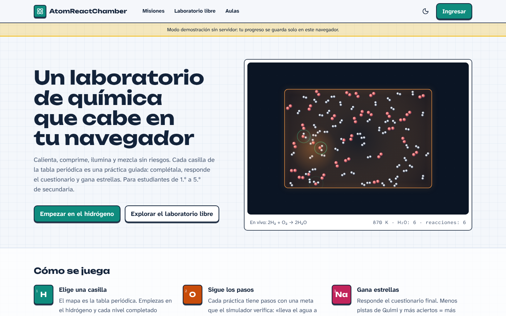
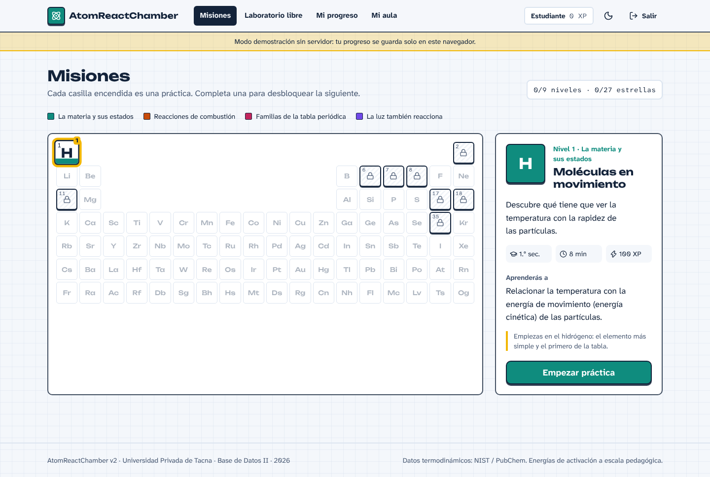
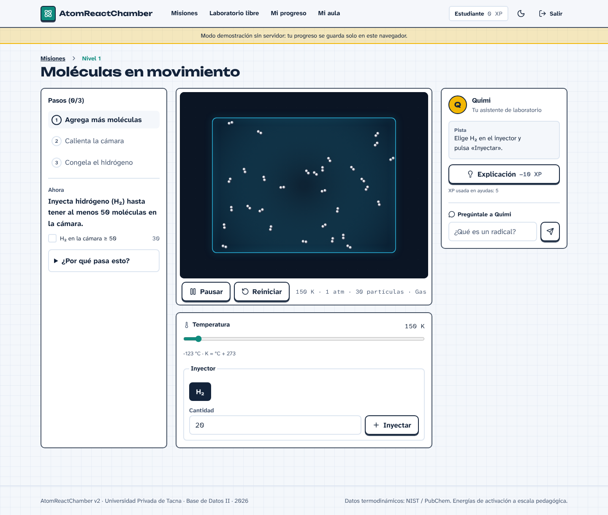
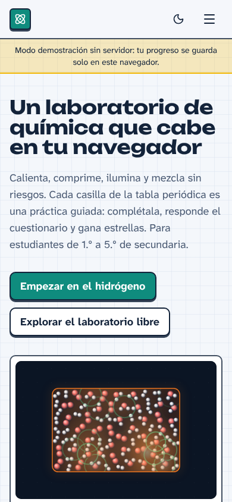
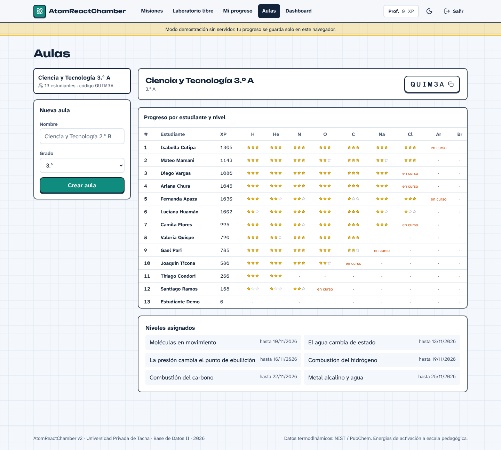
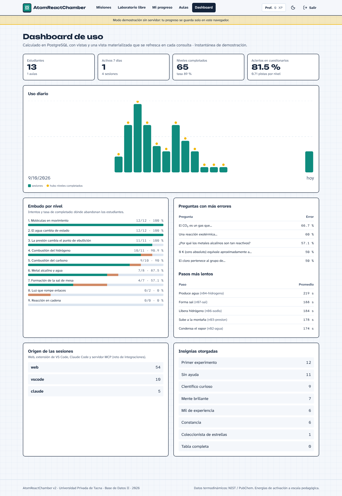

# Control de versiones

| Versión | Hecha por | Revisada por | Aprobada por | Fecha | Motivo |
|---|---|---|---|---|---|
| 1.0 | Adriana Laos | Ing. Patrick Cuadros Quiroga (pendiente) | (pendiente) | 2026-11-07 | Primera versión para estudiantes y docentes |

---

# 1. Introducción

**AtomReactChamber** es un laboratorio virtual de química para estudiantes de 1.º a 5.º de secundaria. La tabla
periódica es el mapa del juego: cada casilla encendida es una práctica guiada. Completas los pasos en un
simulador de moléculas, respondes un cuestionario corto y ganas estrellas, experiencia (XP) e insignias. Tu
docente puede crear un aula y ver cómo avanza cada estudiante.

Este manual tiene dos partes: **para estudiantes** (sección 3) y **para docentes** (sección 4).

## 1.1 Requisitos

| Necesitas | Detalle |
|---|---|
| Un navegador actualizado | Chrome, Edge, Firefox o Safari, en computadora, laptop o celular |
| Conexión a internet | Para guardar tu progreso en el servidor. Sin conexión puedes usar el **modo demostración** |
| Cuenta | Correo y contraseña (mínimo 8 caracteres). Los docentes necesitan además un **código de docente** que entrega la institución |

No hay que instalar nada.

> **Importante para estudiantes menores de 14 años:** antes de crear tu cuenta, tu docente debe contar con la
> autorización firmada de tu madre, padre o apoderado. Usa un **alias** (apodo) en el campo *Nombre* si no
> quieres mostrar tu nombre completo.

## 1.2 Partes de la pantalla

{width=15cm}

*Figura 1. Portada: el laboratorio en vivo y los botones para empezar.*

| Zona | Para qué sirve |
|---|---|
| Barra superior | **Misiones** (mapa), **Laboratorio libre**, **Mi progreso**, **Mi aula** (o **Aulas** y **Dashboard** si eres docente), tu nombre y XP, botón de tema claro/oscuro (luna) y **Salir** |
| Franja amarilla | Aparece en modo demostración: tu progreso se guarda solo en ese navegador |
| Franja de aviso | "El servidor gratuito está despertando": espera hasta un minuto o pulsa **Usar modo demostración** |

Toda la aplicación se puede usar con el teclado: **Tab** para avanzar, **Mayús + Tab** para retroceder y
**Enter** o **Espacio** para pulsar botones.

# 2. Ingresar

1. En la barra superior, pulsa **Ingresar**.
2. Elige **Ingresar** si ya tienes cuenta, o **Crear cuenta** si es la primera vez.
3. Para crear una cuenta escribe tu nombre (o alias), correo y contraseña; elige **Estudiante** y tu grado.
   Si eres docente, elige **Docente** y escribe el *Código de docente* que te dio la institución.
4. Pulsa **Crear cuenta** (o **Ingresar**). Entrarás directamente al mapa de misiones.

**Para probar sin registrarte**, en la misma página están los botones **Entrar como estudiante** y **Entrar
como docente** (cuentas de demostración; contraseña `quimica2026`).

| Mensaje | Qué significa | Qué hacer |
|---|---|---|
| "Correo o contraseña incorrectos" | Los datos no coinciden | Revisa mayúsculas y vuelve a intentar |
| "Ya existe un registro con esos datos" | Ese correo ya tiene cuenta | Usa **Ingresar** |
| "Código de docente incorrecto" | El código no es válido | Pide el código correcto a la institución |
| "Inicia sesión para continuar" | Tu sesión venció (dura 7 días) | Vuelve a ingresar |

# 3. Guía para estudiantes

## 3.1 Unirte al aula de tu docente

1. Pulsa **Mi aula**.
2. Escribe el código de 6 letras y números que te dio tu docente (por ejemplo, `QUIM3A`).
3. Pulsa **Unirme**. Desde ese momento tu docente verá tu avance.

## 3.2 El mapa de misiones

{width=15cm}

*Figura 2. Mapa de misiones con forma de tabla periódica.*

- Cada **casilla de color** es una práctica. El color indica la misión: verde (*La materia y sus estados*),
  naranja (*Reacciones de combustión*), rojo (*Familias de la tabla periódica*) y morado (*La luz también
  reacciona*).
- Las casillas con **candado** están bloqueadas: se abren al completar el nivel anterior. Empiezas en el
  hidrógeno (H).
- Arriba a la derecha ves cuántos niveles y estrellas llevas (por ejemplo, `0/9 niveles · 0/27 estrellas`).
- Al elegir una casilla, el panel de la derecha muestra el título, el grado, los minutos estimados, la XP y lo
  que aprenderás. Pulsa **Empezar práctica**.

## 3.3 Jugar un nivel

{width=15cm}

*Figura 3. Un nivel: pasos a la izquierda, simulador al centro, Quimi a la derecha y controles abajo.*

1. **Lee el paso actual** en el panel izquierdo (*Ahora*). Debajo verás la meta que vigila el simulador (por
   ejemplo, "H₂ en la cámara ≥ 50") y cuánto llevas.
2. **Usa los controles** de la parte inferior. Según el nivel tendrás:
   - **Temperatura** (K), **Presión** (atm) y **Volumen** (L), con deslizadores;
   - **Luz UV** y **longitud de onda λ** (nm);
   - **Inyector**: elige la sustancia, escribe la cantidad y pulsa **Inyectar**;
   - **Chispa**: da energía para iniciar una reacción.
3. **Observa la cámara**: las moléculas se mueven más rápido con más temperatura, cambian de estado, chocan y
   reaccionan. Debajo de la cámara se muestran la temperatura, la presión, el número de partículas y la fase.
   Puedes **Pausar** o **Reiniciar**.
4. Cuando la meta se cumple, el paso se marca y pasa al siguiente. Abre **¿Por qué pasa esto?** para leer la
   explicación científica.
5. Al terminar todos los pasos aparece el **cuestionario**.

## 3.4 Pedir ayuda a Quimi

Quimi es tu asistente de laboratorio (panel derecho).

| Ayuda | Qué te da | Costo |
|---|---|---|
| **Pista** | Una idea para empezar | 5 XP |
| **Explicación** | Lo que está pasando y qué control usar (resta 1 estrella) | 10 XP |
| **Solución** | El valor exacto que necesitas (resta 1 estrella más) | 20 XP |

- Las ayudas se abren en orden: primero la pista, luego la explicación y al final la solución.
- Solo pagas la primera vez que abres cada ayuda en un intento.
- En **Pregúntale a Quimi** puedes escribir una pregunta como "¿qué es un radical?" o "energía de activación";
  Quimi busca en su glosario (no importa si escribes sin tildes).

## 3.5 Cuestionario y resultado

1. Responde cada pregunta eligiendo una alternativa. Verás al instante si acertaste y una explicación.
2. Pulsa **Siguiente pregunta** y, al final, **Ver resultado**.
3. El resultado muestra tus **estrellas**, la **XP** ganada, tu **racha** y las **insignias** nuevas. Elige
   **Siguiente nivel** o **Volver al mapa**.

**Cómo se calculan las estrellas:** empiezas con 3; pierdes 1 si abriste una explicación, 1 más si abriste la
solución y 1 si acertaste menos de 2 de cada 3 preguntas. Siempre obtienes al menos 1 estrella al completar.

**XP:** XP base del nivel según tus estrellas + 10 XP por respuesta correcta − XP gastada en ayudas. Si repites un
nivel que ya completaste, ganas el 25 % de esa XP.

**Racha:** días seguidos en los que completaste al menos un nivel.

## 3.6 Mi progreso

En **Mi progreso** ves tu XP, tu racha actual y la mejor, niveles completados, estrellas totales, las
**insignias** obtenidas (por ejemplo, *Primer experimento*, *Sin ayuda*, *Constancia* —racha de 3 días— o *Mente brillante*) y el historial de
tus últimos intentos.

## 3.7 Laboratorio libre

En **Laboratorio libre** puedes experimentar sin pasos ni puntos: carga uno de los **experimentos** (combustión
del hidrógeno, reacción álcali–agua, síntesis de agua con luz UV o cadena fotoquímica H₂ + Cl₂), cambia los
controles, inyecta sustancias y mira la **composición** y la **consola de eventos** con las reacciones que
ocurren.

## 3.8 Uso en celular

{width=5cm}

*Figura 4. La aplicación se adapta a pantallas pequeñas (primera pantalla en un celular); el menú se abre con el botón ☰.*

# 4. Guía para docentes

## 4.1 Crear un aula

1. Ingresa con tu cuenta de docente y pulsa **Aulas**.
2. En **Nueva aula** escribe el nombre (por ejemplo, "Ciencia y Tecnología 2.º B") y elige el grado.
3. Pulsa **Crear aula**. El sistema genera un **código de 6 caracteres** sin letras que se confundan (sin I, O,
   0 ni 1).
4. Pulsa el botón del código para **copiarlo** y compártelo con tus estudiantes (pizarra, mensaje o
   plataforma del colegio). Ellos lo escriben en **Mi aula → Unirme**.

> En el modo demostración no se pueden crear aulas; se muestra un aula de ejemplo (`QUIM3A`).

## 4.2 Seguir el progreso del aula

{width=15cm}

*Figura 5. Ranking y matriz de progreso por estudiante y nivel.*

- **Progreso por estudiante y nivel:** cada fila es un estudiante (ordenado por XP) y cada columna un nivel del
  mapa (H, He, N, O, C, Na, Cl, Ar, Br). Las celdas muestran las estrellas obtenidas, "en curso" si lo empezó y
  no lo terminó, o "·" si no lo ha iniciado.
- **Niveles asignados:** lista de prácticas asignadas con su fecha límite.
- Solo tú (y el administrador) puedes ver el ranking de tu aula; los estudiantes no ven los resultados de sus
  compañeros.

> La asignación de niveles con fecha límite está disponible por la API (`POST /api/aulas/{id}/niveles`); el
> formulario en esta página es una mejora pendiente. Mientras tanto, puede pedirla al administrador.

## 4.3 Dashboard de uso

{width=12cm}

*Figura 6. Dashboard: indicadores, uso diario y análisis por nivel.*

| Sección | Cómo usarla en clase |
|---|---|
| Indicadores | Estudiantes, aulas, sesiones y activos de los últimos 7 días, niveles completados, tasa de completado, % de aciertos y pistas por nivel |
| Uso diario | Sesiones de los últimos 30 días |
| Embudo por nivel | Intentos, completados, estrellas, pistas y minutos promedio por nivel: identifica en qué práctica se quedan |
| Preguntas con más errores | Las 5 preguntas con mayor % de error: repásalas en clase |
| Pasos más lentos | Los 5 pasos con más tiempo promedio |
| Origen de las sesiones e insignias | Desde dónde se usa (web, VS Code, MCP, Claude) e insignias otorgadas |

## 4.4 Recomendaciones de uso en clase

1. Pruebe primero el nivel usted mismo en modo demostración.
2. Al iniciar la clase, abra la plataforma unos minutos antes: si el servidor estaba dormido, tarda hasta un
   minuto en despertar.
3. Pida a los estudiantes intentar cada paso antes de abrir ayudas; la explicación y la solución reducen las
   estrellas.
4. Use el dashboard al final para comentar las preguntas con más errores.
5. Recuerde reunir la autorización de los padres de los estudiantes menores de 14 años antes de que creen su
   cuenta.

# 5. Preguntas frecuentes

| Pregunta | Respuesta |
|---|---|
| ¿Mi progreso se pierde si cierro el navegador? | Con cuenta en el servidor, no. En modo demostración se guarda solo en ese navegador. |
| ¿Por qué no puedo abrir un nivel? | Está bloqueado: completa el nivel anterior. |
| ¿Por qué la solución no me dio 3 estrellas? | Abrir la explicación o la solución resta estrellas. |
| ¿Puedo repetir un nivel? | Sí; ganas el 25 % de la XP y se guarda tu mejor puntaje de estrellas. |
| ¿Los valores son reales? | Las entalpías y puntos de cambio de estado son datos estándar (NIST/PubChem); las energías de activación están a escala pedagógica. |
| La página dice que el servidor está despertando | Espere hasta un minuto o pulse **Usar modo demostración**. |
